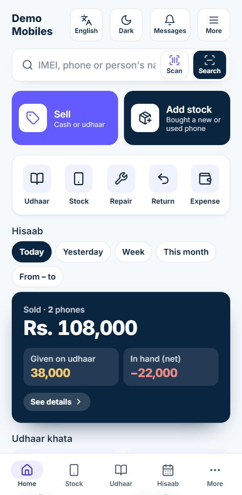
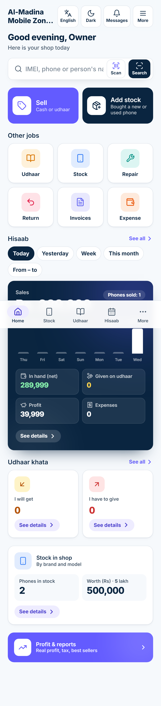
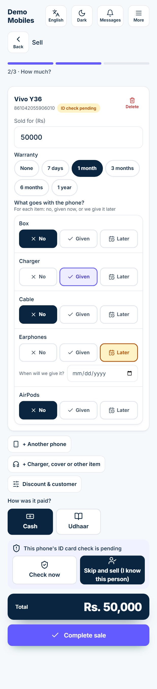
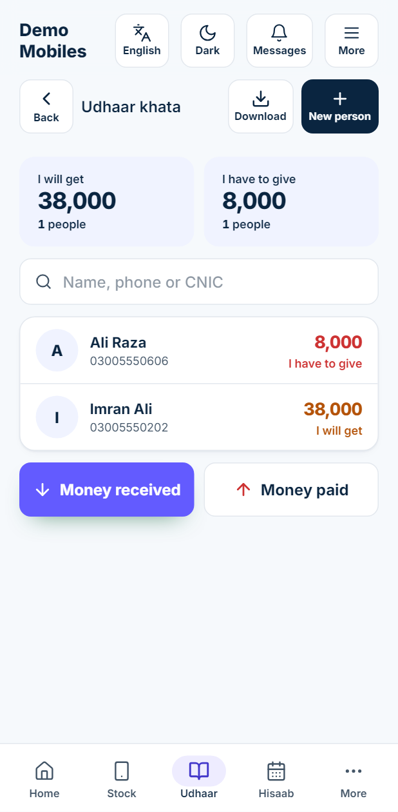
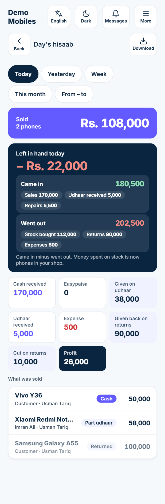
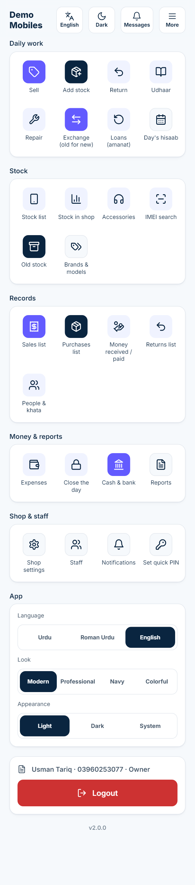

# Mobile Shop — User Manual (English)

A step-by-step guide for shop owners and staff. Every task below uses the exact words you see on the
buttons when the app is in **English**. The pictures come from a demo shop called **Demo Mobiles**
(all names, numbers and IMEIs in them are made up).

> Roman Urdu version: [../roman/02-USER-MANUAL.md](../roman/02-USER-MANUAL.md)

---

## Contents

1. [Getting the app](#1-getting-the-app)
2. [Logging in](#2-logging-in)
3. [The home screen](#3-the-home-screen)
4. [Add stock (buying phones)](#4-add-stock-buying-phones)
5. [ID card check for a customer's phone](#5-id-card-check-for-a-customers-phone)
6. [Selling a phone](#6-selling-a-phone)
7. [Returns (customer brings a phone back)](#7-returns-customer-brings-a-phone-back)
8. [Udhaar khata (who owes whom)](#8-udhaar-khata-who-owes-whom)
9. [Day's hisaab and "Left in hand"](#9-days-hisaab-and-left-in-hand)
10. [Profit, reports and downloads](#10-profit-reports-and-downloads)
11. [Repairs](#11-repairs)
12. [Accessories (chargers, covers etc.)](#12-accessories-chargers-covers-etc)
13. [Expenses and closing the day](#13-expenses-and-closing-the-day)
14. [Exchange (old phone in, new phone out)](#14-exchange-old-phone-in-new-phone-out)
15. [Loans to other shops (amanat)](#15-loans-to-other-shops-amanat)
16. [Stock list, IMEI check and phone history](#16-stock-list-imei-check-and-phone-history)
17. [Staff and roles](#17-staff-and-roles)
18. [Shop settings (shop, tax, receipt)](#18-shop-settings-shop-tax-receipt)
19. [Language, theme and look](#19-language-theme-and-look)
20. [Super admin: opening a shop for a customer](#20-super-admin-opening-a-shop-for-a-customer)
21. [Common problems](#21-common-problems)
22. [Glossary](#22-glossary)

---

## 1. Getting the app

You can use the app in three ways. Your data is the same in all of them.

### 1a. In the browser (website)
1. Open **Chrome** on your phone or computer.
2. Go to **https://mobileshop.oopsolutions.com**.
3. Log in (see [section 2](#2-logging-in)).

### 1b. Install the website as an app (Android, Chrome)
1. Open **https://mobileshop.oopsolutions.com** in Chrome.
2. Tap Chrome's menu (**⋮**, top right).
3. Tap **Install app** (on some phones: **Add to Home screen**).
4. Tap **Install**. A **Mobile Shop** icon appears on your home screen; open it like any app.

### 1c. Android app (APK file)
OOP Solutions sends you the app file (for example `mobile-shop.apk`) on WhatsApp or by USB.
1. Tap the `.apk` file to open it.
2. The first time, Android says the app that opened the file (WhatsApp, Files, Chrome…) is not
   allowed to install apps. Tap **Settings**, switch on **Allow from this source**
   (**Install unknown apps**), then go back.
3. Tap **Install**, then **Open**.
3a. Easiest: on the Android phone open **https://mobileshop.oopsolutions.com/app.apk** (the super admin sends this link from **More → Super admin → Android app**), then open the downloaded file and install.
4. A newer APK later installs over the old one; your data stays (it lives on the server).

> In the Android app, **Print** and **Download** (PDF / Excel / CSV) open in **Chrome**: the print
> screen appears by itself (choose your printer or **Save as PDF**), and Excel / CSV files go to the
> phone's **Downloads**. Go back to the app with the back button. The link works for 2 minutes only.

---

## 2. Logging in

Shops are opened by **OOP Solutions** (the app maker). There is no "create shop" button on the
login page. When your shop is opened you get a **mobile number** and **password** on WhatsApp
(see [section 20](#20-super-admin-opening-a-shop-for-a-customer)). If you want the app for a new
shop, tap **Want this app for your shop? Contact us** on the login page.

### Log in with password
1. At the top, pick your language: **اردو**, **Roman** or **English**.
2. In **Mobile number**, **+92** is already written. Type the rest of your number **without the
   first 0**, e.g. for `0300 1234567` type `3001234567`. (Pasting `0300…` or `+92300…` also works.)
3. Type your **Password**.
4. Tap **Login**.

### Forgot password
Under the login form tap **Forgot password?** and check your mobile number.
- **Send code on WhatsApp**: a 6-digit code arrives on that number (it works for 10 minutes, three
  codes per 10 minutes, five tries). Type it, **Confirm code**, choose a **New password**, and you are
  logged in. Nobody else is involved.
- No WhatsApp, or the server cannot send codes yet: **Ask the owner / provider to reset it**. A **shop
  owner's** request goes to the software provider (Super admin dashboard and WhatsApp); a **staff
  member's** goes to the shop owner (Messages and WhatsApp), who sets a new one in **More → Staff →
  the person → Reset password**.

When the software provider switches on *SIGNUP_OTP*, the public **Create shop account** page also
asks for a code on the number before the shop is opened.

### Quick PIN (faster login on your own phone)
Set it once:
1. Tap **More** (top right) → **Set quick PIN**.
2. Type **Your password**, then a 4–6 digit PIN in **Enter your PIN** (e.g. `1234`).
3. Tap **Save**.

Next time this phone opens the **Enter your PIN** screen with your name. Tap the digits on the
keypad and tap **Next**.

- **Forgot PIN? Use password** — switches back to the password screen.
- **Use another account** — for a different staff member on the same phone.
- **Forgot your password?** Ask the shop **owner**: More → **Staff** → tap your name → **New
  password** → **Save** (see [section 17](#17-staff-and-roles)). The owner's own password is reset by OOP Solutions.

### Logout
**More** → scroll down → **Logout**.

---

## 2a. Fingerprint login

After logging in once with your password: **More → Fingerprint login → Turn on for this phone** and touch the sensor. Next time the login page shows **Log in with fingerprint**: one touch and you are in. It works in the Android app (the phone's fingerprint) and on the website (fingerprint, face or Windows Hello on that device). Your fingerprint never leaves the phone.

- The **owner** can always use it. Staff can use it only after the owner switches on **Settings → Staff may log in with their fingerprint**.
- The same card lists every phone or browser that can log in this way; **Remove** stops that one at once (the owner also sees the staff's). Switching the staff setting off stops all staff fingerprint logins.
- On a shared shop phone, any finger saved in that phone's settings can open the account: turn it on only on your own phone.

## 3. The home screen

From top to bottom:

| Part | What it does |
|---|---|
| Header | Shop name, **English** (language), **Dark** / **Light**, **Messages**, **More**. On a small phone (e.g. iPhone SE) the name is on its own line above the buttons. |
| Greeting | "Good morning / afternoon / evening" with your name |
| Search box | Type an IMEI, phone model or person's name and tap **Search**. **Scan** reads the IMEI barcode with the camera. |
| **Sell** | Sell a phone (cash or udhaar) — [section 6](#6-selling-a-phone) |
| **Add stock** | You bought a new or used phone — [section 4](#4-add-stock-buying-phones) |
| **Other jobs** | **Udhaar**, **Stock**, **Repair**, **Return**, **Invoices**, **Expense**, each with its own colour |
| **Hisaab** | Pick **Today**, **Yesterday**, **Week**, **This month** or **From – to**. The dark card shows **Sales** and phones sold, a **Last 7 days** bar chart (tap a bar to see that day's sales), **In hand (net)**, **Given on udhaar**, **Profit** (owner and manager) and **Expenses**. Tap the card or **See all** for the full hisaab. |
| **Udhaar khata** | **I will get** (people owe you) and **I have to give** (you owe them), each with **See details** |
| **Stock in shop** | **Phones in stock** and their **Worth** (also in lakh). **See details** shows brand → model. |
| **Profit & reports** | Owner and manager only — [section 10](#10-profit-reports-and-downloads) |
| **Needs attention** | e.g. "2 phones: ID card check pending", "1 repair jobs open" |

The bottom bar has **Home**, **Stock**, **Udhaar**, **Hisaab** and **More**.

On a laptop the jobs appear as a side menu, with keyboard keys: **F2** Sell, **F3** Add stock,
**F4** Udhaar, **F6** Stock, **F7** Repair, **F8** Expense, **F9** Return.

Whole home page (scrolled)

---

## 4. Add stock (buying phones)

Use **Add stock** every time a phone comes into the shop. It has 3 steps:
**1 From whom → 2 Which phone, how much? → 3 Done**.

### 4a. From a dealer
**Example:** You buy a box-pack **Samsung Galaxy A55 256GB Blue** from **Rehman Traders** for
**Rs. 92,000** cash and will sell it at **Rs. 100,000**. The box and cable came; the dealer will send
the charger in 3 days.

1. On Home tap **Add stock**.
2. Tap **From a dealer**.
3. In **Select dealer**, type a few letters of the name (`Rehman`) and tap **Rehman Traders**.
   New dealer? Tap the green **+** and fill the form (see 4c).
4. Tap **Next**.

5. Tap **Add device**. The **Add device** form opens:
   - **IMEI**: type the 15 digits (`356938035643809`) or tap **Scan** to read the barcode on the box.
     Under the box you see **New IMEI, not seen before** or **This IMEI has been in your shop before**.
     If the phone is still in your stock, it cannot be added twice.
   - **IMEI 2**: for dual-SIM phones (optional; also has **Scan**).
   - **Brand**: tap **Samsung**.
   - **Model**: type `A55` in the search box and tap **Galaxy A55**.
   - **Storage**: `256GB`. **Colour**: `Blue`.

   - **Condition**: **Box pack**, **Open box**, **Used** or **Patched** (patched asks for **Patch details**).
   - **PTA status**: **PTA approved**, **Non-PTA** or **JV**. For Non-PTA and JV you must fill **SIM time (months)**.
   - **Cost price**: `92000` (what you paid).
   - **Asking price**: `100000` (what you want to sell for). It **cannot be lower than the cost price** —
     you will see *"Selling price cannot be less than the buying price"* and **Add** stays grey.
   - **Warranty (months)**: dealer phones start at 12.

   - **What came with the phone?** For **Box**, **Charger**, **Cable**, **Earphones**, **AirPods** choose
     **No**, **Got it** or **Later**. For **Later** pick the date in **When will they give it?**
     Here: Box **Got it**, Charger **Later** (date), Cable **Got it**.

6. Tap **Add**. The phone appears in the list. Tap **Add device** again for more phones.
   Dealers can also add **+ Charger, cover or other item** lines.
7. **How did you pay?** tap **Cash** (or an Easypaisa / bank account if you added one in
   **More → Cash & bank**), or **Udhaar** (see 4d).
8. **When was it bought?** leave **Just now**, or tap **Earlier** and pick the date and time.
9. **Discount, bill no.** (optional) for a discount and the dealer's bill number.
10. Check the **Total** (Rs. 92,000) and tap **Put in stock**.

You see **Purchase saved**, the amount and the bill number (e.g. `PUR-000001`).

### 4b. Adding a missing brand, model, storage or colour
If it is not in the list, in the **Add device** form tap **+ New brand**, **+ New model**,
**+ New size** or **+ New colour**, type the name (e.g. brand `Dcode`, model `Bold 3`, size `48`)
and tap **Save**. It is chosen straight away and is there next time. You can rename or delete your
own entries later in **More → Brands & models** (built-in ones and ones already used cannot be deleted).

### 4c. Buying a customer's phone (new person, +92 phone, CNIC)
**Example:** **Ali Raza** walks in to sell his used **Infinix Hot 40 128GB** for **Rs. 28,000**.
You pay Rs. 20,000 now and Rs. 8,000 later. You will sell it for Rs. 34,000.

1. **Add stock** → **Buy a customer's phone**.
2. Under **Who is selling the phone?** tap **New person**:
   - **Name**: `Ali Raza`
   - **Mobile number**: +92 is fixed; type `3005550606` (10 digits starting with 3).
   - **CNIC**: type the 13 digits `3740512345673`; it shows as `37405-1234567-3`.
   - **City**, **Address** (optional). Tap **Save**.

3. Tap **Next** → **Add device** → IMEI `490154203237518`, **Infinix**, **Hot 40**, `128GB`,
   **Used**, **Cost price** `28000`, **Asking price** `34000` → **Add**.
4. **How did you pay?** tap **Udhaar** and type `20000` in **Paid now (if any)**.
   **Still to give** shows **8,000** — this goes into Ali Raza's khata as *I have to give*.
5. **ID card check**: choose **Check now / later** (normal) or **Skip, I know this person**.
6. Tap **Put in stock**.

7. The done screen says **Check the phone is not stolen** with three buttons:
   **Check ID card now** (see [section 5](#5-id-card-check-for-a-customers-phone)),
   **Skip, I know this person**, and **Print** (prints the seller's declaration).

If you skip, the phone shows **Skipped, known person** and your name is saved in its history.

### 4d. Paying on udhaar
In step 2, **Udhaar** + **Paid now (if any)** = part paid now, the rest is owed to that dealer or
seller. You pay it later from **Udhaar → Money paid** ([section 8](#8-udhaar-khata-who-owes-whom)).

### 4e. Old stock already in the shop
Phones that were in the shop **before** you started using the app: no dealer, no cash.
1. **More** → **Old stock**.
2. Tap **Add device**, fill the form as above, tap **Add**. Repeat for every phone.
3. Tap **Save**. You see **Purchase saved**.

If an old-stock phone was entered by mistake, open it from the stock list and tap
**Remove old-stock entry** (write why).

---

## 5. ID card check for a customer's phone

Do this for every used phone you buy from a person, so you never buy a stolen phone.

1. Open it: **Check ID card now** after buying, or the phone's page → **ID card check**,
   or Home → **Needs attention** → *phones: ID card check pending*.
2. **Seller**: already filled (e.g. Ali Raza). **CNIC number**: check the 13 digits.
3. Tap each photo box and take a photo with the camera:
   **CNIC front**, **CNIC back**, **Seller photo**, **Phone photo**.
4. **eGadget (Punjab Police)**: tap **Open eGadget portal**, check the IMEI there, then come back and
   choose **Clear**, **Flagged** or **Not checked**. Type the **Reference no.** if the portal gives one.
5. **PTA checked (SMS 8484)**: tap **SMS 8484** to send the IMEI to PTA, then tick the box and pick the result.
6. **Seller signed declaration**: tap **Print** to print the declaration, let the seller sign, then tick the box.
7. **Physical condition notes** (optional), e.g. "small scratch on back".
8. Tap **Save**. **Still missing** lists anything you have not done yet.

- If eGadget says **Flagged**, the phone shows **Stolen? Do not sell**. Only the **owner** can still
  sell it, and must write a reason.
- **Owner override** (owner/manager) marks the check as done without all items; a reason is required and saved.

---

After **Save** a result screen tells you where you stand: **"ID check complete. This phone can be
sold."** with a **Sell this phone now** button, or **"Saved, but the check is not complete yet. Still
missing: …"** (the owner's override also counts as complete), or **Flagged**. From there: back to the
phone, print the declaration, or change something.

### 5a. Scan a CNIC instead of typing

In **New person** (and on the ID check) tap **Scan CNIC (photo of the front)** and take a clear photo of the card's front in good light. After a few seconds the **name** and **CNIC number** are filled in, and the father's name, date of birth and how long the card is valid go into **Notes**. If the card has expired you see a warning. Always check the filled fields before saving; the Urdu address is not read, type it yourself.

The photo is read on your phone: it is not sent anywhere for reading (the reading program is downloaded once, the first time).

## 6. Selling a phone

Three steps: **1 Which phone? → 2 How much? → 3 Done**.

### 6a. Cash sale
**Example:** Sell the **Vivo Y36** for **Rs. 50,000** cash, 1-month warranty, charger given now,
earphones promised later.

1. Home → **Sell**.
2. Tap the phone in the list (or search by IMEI / model, or **Scan** the box).

3. **Sold for (Rs)** is filled with the asking price (`50000`). Change it if you agreed another price.
4. **Warranty**: tap **None**, **7 days**, **1 month**, **3 months**, **6 months** or **1 year**.
5. **What goes with the phone?** for each item tap **No**, **Given** or **Later**
   (with **When will we give it?** date). Items that came with the phone start as **Given**.
6. More phones or items: **+ Another phone**, **+ Charger, cover or other item**.
   **Discount & customer** shows a discount box and an optional customer.
7. **How was it paid?** tap **Cash** (or your Easypaisa / bank account).
8. Check **Total** and tap **Complete sale**.

9. **Sale complete** shows the amount and bill number (e.g. `INV-000001`). Tap
   **Print receipt (80mm)** or **Print invoice (A4)** (website only), **Another sale** or **View sale**.

### 6b. Udhaar sale
**Example:** **Redmi Note 13** for **Rs. 58,000** to **Imran Ali**, who pays **Rs. 20,000** now.
1. Pick the phone, check the price.
2. Tap **Udhaar**.
3. **Who is taking it on udhaar?** — search `Imran` and tap **Imran Ali** (or **+** for a new person).
4. **Paid now (if any)**: `20000`. **Remaining udhaar** shows **38,000**.
5. **Complete sale**. Imran Ali now appears in **Udhaar → I will get** with Rs. 38,000.

A cash sale without a customer must be paid in full; for part payment use **Udhaar**.

### 6c. Price below the buying price
If **Sold for** is less than what you paid, a red box says
*"This price is below the buying price (Rs. 380,000). This is a loss."*
- **Owner or manager**: tap **I know - sell at a loss** to allow it.
- **Salesman**: the sale is refused — *"Only the owner or manager can sell below the buying price. Raise the price."*

### 6d. Phone with a pending ID check
If you bought the phone from a person and the ID check is not done, the sale shows
*"This phone's ID card check is pending"* and **Complete sale** is grey. Choose:
- **Check now** — opens the ID card check ([section 5](#5-id-card-check-for-a-customers-phone)), or
- **Skip and sell (I know this person)** — anyone who sells can do this; your name is saved in the phone's history.

### 6e. Printing, downloading and sharing the receipt
Receipts print in the shop's language (**Shop settings → Shop language**). **Print receipt** opens the
print window: pick your thermal (80 mm) printer. Under it, **Download PDF** saves the bill as a PDF file
and **Share PDF** opens the phone's share list (WhatsApp, Gmail…) with the file attached. The same two
buttons are on every sale's page, after an exchange and on a repair job.

**Document language.** Right above the print / download / share buttons (sale done, a sale's page,
repair job, ID check, and in every report's Download or Share sheet) there is **Document language:
English | اردو**. English is chosen by default; tap **اردو** for an Urdu receipt, bill, job sheet,
declaration or report. The choice holds until you close the app.

### 6f. Tax on a bill (optional)
Tax is **off** on every sale. To add it, tick **Add tax to this bill**: a **Tax %** box appears (it starts
at the shop's rate, usually 18) and the tax is added on top of the price. The total shows
"includes tax Rs. …". Leave the box unticked and no tax is charged.

### 6g. Hold a sale (serve the next customer first)
A customer goes to fetch money? Tap **Hold sale** under **Complete sale**, write a name to find it
(optional) and tap **Hold**. The screen is empty for the next customer; nothing is sold yet and the
phone stays in stock. Later tap **Held sales (n)** at the top of the sale screen → **Resume**: the bill
comes back exactly as it was (prices, tax, payment). A held bill can be resumed from any phone of the
shop. If one of its phones was sold in the meantime, it is taken off the bill and the screen says so.

---

### 6a. How was it paid? (sale and add stock)

Under **How was it paid?** tap one big button:

| Button | When | What it asks |
|---|---|---|
| **Cash** | money in hand | nothing |
| **Online** | bank app, IBFT, Raast, Easypaisa, JazzCash, SadaPay… | which bank or app (tap a name, or **Other bank / wallet** for the full list); TID if you want |
| **Cheque** | a cheque | the cheque's bank, cheque no., cheque date |
| **From abroad** (sales only) | the buyer's family sends the money from another country | the country / currency, how much (e.g. **500 SAR**), the rate (**1 SAR = Rs. 74.20**) → the app shows **Rs. 37,100**; the sender's name; Western Union, MoneyGram… (optional); MTCN (optional) |
| **Udhaar** | pay later | the customer, and what is paid now |

Each way keeps its own account (Cash, Bank / Online, Cheques, Remittance), so the day's hisaab shows how much came by each. Easypaisa / JazzCash go into the shop's own Easypaisa / JazzCash account if you made one in **More → Money accounts**. The receipt and the bill show how it was paid, e.g. *Online · Meezan Bank · Ref TID778812*.

**Example (from abroad):** Usman's brother in Riyadh sends 500 SAR through Western Union for a Rs. 37,100 phone. Tap **From abroad → SAR**, type 500 and 74.20, the sender "Ahmed Raza", tap **Western Union**, **Complete sale**. If the remittance comes to less than the bill, the rest goes on the customer's udhaar (choose the customer).

### 6b. Watches and accessories (counted)

Ordinary watches (Casio, Naviforce…) and accessories (chargers, cables, covers, glass, earphones, power banks) are kept **by count**: no IMEI, just how many you have.

**Buying them:** Add stock → choose the dealer → **Add accessory / watch** → pick it from the list, or **New item (not in the list)**: name, what it is (**Watch**, **Charger**, **Speaker**, … or **+ New kind** to write your own, e.g. *Ring light*), selling price each → **Save and add**. Type how many (**Qty**) and the price you paid for one (**Unit cost**). The count goes up when you save.

**Selling them:** Sell → **Accessory / watch** (also under a phone, to sell a charger with it) → tap the item. The line shows how many are in stock; you cannot sell more than that. The count goes down and the profit is worked out from what you paid.

**Example:** you buy 3 Casio MTP-1302 at Rs. 4,500 and sell one for Rs. 6,500: stock shows 2, profit Rs. 2,000. Smart watches and tablets (one by one, with serial / IMEI) come next.

### 6c. Tablets and smart watches (one by one)

In **Add device** tap **Mobile**, **Tablet** or **Smart watch** first. Only brands that make that kind are shown (e.g. Apple, Samsung, Lenovo for tablets; Apple, Samsung, Huawei, Amazfit for watches) with their models (iPad, Galaxy Tab, Apple Watch, Galaxy Watch…).

Each kind asks only its own things:

| | Mobile | Tablet | Smart watch |
|---|---|---|---|
| SIM? | always | **Wi-Fi only** or **Wi-Fi + SIM** | **No SIM (GPS)** or **With SIM (Cellular)** |
| IMEI | IMEI 1 and IMEI 2 | only with a SIM (one IMEI) | only with a SIM |
| Serial number | — | needed without a SIM | needed without a SIM |
| PTA | PTA approved · Non-PTA · JV | only with a SIM, no JV | only with a SIM, no JV |
| Storage | yes | yes | no — **Case size** instead (38–49 mm, or other) |
| Condition | Box pack · Open box · Used · Patched | Box pack · Open box · Used | Box pack · Open box · Used |
| Battery health % | — | for open box / used (optional) | for open box / used (optional) |
| Accessories | box, charger, cable, earphones, AirPods | box, charger, cable, **pen / stylus**, **keyboard cover** | box, charger, **extra strap** |

- Without a SIM there is no IMEI, so the **Serial number** (on the box, or Settings → About) is searched and shown like an IMEI.
- The stock list shows what matters, e.g. *Watch Series 9 · 45mm · GPS · Battery 91%*.
- A used tablet or watch bought from a customer gets the **ID check**, like a phone.

When selling, the chips **All · Mobile · Tablet · Smart watch** above the stock list narrow it down.

## 7. Returns (customer brings a phone back)

**Example:** **Bilal Ahmed** bought a **Samsung Galaxy A55** for **Rs. 100,000** cash. He brings it
back. The shop keeps **Rs. 10,000** and gives back **Rs. 90,000**.

1. Home → **Return** (or open the sold phone's page → **Return**).
2. In **Find the sold phone by IMEI or name** type part of the IMEI (`3809`) or the name, or pick
   from **Or pick from recent sales**. Tap the phone.
3. **Who brought it back?** — pick **Bilal Ahmed** (needed for a cash sale with no customer).
4. **Customer had paid** shows **100,000**.
5. **Give back from**: **Cash** (or an account). For a known customer you can choose
   **Keep in khata** instead of giving cash.
6. **Give back to customer (Rs)**: type `90000`. **Shop cuts** shows **10,000** automatically.
7. **Why? (optional)**: e.g. "changed his mind".
8. Tap **Take it back**.

**Return done — The phone is back in stock.** The 10,000 kept is counted as income; the day's hisaab
shows **Given back on returns** and **Cut on returns**, and the sale line is crossed out with **Returned**.

If the phone was sold on udhaar and nothing was paid, the app says
*"Nothing was paid for it; it comes off the udhaar"*.

---

## 8. Udhaar khata (who owes whom)

Home → **Udhaar** (or the bottom bar **Udhaar**).

- **I will get** — total people owe you (and how many people). Tap it to show only them.
- **I have to give** — total you owe others.
- Search by **Name, phone or CNIC**. **Download** gives the whole khata as PDF / Excel / CSV.
- **New person** adds a customer, dealer, other shop or technician.

### Money received (customer pays you)
**Example:** Imran Ali pays **Rs. 5,000** of his Rs. 38,000.
1. Tap **Money received** (or open **Imran Ali** → **Money received**).
2. Pick the person (if not already open).
3. **Amount**: `5000`. **Method**: **Cash**, **Bank**, **Easypaisa**, **JazzCash**…
   Optional **Reference / TID** and **Notes**.
4. Tap **Receive money**. His balance goes down to Rs. 33,000.

### Money paid (you pay a dealer or seller)
Same steps with **Money paid** → **Pay money**. Example: pay Ali Raza the Rs. 8,000 still owed for his phone.

### A person's page
Tap a name to see their balance card (**I will get** / **I have to give** / **Clear**),
**Money received**, **Money paid**, **Khata history** (every sale, payment, return with running balance),
**Edit**, **Delete** and **Download** (their statement).

Balances are always worked out from the records; you never type a balance by hand. A mistake is
fixed with a new entry (for example, cancel the bill), never by editing the old one.

### Udhaar reminders on WhatsApp
Tap **Remind** at the top of Udhaar khata. Everyone who owes you is listed, biggest balance first,
with how many days their account has sat and when they were last reminded. Narrow it with
**Older than 7 / 15 / 30 days**.

- Tap the green button beside a name: WhatsApp opens with the reminder written ("Bilal, a reminder
  from Al-Madina Mobile: Rs. 12,000 is outstanding on your account…"); you press send.
- **Send to all** lists them one by one to open.
- **Automatic**: More → Messages → *Udhaar reminders* → tick **Remind customers automatically**,
  choose after how many quiet days and at what time. Then the reminders go out by themselves —
  for that the WhatsApp Business API has to be set on the server (ask the product owner); without
  it they wait in **Messages** for you to tap.

### The night report
More → Messages → *Night report to the owner*: write the **Owner WhatsApp number** and/or **Owner
email**, tick **Send the day's hisaab every night · WhatsApp** and/or **· Email** and choose the time
(e.g. 21:30). Email goes out by itself once the software provider has set an SMTP account on the
server (the screen says whether it is set); WhatsApp needs the Business API. Every night the owner gets one message:
phones sold and the amount, in hand, udhaar given and received, expenses, profit, to get / to give,
phones in stock. **Send today's hisaab now** sends it at once.

### Selling on installments (qist)
Open **Sell**, pick the phone, and tick **Sell on installments (qist)** (it shows when the
*Installments* module is on for your shop). Choose the customer, write the **advance paid now**
(it is taken by the payment method chosen above: cash, online, cheque), tap **how many months**
(3 · 6 · 9 · 12 · 18 · 24) and the **monthly** amount fills itself as (price − advance) ÷ months;
change it if you agreed a different figure, the last installment takes whatever is left. Set the
**day of month** and, if needed, the **first installment** date (empty = next month on that day).
Write the **guarantor** (zamin): name, mobile and CNIC. Complete the sale: the receipt prints the
plan (advance, N × monthly, first date, guarantor), and the rest sits on the customer's khata as
usual.

More → **Installments (qist)** lists the plans: **Due today**, **Late**, **Running**, **Finished**;
search by name, phone, bill number or guarantor. A plan shows the schedule with each installment
*Paid*, *Part*, *Today*, *Late* or *Due*, the customer with Call / WhatsApp, and the guarantor.

- **Take installment**: the next installment's amount is filled in; change it for a part payment
  or for several at once; choose cash / online / cheque. It is a normal payment on that bill, so
  the khata, the day's hisaab and the person's statement all agree.
- **Remind on WhatsApp**: opens WhatsApp with "your installment of Rs. … is due on …" (or "… is
  late by N days"); with the WhatsApp Business API on the server it is sent by itself. Plans whose
  installment is due tomorrow or late are also reminded automatically by the night job (at most
  once in 3 days) when *Remind customers automatically* is on.
- Home's **Needs attention** shows *installments due today* and *plans running late*.

---

## 9. Day's hisaab and "Left in hand"

Bottom bar → **Hisaab** (or Home → hisaab card → **See details**).
Pick **Today**, **Yesterday**, **Week**, **This month** or **From – to** (two dates; "from" cannot be
after "to", and neither can be in the future).

What you see:
- **Sold** — phones sold and total amount (returned sales are not counted).
- **Left in hand today** — **Came in** minus **Went out**, with the reasons as chips:
  - Came in: **Sales**, **Udhaar received**, **Repairs**, **Other**
  - Went out: **Stock bought**, **Returns**, **Expenses**, **Paid to people**, **Other**
- Boxes: **Cash received**, **Easypaisa**, **Given on udhaar**, **Udhaar received**, **Expense**,
  **Given back on returns**, **Cut on returns**, **Profit** (owner/manager).
- **What was sold** — each sale with how it was paid (**Cash**, **Udhaar**, **Part udhaar**…) and who sold it.
- **Download** — the day's hisaab as PDF / Excel / CSV.

### What "Left in hand" means — worked example
"Left in hand" is real money: everything that came into the drawer/accounts minus everything that
went out that day. Money you spent on stock is not lost — it is now phones on your shelf.

| What happened today | Came in | Went out |
|---|---:|---:|
| Bought a phone from a dealer, paid cash | | 750,000 |
| Sold a phone | 800,000 | |
| Customer returned that phone, you gave back | | 750,000 |
| **Total** | **800,000** | **1,500,000** |

- Left in hand = 800,000 − 1,500,000 = **− 700,000**.
- The **sale + return pair alone** leaves **800,000 − 750,000 = 50,000** in hand (that is your profit on that pair).
- The other **− 750,000** is the stock you bought — it is still in the shop as a phone.

In the demo picture: came in 180,500 (sales 170,000 + udhaar received 5,000 + repairs 5,500),
went out 202,500 (stock 112,000 + returns 90,000 + expenses 500) → **− 22,000**.

---

## 10. Profit, reports and downloads

Owner and manager: Home → **Profit & reports** (or **More → Reports**).

- Tabs: **Profit**, **Best sellers**, **Estimate**, **Old stock**.
- Period: **Today**, **Yesterday**, **7 days**, **This month**, **From – to**.
- **Profit** shows **Sold**, **Buying price of what was sold**, **Profit on sales**,
  **Repair & other income** (repairs, cuts kept on returns), each expense, and
  **Real profit (after expenses)**. Also **Tax collected** and **Owner took out (not an expense)**.
- **Best sellers** — which models sell most.
- **Estimate** — **Next 7 days (estimate)** from your last 4 weeks, and **Which phone will run out**
  with advice **Buy more**, **OK** or **Not selling**. It is a guess, not a promise.
- **Old stock** — phones by days in stock.

### Downloading and sharing (PDF, Excel, CSV)
1. Tap **Download** or **Share** (top right of the report, or next to a list under **Download lists**).
2. Choose:
   - **PDF** — a PDF file, ready to send or keep (Urdu reports stay in Nastaliq).
   - **Excel** — for Excel / Google Sheets.
   - **CSV** — simple file for any software.
   - **Print** (Download only) — print on paper.
3. Download saves the file (website: Downloads; Android app: Documents › MobileShop). Share opens
   the phone's share list. A computer that cannot share files downloads it instead and says so.

**Download** buttons are also on Day's hisaab, Stock in shop, Udhaar khata, a person's page, Stock list,
Expenses, Sales list and Purchases list, each with **Share** beside it.

---

## 11. Repairs

Three stages: **Taken in → Being fixed → Ready → Given back**.

**Example:** **Zahid Hussain** brings a **Samsung A54** with a broken screen. Likely cost Rs. 6,000,
advance Rs. 1,000. Work charge ends up Rs. 5,500; he pays Rs. 4,500 when collecting.

### Take the phone in
1. Home → **Repair** → **Take a phone for repair**.
2. Pick the customer or tap **New person** (`Zahid Hussain`, `3005550505`).
3. **Phone name (e.g. Samsung A54)**: `Samsung A54`.
4. **What is the problem?** tap the problem chips and/or type in **Other problem (write)**: `screen broken`.
5. **Likely cost**: `6000`. **Advance taken**: `1000`.
6. **Ready by**: **Today**, **Tomorrow**, **3 days** or a date.
7. **IMEI, things left with the phone** (optional): IMEI, SIM, memory card, cover…
8. Tap **Save and print slip** (the slip prints on the website).

### When it is fixed
1. Open the job (Home → **Repair**). You can also tap **Waiting for parts**, **Start fixing** or **Could not fix**.
2. Tap **It is fixed**. In **Parts and work charge** add parts with **+ Part** (or **From stock** to use
   an accessory from your stock), type **Work charge** `5500`, optional **Paid to outside technician**
   and **Warranty days (if any)**.

3. Tap **It is fixed**. The job shows **Ready** and the bill: total 5,500 − advance 1,000 = **Left to take 4,500**.
   Tap **Call** to phone the customer.

### Give it back
1. Tap **Give back to customer**.
2. **Taken now**: `4500` (if he pays less, *"The rest goes to the customer's khata"*).
3. Tap **Give back to customer**. The job shows **Given back**.

---

## 12. Accessories (chargers, covers etc.)

**More → Accessories** opens **Chargers, covers etc.** with three tabs: **In stock**, **Low stock**,
**Pending accessories**.

### Add an item
**Example:** 10 × **Fast charger 25W**, cost Rs. 900 each, sell at Rs. 1,500, warn when 3 are left.
1. Tap **New item**.
2. **Name** `Fast charger 25W`, **Category** **Charger**, **Sale price** `1500`, **Reorder at** `3`,
   **Opening qty** `10`, **Cost each** `900`.
3. Tap **Save**.

Tap an item to **Adjust stock** (e.g. **Change (+/−)** `-2` with a note), **Edit item** or **Delete**
(only when none are left). **Low stock** lists items at or below the reorder level.

### Selling accessories
In **Sell**, tap **+ Charger, cover or other item**, type the **Item**, **Qty** and **Unit price**.
This puts it on the bill. To keep the count in **Chargers, covers etc.** correct, use **Adjust stock**.

### Pending accessories
Things promised but not handed over yet:
- **From vendor** — e.g. the dealer still owes the charger for the Galaxy A55 (with the date).
- **To customer** — e.g. you promised earphones with the Vivo Y36.

When it is handed over, tap **Delivered**.

---

### Stock alert
Every item has a **Reorder level** (set when you add or edit it). When the count falls to that level
or below, Home shows **"N items low on stock"** under *Needs attention*; tapping it opens the
**Low stock** tab here. The owner's night report also carries "Items low on stock".

### Searching by phone number
Where a person is involved you can search by their phone: the stock list and the sale / return
screens (the buyer's or seller's name or phone, besides IMEI, model, brand), repairs (job no, IMEI,
name or phone), udhaar khata and people, and Invoices.

## 13. Expenses and closing the day

Owner and manager. Home → **Expense** (or **More → Expenses**).

### Add an expense
**Example:** tea for customers, **Rs. 500**.
1. Tap **New expense**.
2. **Category**: **Tea & refreshments** (others: **Shop rent**, **Electricity**, **Salary**, **Staff advance**, **Repair parts**, **Transport**, **Phone & internet**, **Taxes & fees**, **Owner drawing**; **Categories** lets you add your own).
3. **Amount**: `500`. **Details** (optional).
4. Tap **Save**.

Tap an expense to **Edit** it or **Cancel this expense** (write why). The old one stays, crossed out.

### Close the day
1. On **Expenses**, tap **Close the day**.
2. You see **Opening cash**, **Cash in**, **Cash out** and **Expected in drawer**.
3. Count the cash in the drawer and type it in **Counted cash** (e.g. `32000`).
4. **Difference** shows any shortage or extra (here −500).
5. Tap **Close the day**.

---

## 14. Exchange (old phone in, new phone out)

**Example:** **Bilal Ahmed** gives his old **Oppo A17** (you value it at **Rs. 18,000**) and takes the
**Infinix Note 40** for **Rs. 54,000**. He pays **Rs. 30,000** now; **Rs. 6,000** goes on his khata.

1. **More → Exchange (old for new)**.
2. **Select customer**: `Bilal Ahmed` → **Next**.
3. Tap **Add the old phone** and fill it like **Add device**: IMEI `358812091717195`, **Oppo**, **A17**,
   **Cost price** `18000` (= the trade-in value), **Asking price** `22000` → **Add** → **Next**.
   The old phone shows as a card with its trade-in value; **Change the old phone** reopens it.
4. **Pick the new phone from stock** → tap **Infinix Note 40**. **Sale price** `54000` → **Next**.
5. **Settle**: both phones, then **New device** 54,000, **Trade-in value** − 18,000, and a coloured
   card that says in words **Customer pays the difference Rs. 36,000** (or **You give back the
   difference** when the old phone is worth more, or **Nothing to pay either way**).
   **Paid now**: `30000`; less than the difference goes on his khata. **New balance** shows **6,000**.
6. Tap **Complete exchange**. **Exchange complete** → **Print receipt (80mm)**, **A4**, download /
   share, **Another exchange**, **Open the bill**.

The old phone goes into stock as bought from Bilal; do its **ID card check** like any customer's phone.
If the old phone is worth more than the new one, the summary shows **Refund to customer** instead.

---

## 15. Loans to other shops (amanat)

A phone given to another shop to show or sell. It stays **yours** until it is sold or comes back.

**Example:** give the **Tecno Spark 20** to **Madina Mobiles**.
1. **More → Loans (amanat)**. The top card counts the phones out at other shops right now.
2. **Give a phone on amanat** → **Which phone?** tap the Tecno in the list (or search / scan) →
   **Which shop?** search `Madina` (a new shop can be added right there with **+**) → **Back in**
   3 / 7 / 15 / 30 days or **No date** → **Notes** → **Give on loan**.
   The same button is also on the phone's own page (Stock → tap it → **Give on loan (amanat)**).
3. The phone shows **On loan** in stock and as a card here: the phone, how many days it has been
   out (or **Overdue**), the shop with its dates and a **Shop** button to open its page and call.

Under the card, tab **Out**:
- **Device came back** — a short confirmation, then the phone is back **In stock**.
- **They kept it (sell)** — type the **Agreed price** (e.g. 34,500) and **Paid now** (e.g. 20,000);
  the card shows **On their khata** 14,500. Tap **Confirm**: a bill is made in Sales and the rest sits
  on that shop's khata. Tab **Sold to them** keeps **Open the bill**.

Late loans show **Overdue** and are counted on the top card.

---

## 15d. Asking price at the sale, price changes on record, who may go under

Every phone carries an **asking price** (set when it is bought or on its page). At the sale the bill
shows **Asking: 40,000** next to the price box. Type the actual **Sold for** amount — the asking is
only a target. If the market moved, tick **Update asking price**, type the new asking (say 45,000)
and a reason; the sale then goes through at the new figure.

**Check before you sell**: tapping **Complete sale** opens a last screen with every phone's cost
(owner and manager only), asking, new asking when changed, sold price and profit, plus a red line
when the phone is going under the asking price. **Confirm and make the bill** writes the bill. From
then on there is one record: the customer's receipt, the phone's history, the owner's reports and
the khata all read the same sold price.

**Nothing is overwritten.** The phone's history keeps the first asking (40,000), a **Price changed
40,000 → 45,000 · at the sale · market rate** line with the seller's name and time, and the sale
at 45,000. On the phone's money card you see **Asking now** and, when it differs, **First asking**.

**Price rules** (More → Settings → Price rules): two switches, **Selling under the asking price**
and **Changing the asking price**, each **Anyone / Owner-manager / With owner PIN**. The owner and
manager always may. With *Owner-manager*, staff see "needs the owner or manager" and cannot go
on. With *Owner PIN*, a PIN box appears on the check screen: the owner types their quick PIN on
the spot (set under More → Staff), the sale goes through and the approval is written on the record.
Five wrong PINs lock the box for ten minutes. A finished bill's amounts cannot be edited by anyone;
a mistake is a return and a new bill.

**Prices report** (Reports → Prices, owner and manager): every asking-price change and every sale
under the asking price in the period — phone, IMEI, who did it, old → new or asking vs sold, the
difference, profit, reason, bill number, and who approved by PIN — with a count per person on top.

## 15e. Shop audit: the whole business for any period

**Where**: More → Shop audit (owner and manager), or the card at the top of Reports.

**The period bar** is on every audit screen: Today, Yesterday, This week, Last week, This
month, Last month, This year, All time, or From–to. **As of** adds a day for balances: pick
30 April and every balance (cash & bank, who owes whom, phones in stock) is rebuilt as it stood
that evening, from the ledger and the phone events — never from today's figures.

**Overview**: net sales and real profit with the change against the period before; stock bought,
expenses, money in and money out for the period; cash & bank, phones in stock, people who owe us
and people we owe, each as **Start → End → Now**. The **checks** card shows the books proving
themselves (cash start + in − out = end; every entry balanced; khata = ledger; stock start + in −
out = end). Every tile opens the list behind the number.

**Finance**: Profit & loss (sales before discounts, discounts, returns, net sales, cost of goods,
gross profit, expenses, operating profit, other income, real profit — each with the period
before in brackets, plus a day / week / month chart); Cash & bank (where money came from and
went, each account with its reasons, money moved between own accounts shown apart, channels,
remittances from abroad with sender, currency, rate and reference); Expenses (by category with
the period before, largest entries, by person); Tax (every taxed bill).

**People**: top customers and suppliers by the metric you pick (sales, bills, profit, purchases,
phones, profit on their phones, largest amounts owed either way). Tap a person: their page now
carries **Whole journey** — first and last dealing, phones sold to and bought from them, money
received and paid (at the counter / later), returns, the balance, and the same picture as of any
day.

**Udhaar**: people owe us and we owe people kept apart, the period's movement (udhaar given,
received, taken, paid, returns), the **age of each debt** counted from the oldest unpaid bill
(bills carry no due date, so nothing is called overdue), the people and the phones on unpaid bills.

**Stock**: what is in stock by condition, PTA, ID check, type and brand (a used PTA phone is in
both), value at cost and at asking, expected margin, most expensive and thinnest-margin phones;
**Age of stock** in the shop's own bands (Settings → Stock audit thresholds) with alerts — dead
stock, high value and slow, thin margin, no asking price, ID check pending, came back more than
once; **ID checks** — status counts, checks saved, and every skipped check with who skipped it,
for which phone and supplier, and why (a skip is never a completed check).

**Products**: what sold by model, brand or type — units, share, revenue, profit, margin, average
price, average days to sell, returns, stock left — with a Top / Average / Low class and the
thresholds spelled out; sold vs bought over the period. **Bills**: every document of the period by
kind, status and employee, and everything that was voided with who and why.

**Security** (owner only): one feed of every bent number or rule — asking price changed, sold
under asking or under cost, discounts, voids, reversals, stock adjustments, opening balances,
skipped ID checks, wrong owner PINs, admin actions — who, when, before → after, reason, who
approved; per-employee counts with flags.

**Reports**: the **complete shop audit report** — pick the sections, summary or detailed, Print /
PDF or Excel (a sheet per section) for the chosen period, with the period, the as-of day, the
currency and what is not recorded stated on it; and every individual report with its download.

Not recorded, so not shown: due dates on bills, tax on purchases, remittance fees. Buying-side
figures are for the owner and manager only.

## 16. Stock list, IMEI check and phone history

### Stock in shop (worth)
Bottom bar → **Stock**: **What is my stock worth?** — total phones and value, by brand. Tap a brand
to see its models. **See all phones** opens the list.

### Stock list
**More → Stock list** (or **See all phones**). Search **IMEI, model or brand** (or **Scan**), tap a
brand, filter **In stock**, **On loan**, **Sold**, **Faulty**, **All**, and sort. Top buttons:
**Download**, **Check IMEI**, **Add stock**.

### Check an IMEI ("has this phone been here before?")
1. Stock list → **Check IMEI** (or **More → IMEI search**).
2. Type or **Scan** the 15 digits.
3. You see **New IMEI, not seen before**, or **This IMEI has been in your shop before · Bought 1 time(s)**
   with the phone; tap it to open. A wrong last digit shows *"IMEI check digit is wrong, re-check"*.

### Phone page and history
Tap a phone to see IMEI, storage, colour, condition, PTA, **Asking price**, **Cost** (owner/manager),
accessories and the **History** — every event with date, person and amount
(purchased, ID check, sold, returned, loaned, repair…).

Buttons: **Sell**, **ID card check**, **Give on loan (amanat)**, **Mark faulty**, **Send to repair**,
**Change asking price**, **Add note**, **Edit details**, and **Return** for a sold phone.

## 15a. Rate suggestion (what you sold it for last time)

Wherever you type a price, a green box shows your own history for that model: **Last sold Rs. …
on …**, how many days it took, **n sold in 6 months: Rs. low – high**, **Usually bought at Rs. …**
(owner/manager only) and how many of the same model are in stock now and at what price. Tap
**Use …** to take the suggested price (the middle of your recent sales, rounded to the hundred).
It appears in **Sell** under *Sold for*, in **Add stock** under *Asking price* once the model is
chosen, and in a phone's **Change price**. It reads only your shop's sales, never other shops'.

## 15b. The assistant and photo reading (AI)

When the software provider has switched the AI on, **More → Assistant** (and a card on Home) lets
you ask about your own shop in Urdu, English or Roman Urdu: *"How much did we sell today?"*, *"Who
owes the most?"*, *"What sold best this month?"*, *"Where is IMEI 3568…?"*, *"What is my rate for
Samsung A15?"*. The answer comes from your records only (hisaab, khata, stock, best sellers, rates,
the phone's history) and says which of them it looked at; staff who may not see cost prices get
answers without them. Each shop has a daily allowance of questions and photos; the screen shows
"n of m used today". Without the key the screen says the assistant is off and nothing else changes.

Photos: with the AI on, **Scan CNIC** (new person, ID check) and **Scan** on a photo of a phone's
box label are read on the server, which is better at bad light and angles; if that fails, the
phone's own reader runs as before. Photos are used for the reading only and are not stored.

## 15c. Every phone's own money, every person's phones

Open any phone (Stock → tap it): under **Money on this phone** you see **Cost · Still to pay · Sold
for · Still to get · Margin**, then two cards: **Bought from** (who, the purchase bill, agreed price,
paid at the time, every later payment with its receipt, what is still to pay) and **Sold to** (the
same for the sale). **Pay for this phone** / **Receive for this phone** takes a payment that is
booked against that very bill, so the phone's remaining amount and the person's khata move
together. The history below is one timeline from day one: bought, payments, sold, receipts,
returns, repairs, notes — each money row shows what was left on this phone after it.

Open any person: the big balance is split into **They owe (phones)**, **We owe (phones)** and
**Other / opening** (so a payable and a receivable are never silently netted), then **Phones**: each
phone bought from or sold to them with **Agreed · Paid · Still to pay / get**, *Settled*, *They owe*
or *We owe*, and a pay / receive button on pending rows. The statement under it is unchanged;
payment rows print their receipt.

Example (the Vivo): bought from A for 35,000 paying 30,000 (A: we owe 5,000); sold to B for
40,000 taking 35,000 (B: they owe 5,000); paid A 2,000 for this phone (A: 3,000); B paid 3,000
for this phone (B: 2,000). The phone shows cost 35,000 / still to pay 3,000 / sold 40,000 / still
to get 2,000 / margin 5,000 — the same numbers A's and B's pages show.

Buying figures (cost, what is owed to a seller, margin) are shown only to the owner and manager.
A bill with several phones shares each payment across them in proportion to their prices; the row
says "bill of … with other items" so it is clear why.

**Payment receipts**: every payment given or received prints as a thermal or A5 receipt
(number, person, amount, how it was paid, which bill and phone it was for, what is left on that
bill, the account balance after) — from the payment screen, a phone's money card, or a khata row.

## 16a. Price stickers with a barcode

Every phone and item can carry a sticker: shop name, model, storage · colour, **price**, a **Code 128
barcode of the IMEI** (the item's SKU for accessories) with the number under it, condition, PTA and
date. Scanning the barcode with the app's camera or a USB scanner finds the phone in search and in
the sale.

Where to print:
- **Phone page → Print sticker** (one phone).
- **Stock → Stickers**: tick the phones (or **Select all**), then **Stickers (n)**.
- Right after **Add stock**: **Print stickers for these phones**.
- **Items** (accessories) → tap an item → **Print sticker** (copies for a box of chargers).

The sheet asks once: **Sticker size** (38×25, 50×25, 50×30, 60×40, 70×40 mm for roll label printers,
**A4 sheet** of 65 labels, or **Custom mm**), **What goes on it** (switch any line off), **Copies of
each**, then **Print** (the page is already the sticker's size, so a label printer prints one per
sticker), or **Download / Share PDF**. **Remember these choices** keeps them for the shop.

**Cost code**: owner and manager can add the buying price in letters. **Shop settings → Sticker cost
code** takes a word of 10 different letters (e.g. `BLACKHORSE`): digit 0 = 1st letter, 1 = 2nd …,
so 45,000 prints as `KHBBB`. Salesmen never get the code, even if they tick it.

---

## 16b. Mobile Shop on your own PC (no internet)

Shops without reliable internet can run the same software on a Windows PC: install
**MobileShop-Setup.exe**, open **Mobile Shop** from the Desktop; a tray icon appears and the app opens
in the browser at `127.0.0.1:8787`. Create the shop account once, then work as usual. Everything is
on that PC (`MobileShop` folder under your user's AppData); the tray menu has **Backup now** (a dated
copy in `backups` and on the Desktop), **Open data folder** and **Quit**. Phones on the shop's Wi-Fi
can open it too once `MOBILESHOP_HOST=0.0.0.0` is set in `settings.env` and the port is allowed in
the firewall. Updates: run the new Setup; your data stays. See docs/15 for the details.

## 17. Staff and roles

Owner only: **More → Staff**.

### Add a staff member
**Example:** salesman **Kashif Mehmood**.
1. Tap **Add staff**.
2. **Name** `Kashif Mehmood`, **Mobile number** `3005550707`, **Password** (6+ characters),
   **Quick PIN (4-6 digits)** `4321`.
3. **Role**: **Salesman**, **Technician** or **Manager**. Tap **Save**.

Tap a staff member to change the **Role**, set a **New password** (**Save**), or **Disable** / **Enable** them.

### What each role can do
| | Owner | Manager | Salesman | Technician |
|---|:-:|:-:|:-:|:-:|
| Sell, add stock, money received/paid | ✓ | ✓ | ✓ | – |
| See cost price and profit | ✓ | ✓ | – | – |
| Sell below cost ("I know - sell at a loss") | ✓ | ✓ | – | – |
| Cancel bills, expenses, reports | ✓ | ✓ | – | – |
| Sell a phone flagged as stolen (with reason) | ✓ | – | – | – |
| Repairs | ✓ | ✓ | take in | work |
| Staff and shop settings | ✓ | – | – | – |

### Hazri (attendance)
When the *Staff attendance* module is on, Home shows a **Hazri** card for everyone: **Check in**
when you arrive, **Check out** when you leave; the card then says "In 9:05 AM · Out 7:10 PM · 10.1 h".
One check-in per day.

Owner: **More → Staff → Hazri** tab. Pick the period (today, week, this month, from–to). Each
person shows a card: today's status, hours worked, and counts of **Present**, **Half day**,
**Leave**, **Absent** and **No record** (days since they joined with nothing marked). Tap a person
to **mark a day by hand** (day, status, note; e.g. yesterday = Leave, "Eid") and to see their days
with in/out times. Salary and advances stay in **Expenses**.

### What each one did (activity)
**More → Staff → Activity** tab: for the period, each staff member's **Sales (count · Rs)**,
**Received**, **Purchases**, **Expenses**, **Repairs** and the number of **Actions**, with their
last login and today's hazri. Tap a person for the log: every bill, payment, purchase, expense,
repair, phone, person, cancellation and settings change they made, with time, number and amount.
This comes from the audit record the app keeps of every change, so nothing can be left out.

---

## 18. Shop settings (shop, tax, receipt)

Owner only: **More → Shop settings**. One card per topic, each with its icon:
- **Shop** — **Shop name**, **City**, **Phone** (printed on receipts, used in messages).
- **Language for prints and messages** — **Urdu** / **English**: receipts, declarations and
  WhatsApp messages go out in this language; each person still picks their own screen language.
- **Staff login** — **Staff may log in with their fingerprint**.
- **Sales tax** — switch **Charge sales tax**, then **Tax rate %**, **Prices include tax**, **NTN**, **STRN**.
- **Receipt** — **Invoice prefix** (an example number is shown, e.g. `INV-000123`), **Receipt footer**
  (e.g. "No return after 7 days"), **Receipt footer (Urdu)**; a preview box shows the line as it
  will print.

As soon as something changes, a **Save** bar appears above the bottom tabs with "Not saved yet";
tap it and **Saved** is confirmed.

Also in **More**: **Cash & bank** (add Easypaisa, JazzCash or bank accounts so they appear as payment
choices), **Notifications** (optional WhatsApp/email alerts on sales and stock), **Brands & models**.

---

## 18a. Software fees

**More → Software fees** (owner only; the renewal notice at the top of the app also leads here).
- Your plan, monthly fee and **paid until**.
- **Pay into one of these**: the software provider's accounts (Easypaisa, JazzCash, SadaPay, bank)
  with a **Copy** button for the number.
- Send the money from your own app or bank, then **I have paid**: amount (filled with the fee), months,
  which account, the **transaction ID** and a **screenshot**, and **Send**.
- The provider checks it; once approved your paid-until date moves and you get a WhatsApp message.
  **Your payments** below shows each one as *Being checked*, *Received* or *Not accepted* (with the reason).

## 19. Language, theme and look

- **Language**: tap the language button in the header (shows **English**), then **اردو**,
  **Roman Urdu** or **English**. The app shows one language at a time; Urdu is right-to-left.
  Numbers are always 0–9. Also in **More → Language**.

- **Dark / Light**: tap **Dark** (or **Light**) in the header. **More → Appearance** also has **System**.
- **Look**: **More → Look** — **Modern**, **Professional**, **Navy**, **Colorful**.

---

## 20. Super admin: opening a shop for a customer

Only for the product owner (OOP Solutions). **More → Super admin** (others do not see it).

**Example:** open **Hamza Mobile Centre**, Multan, owner **Hamza Iqbal**.
1. Tap **Open a new shop**.
2. **Shop name** `Hamza Mobile Centre`, **City** `Multan`, **Owner's name** `Hamza Iqbal`,
   **Owner's mobile (login)** (10 digits after +92), **Password for the owner** (6+ characters),
   **Shop language** **Urdu** or **English**.
3. Tap **Open a new shop**.

4. **Shop opened** shows the **Mobile number** and **Password**. Tap **Send on WhatsApp** to send
   them to the owner's WhatsApp. **Open another shop** starts again.

The list **Customer shops** shows every shop with its owner, plan and fee; use the search box to find one.

### Shop requests from the website
The public page at **/welcome** (what a visitor sees on the site's root without a login) explains the
software module by module with screenshots, a sample video, the prices and the payment accounts, and
has an **Open my shop** form. Each request shows at the top of Super admin as **Shop requests from the
website** with a WhatsApp button; **Open a new shop** there prefills the owner's name, number, city and
plan with a generated password — the request closes when the shop is opened.

### Software fees: accounts and payments received
- **Payment accounts** (in the *Software fees* card): write the accounts shops pay into — name (e.g.
  Easypaisa), account holder, number or IBAN, a note. They live only in the database and show on every
  shop's *Software fees* screen.
- Payments the shops report appear in the same card with the shop, amount, method, reference, months
  and the **screenshot**. **Received · +N month(s)** extends that shop's paid-until by the months
  reported and sends the owner a WhatsApp confirmation; **Reject** asks for a reason the owner sees.
- The card's header shows this month's received total and how many payments wait.

### Modules: what each shop may use
When opening a shop (and later in its sheet under **Modules for this shop**) you decide what the
shop gets. The basics are always on: stock, sale, purchase, return, udhaar khata, payments, invoices,
ID check, hisaab, settings, staff. The rest is switchable: accessories & watches, repairs, expenses &
day close, hold a sale, tax on bills, exchange, profit & reports, download & share, WhatsApp messages
& reminders, loans (amanat).

**Follow the plan** uses the plan's defaults (trial and chain: everything; basic: accessories,
expenses, hold, tax; pro: everything but loans). Untick it to pick by hand. A switched-off module
disappears from the shop's Home, More and buttons; its address shows *"This feature is not in your
plan"* with a WhatsApp button to you.

### Password requests, the owner's password, opening a shop
- **Password requests** at the top of the page list every owner who tapped *Forgot password?*
  (name, shop, number, time). **Set password** opens that shop's sheet; the tick marks a request done.
- In a shop's sheet, **Owner's password (when forgotten)**: write a new one and **Save**; then
  **Send on WhatsApp** sends the login and the new password to the owner. The request closes by itself.
- **Open this shop** puts you inside that shop with full rights (its data, screens and settings),
  recorded in the shop's audit log; switch back in **More → My shops**.

### Plan, monthly fee and paid-until
Tap a shop in the list. Choose the **plan** (trial / basic / pro / chain), write the **Monthly fee (Rs)**
and the **Paid until** date, or tap **+1 / +3 / +12 months** when the owner pays (it adds to the
current date, so paying early keeps the remaining days). **Unlimited** removes the date.

What the shop owner sees: from **7 days** before the date a yellow notice at the top ("Your
subscription ends in 3 days") with a WhatsApp button to you; after the date, **15 grace days**; after
the grace the app only shows their data and refuses to save until you extend. Shops opened before
this existed are **Unlimited** until you set a date. The filters **Fees due** and **Locked** above the
list show whom to call.

### Branches: one owner, several shops
In the same sheet, **Add a branch** with the branch's name and city. The owner logs in as before and
switches shops in **More → My shops**; every shop keeps its own stock, khata, bills and numbers, and
the plan covers all branches together.

---

## 20a. Invoices: find any bill

**Home → Invoices** (or **More → Invoices**) shows every bill of the shop in one list: sales, purchases (owner and manager only), returns and repairs, newest first.

1. Pick the period (**Today**, **Week**, **This month**, **From – to**) or type in the search box. A search looks through **all dates**.
2. Search by **bill number** (e.g. `INV-000012`), the **person's name or phone**, or part of a phone's **IMEI**. Tap **Scan** to read the IMEI barcode.
3. Narrow it down: **Sales / Purchases / Returns / Repairs**, and **Udhaar left / Paid / In repair / Returned / Cancelled**.
4. The two boxes at the top add up what is still **to get** from customers and still **to pay** dealers for the bills in the list.
5. Tap a bill to open it. Print the receipt from there. A return opens the sale or purchase it belongs to.

**Example:** a customer comes back a month later with a Galaxy A54 and says "I bought it here". Type the last 6 digits of its IMEI: the sale bill (and any repair of that phone) appears with the date, the price and whether udhaar is left.

## 20b. Working without internet

The market's internet drops? Keep selling.

- What you opened while online (stock, khata, the sale screen's list, a person's page) stays on the
  phone for a day and opens without internet.
- A **sale, add stock, payment or expense** made without internet is **saved on the phone**. The
  strip under the header says *"Saved on this phone. It will be sent when the internet is back."*
  and then *"1 waiting to be sent"*. Tap it to see the list.
- When the connection returns they are sent by themselves, in order, each **only once** (even if
  the connection drops again halfway). Bill numbers are given when they reach the server.
- If the server refuses one (for example the same phone was sold from another phone meanwhile) it
  stays in the list in red with the reason: **Try again** after fixing, or delete it.
- Not possible offline: things that need the server to answer (ID card check lookup, reports,
  downloads, WhatsApp sending).

## 21. Common problems

**The Scan button does not read the IMEI.**
- Point at the **IMEI barcode on the box label** (not the shop barcode), or dial **`*#06#`** on the phone
  and scan the screen. Hold steady, in good light.
- If the camera does not open (*"The camera did not open. Take a photo instead."*), tap
  **Take a photo instead** and take a clear photo of the barcode.
- If the label has IMEI 1 and IMEI 2, the app asks **Which IMEI?** — tap the right one.
- You can always type the 15 digits by hand.

**Print or download in the Android app opens Chrome.** That is how it works: Chrome shows the
print screen or saves the file. If Chrome says the link has expired, go back and tap Print /
Download again (a link lasts 2 minutes).

**I forgot my password or PIN.** PIN: tap **Forgot PIN? Use password**. Password: ask the shop owner
(**More → Staff** → your name → **New password**). The owner contacts OOP Solutions.

**"Selling price cannot be less than the buying price".** The **Asking price** is lower than the
**Cost price**. Raise the asking price (or check the cost you typed).

**"This price is below the buying price… This is a loss."** at sale. Raise **Sold for**, or ask the
owner/manager to tick **I know - sell at a loss**.

**Complete sale is grey.** Check: price typed; for **Udhaar** a customer chosen; a pending ID check
must be done or skipped (**Skip and sell (I know this person)**); a below-cost price needs the owner/manager.

**"Enter a 10-digit mobile number starting with 3".** Type the number after +92 without the first 0:
`3001234567`. **"CNIC must have exactly 13 digits"** / **"IMEI must have exactly 15 digits"**: count the digits.

**The IMEI says it is already in stock.** The same phone cannot be added twice. Check the stock list —
it may have been entered earlier.

**The phone reloaded while I took a photo.** What you typed is kept; continue where you were.

---

## 22. Glossary

| Word | Meaning |
|---|---|
| **Udhaar** | Credit — goods given now, money paid later (or money you still owe). |
| **Khata** | The account book of a person: everything sold, bought, paid and received, with the balance. |
| **Hisaab** | The account/summary of a day or period. |
| **Amanat** | A phone given on trust (loan) to another shop; still yours. |
| **IMEI** | The 15-digit number of a phone (dial `*#06#`). Dual-SIM phones have IMEI 1 and IMEI 2. |
| **CNIC** | Pakistani national identity card number, 13 digits (`12345-1234567-1`). |
| **PTA** | Pakistan Telecommunication Authority. **PTA approved** phones work with Pakistani SIMs. |
| **Non-PTA** | Not registered with PTA; a local SIM works only for a limited time (**SIM time**). |
| **JV** | A phone locked/patched to get around PTA; it also has a SIM time and is higher risk. Record the SIM time. |
| **eGadget** | Punjab Police portal to check if a phone's IMEI is reported stolen. |
| **Box pack / Open box / Used / Patched** | Condition of the phone. |
| **Asking price / Cost price** | What you want to sell for / what you paid. |
| **Left in hand** | Money that came in minus money that went out in the period. |
