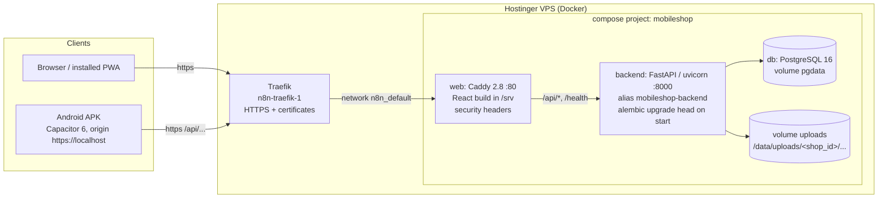

# Mobile Shop SaaS: Technical Reference

Audience: developers who will maintain or extend the system. This guide describes the code as it is on `develop` (October 2026, live at https://mobileshop.oopsolutions.com). Where the older planning docs (`docs/03`, `docs/04`) say something different from the code, **the code wins**. Those differences are listed in section 15.

Related documents:
- Business rules: `docs/02-FUNCTIONAL-REQUIREMENTS.md` (FR ids such as `FR-DEV-04`)
- Decisions: `docs/10-DECISIONS.md` (ADR-001 … ADR-013)
- Design system: `docs/11-DESIGN-SYSTEM.md`
- Deployment runbook: `docs/12-DEPLOYMENT.md`; Android app: `docs/13-MOBILE-APP.md`
- Progress and known issues: `docs/06-PROGRESS.md`; history: `docs/09-SESSION-LOG.md`

---

## 1. System overview

The product is a multi-tenant SaaS for Pakistani mobile-phone shops. It handles new and used phones (one row per IMEI, kept forever), checking the seller's ID when buying a used phone, sales on cash or credit ("udhaar"), loans of phones to other shops ("amanat"), exchanges, repairs, accessories, expenses, a day's cash count, reports and exports. The UI shows one language at a time: Urdu (Nastaliq, RTL), Roman Urdu or English.

Two ideas shape the code:

1. **Nothing that touches money or a device is ever edited in place.** Money moves only through balanced, append-only ledger groups. A device's status changes only through append-only `device_events`. Balances and statuses are *projections* of these logs. A mistake is fixed by posting a reversal, never by editing a row (ADR-002). This is what lets the owner settle an argument with a customer by showing the full history.
2. **Every tenant row carries `shop_id`, and every query filters on it.** The active shop comes from the authenticated user plus the `X-Shop-Id` header and is checked against the user's assignments on every request.

### Architecture



The same thing as plain text:

```
Browser / PWA / Android APK
        │  HTTPS
        ▼
Traefik (shared, on the VPS; ends TLS)  ── Docker network n8n_default
        │  HTTP :80
        ▼
web  = Caddy: serves the SPA (try_files → index.html), adds headers,
       proxies /api/* and /health ──► backend = FastAPI :8000 ──► db = PostgreSQL 16
                                                     │
                                                     └──► uploads volume (photos, PDFs)
```

Only `web` sits on Traefik's network. `db` and `backend` are on the private `internal` network. The stack publishes no ports.

### Request walk-through (a credit sale)

1. The React app calls `POST /api/v1/sales` with `Authorization: Bearer <access JWT>` and `X-Shop-Id: <uuid>`.
2. Traefik ends TLS and forwards to Caddy, which proxies `/api/*` to `mobileshop-backend:8000`.
3. FastAPI resolves `CurrentContext` (`core/tenancy.py`): it decodes the JWT, loads the user, and checks that the shop in `X-Shop-Id` is one of the user's active shops. `require_cap(Cap.TRANSACT)` checks the role.
4. `sales.service.create_sale` validates the request (stock status, ID check, price ≥ cost, paid ≤ total, credit needs a customer), numbers the invoice, builds one `Posting`, calls `ledger.service.post()`, writes a `SOLD` event per device through `devices.service.apply_event()`, queues optional notifications, writes the audit row, and commits **once**.
5. Errors anywhere come back as `{"error": {code, message_en, message_ur, details}}` with a matching HTTP status.

---

## 2. Tech stack

Versions: the range comes from `backend/pyproject.toml` or `frontend/package.json`, and "installed" is what the dev machine's lockfile/venv resolved to (checked 2026-10-27).

### Backend

| Component | Declared | Installed | Role |
|---|---|---|---|
| Python | `>=3.12,<3.13` | 3.12 | runtime (`python:3.12-slim` image) |
| FastAPI | `>=0.115,<1` | 0.159.1 | HTTP API, OpenAPI at `/docs` (not in prod) |
| uvicorn[standard] | `>=0.30` | 0.54.0 | ASGI server, `--workers ${WEB_WORKERS:-2}` |
| SQLAlchemy | `>=2.0.30,<3` | 2.1.6 | typed ORM, `Mapped[...]` models |
| Alembic | `>=1.13` | 1.20.1 | migrations (`backend/alembic/versions`) |
| Pydantic / pydantic-settings | `>=2.8,<3` / `>=2.4` | 2.14.1 | schemas, settings from env/`.env` |
| PyJWT | `>=2.9` | 2.15.1 | HS256 access/refresh tokens |
| bcrypt | `>=4.1,<5` | 4.3.0 | password and PIN hashes (12 rounds) |
| openpyxl | `>=3.1,<4` | 3.1.5 | `.xlsx` exports |
| python-multipart | `>=0.0.9` | — | file uploads |
| psycopg[binary] | `>=3.2` (extra `postgres`) | — | PostgreSQL driver in production |
| pytest, httpx, hypothesis, ruff | dev extra | pytest 9.1.1 | tests and lint (`ruff`, line length 100) |
| PostgreSQL | `postgres:16-alpine` | 16 | production DB |
| SQLite | built in | — | local dev and the test suite |

### Frontend

| Component | Declared | Installed | Role |
|---|---|---|---|
| React / react-dom | `^18.3.1` | 18.3.1 | UI |
| TypeScript | `^5.6.3` | 5.9.3 | types (`npm run typecheck`) |
| Vite | `^5.4.10` | 5.4.21 | dev server (5173), build |
| Tailwind CSS | `^3.4.14` | 3.4.19 | utility CSS over CSS-variable tokens |
| @tanstack/react-query | `^5.59.0` | 5.104.5 | server state, cache keyed per shop |
| react-router-dom | `^6.27.0` | 6.30.6 | routing (`createBrowserRouter`) |
| i18next / react-i18next | `^23.16.0` / `^15.1.0` | 23.16.8 / 15.7.4 | `en`, `ur`, `roman` locales |
| zustand | `^5.0.0` | 5.0.16 | auth and theme stores (persisted) |
| lucide-react | `^0.453.0` | 0.453.0 | stroke icons (no emoji) |
| @zxing/browser / @zxing/library | `^0.1.5` / `^0.21.3` | — | IMEI barcode reading, lazy-loaded |
| vite-plugin-pwa | `^0.20.5` | 0.20.5 | manifest + app-shell service worker |
| @capacitor/core, android, camera, share | `^6.x` | 6.2.0 | Android shell (`pk.mobileshop.app`) |
| vitest + Testing Library + jsdom | `^2.1.3` | 2.1.9 | unit tests |
| @playwright/test | `^1.48.2` | 1.48.2 | E2E at phone size |
| @vitejs/plugin-basic-ssl | `^1.2.0` | — | `npm run dev:phone` (https on LAN) |

### Infrastructure

Docker Compose (`deploy/docker-compose.yml`), Caddy 2.8 (`deploy/web.Dockerfile`, built on `node:22-alpine`), Traefik (shared, not part of this repo), GitHub Actions (`ci.yml`, `deploy.yml`, `android.yml`), images on `ghcr.io`.

---

## 3. Multi-tenancy, roles and capabilities

### 3.1 Organisation → shop → user

| Table | Key columns | Notes |
|---|---|---|
| `organisations` | `name`, `plan` (`trial` default), `plan_expires_at`, `is_active` | Plans are stored but not enforced yet (FR-AUTH-07 not started). |
| `shops` | `organisation_id`, `name`, `name_ur`, tax fields (`tax_enabled`, `tax_rate`, `tax_inclusive`, `ntn`, `strn`), `invoice_prefix`, counters `next_invoice_no`, `next_purchase_no`, `next_repair_no`, `next_payment_no`, `next_return_no`, `next_expense_no`, `next_exchange_no`, `notification_settings` (JSON), `timezone` (`Asia/Karachi`), `default_locale` (`ur`) | Settings live on the shop row. |
| `users` | `organisation_id`, `name`, `phone` (**globally unique**), `password_hash`, `pin_hash`, `role`, `locale`, `is_active` | Login is by phone only; no organisation picker is needed because the phone is unique across the whole system. |
| `user_shops` | `user_id`, `shop_id` (composite PK) | Which shops a user may act in. |

### 3.2 `shop_id` on tenant tables

`app/db/base.py` defines the `ShopScoped` mixin: a non-null `shop_id` FK to `shops.id` (ON DELETE RESTRICT) with an index. Every top-level business table uses it (`parties`, `devices`, `device_events`, `invoices`, `purchases`, `payments`, `loans`, `returns`, `exchanges`, `repair_jobs`, `accessories`, `accessory_movements`, `expenses`, `day_closes`, `cash_accounts`, `ledger_groups`, `ledger_entries`, `verifications`, `messages`, `audit_log`).

Exceptions, all by design:
- **Child line tables** (`invoice_lines`, `purchase_lines`, `repair_parts`, `repair_status_log`, `device_accessory_items`) have no `shop_id`. They are always reached through their parent, which is shop-scoped.
- **Catalogue and expense categories** (`brands`, `models`, `storages`, `colours`, `expense_categories`) have a *nullable* `shop_id`. `NULL` means global (seeded, visible to every shop). A value means the shop added the row and only that shop sees it. Name uniqueness within "global + own shop" is enforced in the service, because a unique index cannot cover NULLs.

### 3.3 How a request gets its shop (`core/tenancy.py`)

```python
def get_current_context(current, db, x_shop_id: str | None = Header(alias="X-Shop-Id")):
    assigned = <active shops joined through user_shops for this user>
    if not assigned:            -> 403 no_shop
    if x_shop_id is None:
        if len(assigned) == 1:  -> that shop
        else                    -> 403 shop_required
    if x_shop_id not a UUID     -> 403 shop_invalid
    if x_shop_id in assigned    -> CurrentContext(user, shop)
    else                        -> 403 shop_forbidden   # same answer whether the shop exists or not
```

The last line is deliberate: a user cannot probe for other shops' IDs.

**How queries are scoped.** There is no automatic ORM filter and no PostgreSQL row-level security. Each service function takes `shop_id` and filters explicitly. Lookups by id use the pattern:

```python
inv = db.get(Invoice, invoice_id)
if inv is None or inv.shop_id != shop_id:
    raise NotFound(code="invoice_not_found")
```

The ledger adds a second check: `ledger.service._check_account_belongs()` refuses a posting line whose party or cash account belongs to another shop. Uploaded files are checked by path prefix (`<shop_id>/...`). `backend/tests/test_tenancy.py` (8 tests) creates two shops and asserts that one cannot see or touch the other.

> When you add a query, filter on `shop_id`. Code review is the only guard against forgetting it.

### 3.4 Roles and capabilities (`core/permissions.py`)

Roles: `owner`, `manager`, `salesman`, `technician`. Endpoints check **capabilities**, never role names, through `require_cap(Cap.X)` or `ctx.can(Cap.X)`.

| Capability | owner | manager | salesman | technician | Used for |
|---|:-:|:-:|:-:|:-:|---|
| `TRANSACT` | ✓ | ✓ | ✓ | – | sales, purchases, payments, loans, returns, exchanges, ID check, device writes |
| `VIEW_COST` | ✓ | ✓ | – | – | cost/profit fields in responses; sale below cost (`below_cost_ok`); purchase details of other staff |
| `VOID` | ✓ | ✓ | – | – | void sale/purchase/payment/expense, ledger reverse, delete with history |
| `EXPENSES` | ✓ | ✓ | – | – | expenses and day close |
| `REPAIR_CREATE` | ✓ | ✓ | ✓ | – | take a repair in; also lets a user add a party |
| `REPAIR_WORK` | ✓ | ✓ | – | ✓ | status/parts on a repair |
| `CATALOGUE_EDIT` | ✓ | ✓ | – | – | rename/delete the shop's own brands, models, storages, colours |
| `REPORTS_ALL` | ✓ | ✓ | – | – | `/reports/profit-loss`, `cash-flow`, `tax`, `stock-ageing`, `top-sellers`, `forecast`, all `/exports/*` |
| `REPORTS_OWN` | ✓ | ✓ | ✓ | ✓ | defined but **not used by any endpoint yet** |
| `MANAGE_STAFF` | ✓ | – | – | – | `/staff` |
| `MANAGE_SETTINGS` | ✓ | – | – | – | `PATCH /shops/current`, cash accounts, notification settings, `/audit` |
| `VERIFY_OVERRIDE` | ✓ | – | – | – | mark a **flagged** phone sellable |

Owners get every capability (`frozenset(Cap)`). Note that `VERIFY_OVERRIDE` belongs to the owner only, although some comments and docs say "owner/manager" (section 15).

Some endpoints need only `Ctx` (any logged-in staff of the shop): `/reports/dashboard`, `/reports/day`, `/reports/stock-summary`, catalogue reads, party reads. Those responses hide cost and profit unless the caller has `VIEW_COST`. For example, `stock-summary` values stock at cost for owner/manager and at asking price for everyone else, and `day` returns `profit: null`.

### 3.5 Super user and closed signup (ADR-012)

- `PUBLIC_SIGNUP` (default `false`). When false, `POST /api/v1/auth/signup` returns `403 signup_closed`. Only the test setup and the CI stack turn it on, so tests can create throwaway shops.
- `SUPERUSER_PHONES`: comma-separated mobile numbers, normalised to `03XXXXXXXXX`. A user whose phone is in this set is a super user: `/me` returns `user.is_superuser = true`, and `GET/POST /api/v1/admin/shops` work for them (`403 superuser_only` for everyone else). Opening a shop there creates the organisation, the shop, the owner login and the default cash account, without logging in as that owner.
- The very first login on an empty server is made with the CLI (signup is closed):
  ```
  docker compose exec backend python -m app.cli create-owner   # optional --shop --name --phone --city
  ```
  It asks for the password twice through `getpass`, so it never lands in shell history. It prints a reminder if the number is not in `SUPERUSER_PHONES`.

---

## 4. Authentication

| Endpoint | Purpose |
|---|---|
| `POST /api/v1/auth/signup` | Create organisation + shop + owner (only when `PUBLIC_SIGNUP=true`) → `{tokens, me}` |
| `POST /api/v1/auth/login` | `{phone, password}` → `{tokens, me}` |
| `POST /api/v1/auth/pin-login` | `{phone, pin}` (4–6 digits) → `{tokens, me}`: quick staff switch on a shared counter device |
| `PUT /api/v1/me/pin` | Set or clear your own PIN; needs your current password |
| `POST /api/v1/auth/refresh` | `{refresh_token}` → new token pair |
| `GET /api/v1/me` | `{user, shops, active_shop_id}`; `user.has_pin`, `user.is_superuser` |

**Tokens** (`core/security.py`): HS256 JWT signed with `SECRET_KEY`. Claims: `sub` (user id), `org`, `typ` (`access`/`refresh`), `iat`, `exp`, `jti`. Lifetimes: `ACCESS_TOKEN_MINUTES=30`, `REFRESH_TOKEN_DAYS=30`. `decode_token` rejects a wrong `typ` (`token_wrong_type`), an expired token (`token_expired`) and a bad signature (`token_invalid`). Refresh is stateless: the `jti` is not stored, so there is no server-side revocation. Disabling a user (`is_active=false`) blocks their next request and their next refresh (`user_inactive`).

**Hashing:** bcrypt with 12 rounds for passwords and PINs (`hash_pin` = `hash_password`). PINs are short, so they rely on the attempt limiter.

**Attempt limiter** (`core/ratelimit.py`): an in-process sliding window, 5 failures per 10 minutes per key (`pw:<phone>` or `pin:<phone>`), then `429 too_many_attempts`. It resets on success. Because it lives in process memory, each uvicorn worker (2 in production) keeps its own count. See section 14.

**Phone normalisation** (`core/pk.py`): `normalise_phone` accepts `+92…`, `0092…`, `92…`, `03…`, spaces, dashes and Urdu/Arabic-Indic digits, and stores `03XXXXXXXXX`. `normalise_cnic` stores `#####-#######-#`. `latin_digits` converts `۰۱۲…` to `012…`.

**Frontend side** (`lib/auth.ts`, `lib/api.ts`): a zustand store persisted under the localStorage key `mobileshop.auth` holds `accessToken`, `refreshToken`, `me` and `activeShopId`. `api()` adds `Authorization` and `X-Shop-Id`. On a 401 (other than `bad_credentials`) it makes **one** refresh attempt, shared across concurrent calls, and retries the request. If the refresh fails, it logs out.

---

## 5. Money and the ledger

### 5.1 Rules

- **Never a float.** DB columns use `Money = Numeric(14, 2)` (`db/base.py`; `Base.type_annotation_map` maps every `Decimal` annotation to it). Python uses `Decimal`, and every amount passes through `ledger.service.money()` (quantised to 0.01, `ROUND_HALF_UP`). The API serialises money as strings such as `"45000.00"`. Currency is always PKR. (The only float conversion is the `.xlsx` export writer, which turns cells into Excel numbers.)
- **Append-only.** Rows in `ledger_groups` and `ledger_entries` are never updated or deleted. The only mutation is setting `reversed_by_group_id` on the original group when a reversal is posted.
- **Balances are derived.** `parties.balance` is a cache, rewritten by `refresh_party_balance()` from `Σ(debit − credit)` every time a posting touches that party. It is read-only in every API schema.

### 5.2 Tables

| Table | Columns |
|---|---|
| `cash_accounts` | `kind` (`cash`, `bank`, `easypaisa`, `jazzcash`), `name`, `name_ur`, `account_no`, `opening_balance`, `opening_date`, `is_default`, `is_active`. Each shop gets a default "Cash / نقد" drawer. |
| `ledger_groups` | `document_type` (`invoice`, `purchase`, `payment`, `expense`, `sale_return`, `exchange_refund`, `repair_advance`, …, or `reversal:<type>`), `document_id`, `memo`, `posted_by`, `at`, `reverses_group_id`, `reversed_by_group_id` |
| `ledger_entries` | `group_id`, `seq`, `account`, `party_id`, `cash_account_id`, `device_id`, `debit`, `credit`, `memo`, `at` |

### 5.3 Account keys (`ledger/accounts.py`)

| Key | Meaning |
|---|---|
| `party:<uuid>` | a customer's, supplier's or other shop's khata. Debit = they owe us more. |
| `cash:<uuid>` | a money account (drawer, bank, Easypaisa, JazzCash). Every kind uses the `cash:` prefix. |
| `sales` | sales income (net of discount, without tax) |
| `cogs` / `inventory` | cost of goods sold / stock at cost |
| `purchases` | non-stock purchase lines (misc) |
| `tax_payable` | sales tax collected |
| `repair_income`, `other_income` | income (other_income includes the cut a shop keeps on a return, and positive stock adjustments) |
| `expense:<category_key>` | e.g. `expense:rent`, `expense:stock_loss` |
| `equity` | opening stock and opening balances |
| `discounts`, `suspense` | defined in `SysAccount` but not posted by any module today |

Sign convention: party balance = Σ(debit − credit) on `party:<id>`. **Positive = the party owes the shop ("lene hain"). Negative = the shop owes the party ("dene hain").** Cash balance = `opening_balance` + Σ(debit − credit) on that `cash_account_id`.

### 5.4 The posting service (`ledger/service.py`)

"PostingService" in the docs means these functions:

```python
posting = Posting(document_type="invoice", document_id=invoice.id, memo="INV-000012 Ali")
posting.debit(acc.party_account(ali.id), 45000).credit(acc.SysAccount.SALES, 45000)
group = post(db, shop_id, user_id, posting)       # validates, writes, refreshes balances; no commit
...
reverse(db, shop_id, user_id, group.id, reason)   # mirror group, links both ways, audit row
```

`post()`:
1. drops zero lines and refuses an empty posting (`422 ledger_empty`);
2. refuses negative amounts, or a line with both debit and credit (`500 ledger_unbalanced`);
3. requires Σdebit == Σcredit (`500 ledger_unbalanced`; this is a programming error, never user input);
4. checks that every party and cash account belongs to the shop (`404 party_not_found` / `cash_account_not_found`);
5. writes the group and its entries with one shared timestamp, then refreshes the cached balance of every party it touched.

`post()` **does not commit**. The calling document service commits once after it has also written device events, stock movements and audit rows, so a document is all-or-nothing. Exchanges rely on this: `create_purchase(..., commit=False)` + `create_sale(..., commit=False)` + an optional refund posting, inside one `try/except` that rolls back on any error.

`reverse()` refuses a group that has already been reversed (`409 already_reversed`) and refuses to reverse a reversal (`cannot_reverse_reversal`). The generic endpoint is `POST /api/v1/ledger/groups/{group_id}/reverse` (`VOID`). Document voids (`/sales/{id}/void` etc.) call it and also undo the document's side effects (device events, stock, allocations).

Read helpers: `party_balance`, `cash_balance`, `account_total`, `party_statement` (opening balance before `date_from`, running balance per row, `reversed` flag), cash book per account.

### 5.5 Posting recipes (as coded)

| Document | Lines |
|---|---|
| Purchase (`purchase`) | Dr `inventory` (each device at its net cost, after its share of the discount) · Dr `inventory` (accessory lines) or Dr `purchases` (other misc) · Cr `party` total · then if paid: Dr `party` / Cr `cash` |
| Opening stock (device) | Dr `inventory` cost / Cr `equity` |
| Sale (`invoice`) | per device: Dr `cogs` / Cr `inventory` at the device's cost · Dr `party` total (or Dr `cash` for a walk-in cash sale) / Cr `sales` net / Cr `tax_payable` tax · then if paid on credit: Dr `cash` / Cr `party` |
| Payment in / out (`payment`) | in: Dr `cash` / Cr `party` · out: Dr `party` / Cr `cash` |
| Sale return (`sale_return`) | per returned line: Dr `sales` net, Dr `tax_payable` tax, Dr `inventory` / Cr `cogs` cost · Cr `party` line total · refund: Dr `party` / Cr `cash` · kept cut: Dr `party` / Cr `other_income` |
| Purchase return (`purchase_return`) | Dr `party` amount / Cr `inventory` (device lines) or Cr `purchases` (misc) at net cost · refund: Dr `cash` / Cr `party` |
| Expense (`expense`) | Dr `expense:<key>` / Cr `cash` |
| Repair advance | Dr `cash` / Cr `party` |
| Repair delivery | parts Dr `cogs` / Cr `inventory` · Dr `party` total / Cr `repair_income` · Dr `cash` / Cr `party` paid · outside technician cost (to their party or paid in cash) |
| Accessory adjust | + Dr `inventory` / Cr `other_income` · − Dr `expense:stock_loss` / Cr `inventory` |
| Party opening balance | they owe: Dr `party` / Cr `equity` · we owe: Dr `equity` / Cr `party` |
| Loan out / back | **no ledger lines**: only device events and the `loans` row |

### 5.6 Worked example: credit sale with part payment, then a return with a cut

Ali buys a used Samsung that cost the shop Rs. 38,000. The price is Rs. 45,000, no tax, and Ali pays Rs. 15,000 cash now.

`POST /api/v1/sales`
```json
{"party_id": "<ali>", "devices": [{"device_id": "<d1>", "price": 45000}], "paid": 15000}
```

Group `invoice` (INV-000012):

| # | Account | Debit | Credit |
|---|---|---:|---:|
| 1 | `cogs` (device d1) | 38,000.00 | |
| 2 | `inventory` (device d1) | | 38,000.00 |
| 3 | `party:<ali>` | 45,000.00 | |
| 4 | `sales` | | 45,000.00 |
| 5 | `cash:<drawer>` | 15,000.00 | |
| 6 | `party:<ali>` | | 15,000.00 |
| | **Total** | **98,000.00** | **98,000.00** |

Results: Ali's balance = 45,000 − 15,000 = **+30,000** (he owes the shop). The invoice is `partially_paid` with `paid = 15000`. Device d1 gets a `SOLD` event and becomes `sold` with `current_party_id = ali`. The drawer is up by 15,000.

A week later Ali brings the phone back. The shop gives him Rs. 13,000 back and keeps Rs. 2,000 as its cut.

The service first works out how much of the returned value Ali had actually paid:
`outstanding_before = total − returned_total − paid = 45,000 − 0 − 15,000 = 30,000`
`excess_paid = max(0, amount − max(0, outstanding_before)) = 45,000 − 30,000 = 15,000`
Hand-back + cut may be at most 15,000 (`exceeds_excess` otherwise). For a walk-in sale, they must equal it exactly (`walk_in_settle_all`).

`POST /api/v1/returns/sale`
```json
{"invoice_id": "<inv>", "line_ids": ["<line>"], "settlement": "refund",
 "refund_amount": 13000, "kept_amount": 2000, "reason": "customer did not like it"}
```

Group `sale_return` (RET-000003):

| # | Account | Debit | Credit |
|---|---|---:|---:|
| 1 | `sales` | 45,000.00 | |
| 2 | `inventory` (d1) | 38,000.00 | |
| 3 | `cogs` (d1) | | 38,000.00 |
| 4 | `party:<ali>` | | 45,000.00 |
| 5 | `party:<ali>` | 13,000.00 | |
| 6 | `cash:<drawer>` | | 13,000.00 |
| 7 | `party:<ali>` | 2,000.00 | |
| 8 | `other_income` | | 2,000.00 |
| | **Total** | **98,000.00** | **98,000.00** |

Results: Ali's balance = 30,000 − 45,000 + 13,000 + 2,000 = **0**. Sales and COGS net to zero for this phone, and the shop's profit is the 2,000 in `other_income`. The drawer is net +2,000. Device d1 gets `SALE_RETURNED` and is back `in_stock`. The invoice's `returned_total` becomes 45,000. Nothing was edited: the original invoice group is still there, and both groups show on Ali's statement.

Variants:
- `"settlement": "credit"` (no refund, no cut): only lines 1–4. Ali's balance becomes **−15,000**: the shop holds his money as an advance for his next purchase.
- `"settlement": "income"` with no amounts: the whole excess paid (15,000) is kept as `other_income`.
- `credit` together with a refund or cut is refused with `settlement_mismatch`.

---

## 6. Device lifecycle

### 6.1 One row per phone, forever

`devices` has `UNIQUE(shop_id, imei1)`. If a phone the shop sold earlier is bought back, the same row is reused: `cycle_no` goes up by one, and the full history (both ownership cycles) stays on one timeline. Projection fields such as `status`, `current_party_id`, `verification_status`, `cost_price`, `asking_price`, `cycle_no`, `event_count` and `last_event_at` are written **only** by `devices.service.apply_event()`.

### 6.2 `device_events` (append-only)

Columns: `device_id`, `seq` (unique per device, `UNIQUE(device_id, seq)`), `type`, `status_after`, `party_id`, `amount`, `ledger_group_id`, `document_type`, `document_id`, `data` (JSON), `user_id`, `at`. `GET /api/v1/devices/{id}/history` returns them with party and user names. This is the device history screen.

### 6.3 State machine (`devices/state.py`)

Statuses: `in_stock`, `on_loan`, `with_customer_for_approval`, `sold`, `in_repair`, `faulty`, `returned_to_supplier`.

| From | Event | To |
|---|---|---|
| (new) | `purchased` | `in_stock` |
| `sold` / `returned_to_supplier` | `purchased` | `in_stock` (new cycle) |
| `in_stock` | `loaned_out` | `on_loan` |
| `on_loan` | `loan_returned` | `in_stock` |
| `on_loan` | `sold` | `sold` (loan settled as a sale to that shop) |
| `in_stock` | `approval_out` | `with_customer_for_approval` |
| `with_customer_for_approval` | `approval_returned` / `sold` | `in_stock` / `sold` |
| `in_stock` | `sold` | `sold` |
| `sold` | `sale_returned` | `in_stock` |
| `in_stock` / `faulty` | `sent_to_repair` | `in_repair` |
| `in_repair` | `repair_returned` | `in_stock` |
| `in_stock` / `in_repair` | `marked_faulty` | `faulty` |
| `faulty` | `faulty_cleared` | `in_stock` |
| `in_stock` / `faulty` | `returned_to_supplier` | `returned_to_supplier` |
| any | `verified`, `price_changed`, `note` | unchanged (neutral) |

Any other pair raises `409 invalid_transition` with `details: {status, event}`.

Guard rails on `POST /api/v1/devices/{id}/events` (the generic, non-money endpoint):
- `MONEY_EVENTS` (`purchased`, `sold`, `sale_returned`, `returned_to_supplier`) → `422 money_event`. Use the purchase, sale or return documents, so the ledger is always posted.
- `loaned_out` / `loan_returned` → `use_loans_endpoint`; `verified` → `use_verification_endpoint`.
- `approval_out` needs a `party_id` (`party_required`). A loan party must have kind `shop` (`loan_party_must_be_shop`).

### 6.4 IMEI validation

- **Backend** (`devices/schemas.clean_imei`): converts Urdu digits, strips non-digits, and requires **exactly 15 digits** (422 otherwise). The Luhn check (`core/pk.is_valid_imei`) is reported, not enforced: `imei_luhn_ok` on device output and `luhn_ok` on `GET /api/v1/devices/imei/{imei}` (which also returns `found`, `seen_before`, `times_bought`). Some real phones and test devices have non-Luhn IMEIs, so the server lets them through. The UI shows the flag.
- **Frontend** (`components/FieldInputs.ImeiInput`): digits only, max 15. **The scanner** (`lib/scan.ts`) accepts only exactly 15 digits in a row that also pass Luhn, so the EAN, serial and 32-digit EID barcodes on the same box label are ignored.
- Duplicates: `409 imei_exists` (a device with that IMEI already exists), `409 imei_in_stock` (buying a phone that is still in stock).

### 6.5 ID check (verification) flow (`modules/verification`)

When a used phone is bought from a walk-in seller, the shop records who sold it.

- `verifications` holds one row per device **per cycle** (`cycle_no`): `seller_party_id`, `cnic_no`, `cnic_front_path`, `cnic_back_path`, `seller_photo_path`, `device_photos`, `egadget_result` (`clear` / `flagged` / `not_checked`), `egadget_ref`, `egadget_screenshot_path`, `pta_checked`, `pta_result`, `declaration_signed`, `declaration_path`, `physical_notes`, `result`, `missing`, `checked_by/at`, `override_by/reason/at`.
- `PUT /api/v1/devices/{id}/verification` (`TRANSACT`) upserts and computes the result:
  - `egadget_result == "flagged"` → **flagged** (suspected stolen or blocked);
  - otherwise **clear** only if CNIC number, both CNIC photos, seller photo, eGadget `clear` and declaration signed are all present;
  - otherwise **pending**, with the `missing` list.
  It writes a `verified` event (neutral for status) that sets `devices.verification_status`. Every file path must start with this shop's id (`file_not_found` otherwise).
- At purchase time, a box-pack phone from a supplier gets `verification_status = not_required`. Anything else starts `pending` unless the purchase line says otherwise (the add-stock screen can choose "skip").
- `assert_sellable()` is called by the sale: `flagged` → `409 device_flagged`, `pending` → `409 not_sellable`.
- **Skip / override** (`POST /api/v1/devices/{id}/verification/override`, `{reason}`): anyone with `TRANSACT` may skip a **pending** check ("I know this person"). A **flagged** phone needs `VERIFY_OVERRIDE` (owner only in code). The override writes a `verified` event with `data.override = true`, the reason and the previous result, plus an audit row. The sale request can carry `override_reason` to do the same thing inline.
- `GET /api/v1/devices/{id}/verification/declaration?lang=en|ur` returns the printable seller declaration (A5 HTML) in the shop's language.

### 6.6 Price rules

- **Asking ≥ cost.** Opening stock and purchase lines refuse `asking_price < cost_price` (422, schema validator). `PATCH /api/v1/devices/{id}` refuses an asking price below cost with `422 asking_below_cost`. A price change writes a `price_changed` event.
- **Sale below cost** (`409 below_cost`): a sale line whose price is lower than the phone's `cost_price` is refused unless the request sends `"below_cost_ok": true` **and** the user has `VIEW_COST` (owner/manager). The sale screen shows a red warning. Owners and managers get "I know - sell at a loss"; salesmen are told to raise the price.
- PTA status `non_pta` or `jv` requires `sim_time_months` (`sim_time_required`).

---

## 7. Module reference

All paths start with `/api/v1`. "Cap" is the capability the router requires (`Ctx` = any staff of the shop). The full list comes from `app.openapi()`. In dev, browse `http://localhost:8000/docs`.

### 7.1 auth, shops, staff, audit (`modules/auth`, `modules/audit`)
- `POST /auth/signup`, `POST /auth/login`, `POST /auth/pin-login`, `POST /auth/refresh`, `GET /me`, `PUT /me/pin`: see section 4.
- `GET /shops` (the user's shops), `POST /shops`, `GET /shops/current` (full settings `ShopSettingsOut`), `PATCH /shops/current` (`MANAGE_SETTINGS`).
- `GET/POST /staff`, `PATCH /staff/{staff_id}` (`MANAGE_STAFF`): role, password, PIN, active. Guards: `cannot_disable_self`, `cannot_demote_owner`, `phone_taken`.
- `GET /audit` (`MANAGE_SETTINGS`): `audit_log` rows (`entity`, `entity_id`, `action`, `before`, `after`, `user_id`, `at`). Services call `record_audit()` on every create/update/void.
- Errors: `bad_credentials`, `bad_pin`, `too_many_attempts` (429), `signup_closed`, `user_inactive`, `token_expired`, `token_invalid`, `token_wrong_type`, `no_shop`, `shop_required`, `shop_forbidden`.

### 7.2 admin (`modules/admin`)
- `GET /admin/shops?q=`, `POST /admin/shops`: super user only (`superuser_only`). The body is the same as signup.

### 7.3 catalogue (`modules/catalogue`, `seeds/catalogue.py`)
- `GET|POST /catalogue/brands`, `/catalogue/models` (`?brand_id=&q=&limit=`), `/catalogue/storages`, `/catalogue/colours`; `PATCH|DELETE /catalogue/{brands|models|storages|colours}/{row_id}` (`CATALOGUE_EDIT`).
- The global catalogue is seeded idempotently at startup (`lifespan` in `main.py`, skipped when `APP_ENV=test`): about 465 models, 37 colours, storages from 16 GB up, with Urdu names. Shops may add their own rows.
- Rules: names are unique (case-insensitive) within global + own shop (`brand_exists`, `model_exists`, `storage_exists`, `colour_exists`; adding an existing colour just returns it in the UI); global rows cannot be changed (`catalogue_builtin`); rows in use are archived, not deleted (`catalogue_in_use`); a model must belong to the brand (`catalogue_mismatch`).

### 7.4 parties (`modules/parties`)
- `GET /parties?kind=&q=&with_balance=&include_inactive=&limit=`, `POST /parties`, `GET /parties/by-phone/{phone}`, `GET|PATCH|DELETE /parties/{party_id}`.
- One table for customers, suppliers, other shops and technicians (`kinds` JSON list). Phone is unique per shop (`UNIQUE(shop_id, phone)`, `party_phone_exists`). CNIC and phone are normalised. Search covers name, Urdu name, phone and CNIC. `balance` is read-only (from the ledger).
- Delete rule (`db/refs.count_references`): no references → real delete; has history → archived (`is_active=false`, needs `VOID`); balance not zero → refused (`party_has_balance`).
- Writers need `TRANSACT` or `REPAIR_CREATE`.

### 7.5 ledger (`modules/ledger`)
- `GET|POST /ledger/accounts`, `PATCH|DELETE /ledger/accounts/{account_id}` (create/edit with `MANAGE_SETTINGS`): cash/bank/wallet accounts. Guards: `cash_account_default` (cannot remove the default drawer), `cash_account_has_balance`.
- `GET /ledger/accounts/{account_id}/book`: cash book. `GET /ledger/parties/{party_id}/statement?date_from=&date_to=`: khata. `POST /ledger/parties/{party_id}/opening-balance`. `GET /ledger/groups/{group_id}`. `POST /ledger/groups/{group_id}/reverse` (`VOID`).

### 7.6 devices + verification (`modules/devices`, `modules/verification`)
- `GET /devices?status=&q=&brand_id=&condition=&pta_status=&limit=`: `q` matches IMEI, model, brand and serial.
- `GET /devices/imei/{imei}`: "has this phone been here before?"
- `POST /devices/opening-stock`: old stock already in the shop (Dr `inventory` / Cr `equity`, `purchased` event with source opening). `POST /devices/{id}/cancel-opening` (`VOID`): remove a wrongly entered old-stock phone, only if nothing else happened to it.
- `GET|PATCH /devices/{id}` (details, asking price; cost needs `VIEW_COST`), `GET /devices/{id}/history`, `PUT /devices/{id}/accessories` (box, charger, cable, earphones, airpods, other: `came_with`, `pending_from` `none|vendor|shop`, `expected_at`, `given_at_sale`, `promised_to_customer_at`), `POST /devices/{id}/events`.
- Verification endpoints: section 6.5.
- Device fields: `condition` (`box_pack`, `open_box`, `used`, `patched`), `pta_status` (`pta_approved`, `non_pta`, `jv`, `unknown`), `sim_time_months`, `warranty_months`, `warranty_start`, `patch_details`, `photos`.

### 7.7 purchases (`modules/purchases`)
- `POST /purchases` (`TRANSACT`), `GET /purchases?party_id=&date_from=&date_to=&limit=` (**`VIEW_COST`**: salesmen cannot list purchases), `GET /purchases/{id}` (`VIEW_COST`, or the staff member who made it), `POST /purchases/{id}/void` (`VOID`).
- `kind`: `supplier`, `walk_in`, `shop`, `trade_in`. Numbering `PUR-000001`. Device lines plus misc lines. The document discount is spread across lines in proportion to their amounts (`_allocate_discount`; the rounding remainder goes to the last line), so each device's cost already includes its share of the discount.
- `purchased_at` (migration `3f1c2a7b9d10`) records when the phone was actually bought. A time without a zone is read as Pakistan time; future times are refused (`purchase_in_future`, 5-minute slack); a time before the phone's last event is refused (`purchase_before_history`). Paying from a cash account whose day is already closed is refused (`day_closed`).
- Errors: `discount_too_big`, `paid_exceeds_total`, `imei_in_stock`, `party_not_shop`, `device_changed` (void after the phone has moved on), `already_voided`.

### 7.8 sales (`modules/sales`)
- `POST /sales`, `GET /sales?party_id=&date_from=&date_to=&status=&limit=`, `GET /sales/{invoice_id}`, `POST /sales/{invoice_id}/void` (`VOID`), `GET /sales/{invoice_id}/receipt?format=thermal|a4&lang=en|ur` (printable HTML).
- Invoice number = `shops.invoice_prefix` (default `INV`) + 6-digit counter. Statuses: `open`, `partially_paid`, `paid`, `returned`, `void`.
- Tax from the shop settings: `compute_tax(base, rate, inclusive)`. Inclusive: `tax = base·r/(100+r)`. Exclusive: `tax = base·r/100`, added on top. Rounded to 2 dp. Discount and tax are allocated per line (`discount_share`, `tax_share`).
- Device lines: `price`, `warranty_days`, `accessories_given`, `accessories_pending[{kind, promised_at}]`. Misc lines: `description`, optional `accessory_id` (reduces accessory stock at average cost), `qty`, `unit_price`, `cost`.
- Errors: `device_not_in_stock`, `device_on_loan`, `device_with_other_customer`, `device_flagged`, `not_sellable`, `below_cost`, `discount_too_big`, `paid_exceeds_total`, `credit_needs_customer` (a walk-in must pay in full), `already_voided`, `device_changed`.

### 7.9 returns (`modules/returns`)
- `POST /returns/sale`, `POST /returns/purchase`, `GET /returns?kind=&party_id=&limit=`, `GET /returns/{return_id}`. Numbering `RET-000001`.
- Sale return: per line (`line_ids`), `settlement` `refund | credit | income`, optional `refund_amount` + `kept_amount` (the shop's cut). A walk-in sale needs `party_id` of the person bringing it back (`return_needs_customer`) and must settle in full. See 5.6. Errors: `invoice_closed`, `line_already_returned`, `settlement_mismatch`, `exceeds_excess`, `walk_in_settle_all`.
- Purchase return: per line, optional supplier refund (`refund_exceeds_return`). Writes `returned_to_supplier` events. Updates the purchase's `returned_total`.

### 7.10 payments (`modules/payments`)
- `POST /payments`, `GET /payments?party_id=&limit=`, `GET /payments/{payment_id}`, `POST /payments/{payment_id}/void` (`VOID`). Numbering `PAY-000001`.
- `direction` `in|out`, `method` `cash|bank|easypaisa|jazzcash|card|other`, `cash_account_id`. Allocation is FIFO by default: oldest open invoices (in) or unpaid purchases (out). Explicit `allocations` are also accepted. Money beyond what is owed stays as an advance (negative balance). Void undoes the allocations and reverses the ledger group.
- Errors: `over_allocation`, `allocation_exceeds_amount`, `allocation_direction`.

### 7.11 loans / amanat (`modules/loans`)
- `POST /loans` (`device_id`, `party_id` of kind shop, `expected_back_at`), `GET /loans?status=out|returned|sold`, `GET /loans/{loan_id}`, `POST /loans/{loan_id}/return`, `POST /loans/{loan_id}/sell` (`price`, `paid`, `discount`, `warranty_days`).
- No money moves on loan out or return; only `loaned_out` / `loan_returned` events. `sell` creates a normal invoice to the other shop (with `invoice.loan_id`). The output has an `overdue` flag. Errors: `loan_party_must_be_shop`, `device_not_in_stock`, `loan_not_open`.

### 7.12 exchanges (`modules/exchanges`)
- `POST /exchanges`, `GET /exchanges`, `GET /exchanges/{exchange_id}`. Numbering `EXC-000001`.
- In **one transaction**: a `trade_in` purchase of the customer's old phone (`trade_in` lines) + a sale of the new item (`devices`/`misc`, `discount`, `paid`) + an optional cash `refund` (`exchange_refund` group). Stores `trade_in_value`, `new_total`, `previous_balance`, `paid`, `new_balance`. Any failure rolls back everything (tested). Error: `exchange_needs_new_item`.

### 7.13 repairs (`modules/repairs`)
- `GET /repairs/fault-codes` (EN/UR quick picks), `GET|POST /repairs`, `GET|PATCH /repairs/{job_id}`, `PUT /repairs/{job_id}/parts`, `POST /repairs/{job_id}/status`, `POST /repairs/{job_id}/deliver`, `GET /repairs/{job_id}/job-sheet?lang=`.
- Customer device (free-text `device_desc`, optional `imei`) or a stock device (sends it `in_repair`). Status flow `received → diagnosed → waiting_parts → in_progress → repaired → delivered | returned_unrepaired | unclaimed` (transition table in `repairs/models.py`; `unclaimed → delivered` allowed). Each change goes to `repair_status_log`.
- Advance → ledger (Dr cash / Cr party, `advance_group_id`). Deliver posts the bill (`bill_group_id`): parts at cost, labour, discount, `repair_income`, payment. An outside technician's cost goes on top of a stock device's cost. Returned unrepaired → stock device becomes `faulty`. A "repair ready" WhatsApp message is queued if enabled.
- Errors: `repair_closed`, `invalid_transition`, `use_deliver_endpoint`, `advance_needs_customer`, `fault_code`.

### 7.14 accessories (`modules/accessories`)
- `GET /accessories/categories`, `GET|POST /accessories`, `GET|PATCH|DELETE /accessories/{id}`, `POST /accessories/{id}/adjust`, `GET /accessories/{id}/movements` (`VIEW_COST`), `GET /accessories/pending`, `POST /accessories/pending/{item_id}/deliver`.
- Stock by quantity with a moving **average cost** (`avg_cost`). Every change is an `accessory_movements` row (purchase, sale, return, repair, adjust). `UNIQUE(shop_id, sku)` (`sku_exists`). Low-stock list uses `reorder_level`. "Pending" lists device accessories still owed by a vendor or promised to a customer. Errors: `insufficient_stock`, `accessory_has_stock`.

### 7.15 expenses and day close (`modules/expenses`)
- `GET|POST /expenses/categories`, `PATCH|DELETE /expenses/categories/{category_id}`, `GET|POST /expenses`, `GET|PUT /expenses/{expense_id}` (edit = void + repost), `POST /expenses/{expense_id}/void`, `GET /expenses/day-close/preview?cash_account_id=&date=`, `POST /expenses/day-close`, `GET /expenses/day-close`. All need `EXPENSES`.
- Seeded bilingual categories (built-in ones cannot be renamed: `category_builtin`). Numbering `EXP-000001`. Posting Dr `expense:<key>` / Cr `cash`. Optional link to a staff member (salary) or a party.
- Day close per cash account per date (`UNIQUE(shop_id, cash_account_id, date)`): stores `opening`, `cash_in`, `cash_out`, `expected`, `counted`, `difference`. `day_already_closed` if repeated. Purchases paying from a closed day are refused (`day_closed`).

### 7.16 reports (`modules/reports`)

| Endpoint | Cap | Returns |
|---|---|---|
| `GET /reports/dashboard` | Ctx | today's sales count/total, received today, profit today (cost roles), cash in hand, receivable, payable, stock count/value, pending ID checks, loans out, open repairs |
| `GET /reports/day?date=` or `?date_from=&date_to=` | Ctx | **day or period hisaab**: `money_in`, `money_out`, `cash_net`, `came_in` {`sales`, `udhaar_back`, `repairs`, `other`}, `went_out` {`stock`, `returns`, `expenses`, `paid_out`, `other`}, `returns_refunded`, `returns_kept`, `sales_count`, `phones_sold`, `sales_total`, `received` {cash, bank, easypaisa, jazzcash}, `udhaar_given`, `udhaar_received`, `expenses`, `profit` (null without `VIEW_COST`), `items` (each line sold, with `sold_by`, `how`, `returned`) |
| `GET /reports/stock-summary` | Ctx | stock worth by brand → model (`basis` `cost` or `asking`) |
| `GET /reports/profit-loss` | REPORTS_ALL | sales, cogs, gross, repair/other income, expenses by category, net profit, owner drawing, tax |
| `GET /reports/cash-flow` | REPORTS_ALL | per cash account: opening, in, out, closing |
| `GET /reports/tax` | REPORTS_ALL | invoices, taxed invoices, taxable sales, tax on invoices, tax net of returns |
| `GET /reports/stock-ageing` | REPORTS_ALL | age buckets, value at cost for cost roles |
| `GET /reports/top-sellers` | REPORTS_ALL | best sellers by model/item, profit for cost roles |
| `GET /reports/forecast` | REPORTS_ALL | next 7 days' expected sales (average of the same weekday over the last 4 weeks) + per-model days of stock left at the last 30 days' speed, `advice` `buy_more`/`ok`/`slow`. An estimate, not a promise. |

`came_in`/`went_out` come from `_cash_by_reason()`: ledger entries on cash accounts grouped by their group's `document_type` (`invoice`→sales, `payment`→udhaar_back or paid_out, `repair*`→repairs, `purchase`→stock, `sale_return`/`exchange_refund`→returns, `expense`→expenses, anything else→other). Ranges default to the current month. `from > to` → `422 bad_date_range`.

### 7.17 exports (`modules/exports`)
- `GET /exports/{stock|parties|sales|purchases|expenses}`, `/exports/parties/{party_id}/statement`, `/exports/{profit-loss|top-sellers|day|stock-summary|khata|forecast|stock-ageing}`. Old `*.csv` paths still work. All need `REPORTS_ALL`.
- `?format=csv|xlsx|pdf` (default csv):
  - **csv**: UTF-8 **with BOM**, so Excel shows Urdu correctly;
  - **xlsx**: openpyxl, bold shaded header, frozen first row, column widths fitted;
  - **pdf**: actually an **HTML page meant for printing** (A4, landscape when there are more than 6 columns, Manrope + Noto Nastaliq). The browser's "Save as PDF" shapes Nastaliq correctly; server PDF libraries do not.
- Cost and profit columns appear only for `VIEW_COST`.

### 7.17a invoices (`modules/invoices`)
Read-only view over sales, purchases, returns and repair jobs, shaped into one row type (`DocumentRow`: kind, no, date, party, items, total, paid, due, state, ref for returns). `GET /api/v1/invoices?kind=&q=&date_from=&date_to=&state=&limit=` returns `{rows, to_get, to_give}`. `q` matches bill no (and the purchase's supplier reference and a return's original bill no), party name/phone, and IMEI (≥4 digits) through invoice/purchase lines and the repair IMEI. States: `paid`, `due` (sales/repairs: to get; purchases: to pay), `open` (repair not delivered), `returned`, `void`. Visibility follows the source screens: purchases and purchase returns need `VIEW_COST`, sales `TRANSACT`, repairs `REPAIR_CREATE` or `REPAIR_WORK`. Repairs are dated by when the phone came in. `bad_date_range` 422 if from > to. Tests: `tests/test_invoices.py`; screen `features/invoices/InvoicesPage.tsx`, e2e `e2e/invoices.spec.ts`.

### 7.18 notifications (`modules/notifications`)
- `GET|PUT /notifications/settings` (`MANAGE_SETTINGS`), `GET /notifications?status=&audience=owner|customer&limit=`, `POST /notifications/{message_id}/mark-sent`.
- An **outbox**: the hooks `on_sale`, `on_purchase`, `on_payment_in`, `on_repair_ready` write `messages` rows (`channel` `whatsapp|email`, `audience` owner/customer, `recipient`, `template_key`, `lang`, `body`, `link` = a `wa.me` deep link, `status` `queued|sent|failed|skipped`). Every toggle in `NotificationSettings` is off by default. Language = settings `language` or `shops.default_locale`. There is no Meta Cloud API or SMTP sender yet. The shopkeeper taps the wa.me link and marks the message sent.

### 7.19 files / uploads (`modules/files`)
- `POST /files?purpose=<a-z_>` (multipart `file`) → `{path: "<shop_id>/<purpose>-<uuid>.<ext>"}`. `GET /files/{path}`.
- Allowed: JPEG, PNG, WEBP, PDF. Max 8 MB (Caddy allows 10 MB bodies). Errors: `file_type`, `file_too_large`, `file_empty`, `file_not_found`.
- Stored under `UPLOAD_DIR` (`/data/uploads`, Docker volume `uploads`). `resolve()` serves a file only if the path starts with the caller's shop id, contains no `..` or `\`, and resolves inside the upload root. Records store only the relative path.

### 7.20 CLI (`app/cli.py`)
`python -m app.cli create-owner [--shop S] [--name N] [--phone P] [--city C]`. See 3.5.

### 7.21 Numbering summary
`next_number(db, shop, prefix, counter)` returns `PREFIX-000001`, incrementing the shop's counter in the same transaction. Each document table has `UNIQUE(shop_id, no)`. Prefixes: invoice `shops.invoice_prefix` (default `INV`), `PUR`, `PAY`, `RET`, `EXP`, `REP`, `EXC`.

---

## 8. Data model

UUID primary keys everywhere (SQLAlchemy `Uuid`, portable between SQLite and PostgreSQL). `created_at` / `updated_at` in UTC (`Timestamped`). Enums are `StrEnum`s stored as strings. 34 tables in `Base.metadata`.

```
organisations 1─* shops 1─* (every ShopScoped table)
organisations 1─* users *─* shops   (through user_shops)

parties ──< invoices ──< invoice_lines >── devices / accessories
        ──< purchases ──< purchase_lines >── devices / accessories
        ──< payments, returns, loans, exchanges, repair_jobs, expenses (optional party)
devices ──< device_events  (seq per device; ledger_group_id, document_type/id)
        ──< device_accessory_items
        ──< verifications  (per cycle_no)
ledger_groups ──< ledger_entries >── parties / cash_accounts / devices
repair_jobs ──< repair_parts, repair_status_log
accessories ──< accessory_movements
expense_categories ──< expenses ; cash_accounts ──< day_closes
brands ──< models ; storages ; colours   (shop_id NULL = global)
messages, audit_log   (per shop)
```

Each document points to its ledger group (`invoices.ledger_group_id`, `returns.ledger_group_id`, `repair_jobs.advance_group_id` / `bill_group_id`, …), and each ledger group points back (`document_type`, `document_id`). Device events point to both.

### Migrations (`backend/alembic/versions`, in order)

| # | Revision | Adds |
|---|---|---|
| 1 | `30a7d2dc3b64` | organisations, shops, users, user_shops, audit_log |
| 2 | `7f4c986a8f9f` | brands, models, storages, colours |
| 3 | `975f04ac8e85` | parties |
| 4 | `6d403b33df28` | cash_accounts, ledger_groups, ledger_entries |
| 5 | `07033ee5abb9` | devices, device_events, device_accessory_items |
| 6 | `04c1bc608d58` | verifications |
| 7 | `c2b50b843a18` | purchases, purchase_lines, shop counters |
| 8 | `7efefcded18f` | invoices, invoice_lines |
| 9 | `68c40ffb1e1f` | payments, loans, payment counter |
| 10 | `6e125ad21486` | returns, returned totals |
| 11 | `01c39f11d273` | messages (notifications outbox), shop notification settings |
| 12 | `e1b1a31dbe63` | expense_categories, expenses, day_closes |
| 13 | `e95a0709d555` | repair_jobs, repair_parts, repair_status_log |
| 14 | `ab0e2601f475` | accessories, accessory_movements, accessory links on lines |
| 15 | `218e639dde2c` | exchanges |
| 16 | `3f1c2a7b9d10` | `purchases.purchased_at` (**head**) |

The backend container runs `alembic upgrade head` before uvicorn starts. `tests/test_migrations.py` checks that `upgrade head` produces the same schema as the models (no drift). CI runs upgrade → downgrade base → upgrade on PostgreSQL 16. **A rollback of the image does not undo migrations.** Going back across a schema change needs a DB restore (`docs/12`).

To add a migration: change the models, then `alembic revision --autogenerate -m "..."`. Read the file it generates (SQLite and PostgreSQL both have to work: name your constraints, and make the downgrade drop the same names), then run `pytest tests/test_migrations.py`.

---

## 9. API conventions

- **Base path** `/api/v1`. JSON in and out. Health: `GET /health` → `{"status":"ok","env":"prod"}`.
- **Error shape** (`core/errors.py`), always:
  ```json
  {"error": {"code": "below_cost",
             "message_en": "This price is below the buying price. Only the owner can sell at a loss.",
             "message_ur": "…",
             "details": {}}}
  ```
  Classes: `NotFound` 404, `Unauthorized` 401, `Forbidden` 403, `Conflict` 409, `ValidationFailed` 422, `TooManyAttempts` 429, `NotSellable` 409, `Unbalanced` 500. Codes are stable and the frontend can branch on them. Each error carries both languages, so the client picks one (Roman Urdu mode shows English, ADR-010).
- **Validation**: Pydantic errors become `422 validation_failed` with `details.errors` = Pydantic's list (`loc`, `msg`, `type`). Business-rule failures use their own codes.
- **Money** is serialised as strings with 2 decimals. Send numbers or strings. Dates are ISO `YYYY-MM-DD`, datetimes ISO 8601 with offset.
- **Lists and filters**: query parameters (`q`, `status`, `party_id`, `kind`, `date_from`, `date_to`, …) and `limit` (default 100, max 500; catalogue models 200; day-closes 60/365). There is **no offset or cursor pagination yet**. Lists are newest-first, capped by `limit`.
- **Status codes**: create → 201, plain update → 200, `PUT /me/pin` → 204.
- **Language of server-made documents**: receipts (`/sales/{id}/receipt`), job sheets and the declaration take `?lang=en|ur`, defaulting to `shops.default_locale`. Notifications use the settings language or the shop default. One language per document, never mixed.
- **Auth headers**: `Authorization: Bearer <access>`, `X-Shop-Id: <uuid>` (optional when the user has one shop).

---

## 10. Frontend architecture

### 10.1 Layout

```
frontend/src/
  main.tsx          QueryClientProvider + RouterProvider
  app/router.tsx    routes (createBrowserRouter), RequireAuth / RedirectIfAuthed
  app/Shell.tsx     header (shop name, language sheet, light/dark), 5-tab bottom bar, laptop side menu
  features/<area>/  pages: counter (home, hisaab, khata, stock summary, jobs.ts), sale, purchase,
                    stock, parties, payments, loans, exchange, repairs, accessories, expenses,
                    reports, more, admin, catalogue, auth
  components/       Bilingual.tsx, ui.tsx, FieldInputs.tsx, ScanButton.tsx, AccessoryPicker.tsx,
                    PartyPicker.tsx, RemoveSheet.tsx, DownloadButton.tsx
  lib/              api, auth, queries, types, draft, scan, format, theme, files, id
  i18n/             index.ts + locales/en.json, ur.json, roman.json
```

### 10.2 Routing and Shell
Public routes: `/login`, `/signup` (signup shows only "closed" in production). Everything else sits under `RequireAuth` → `Shell`. Main routes: `/` (home), `/stock`, `/stock/summary`, `/stock/:id`, `/stock/:id/verify`, `/stock/opening`, `/purchase/new`, `/sale/new`, `/return/new`, `/exchange/new`, `/sales`, `/sales/:id`, `/purchases`, `/purchases/:id`, `/payments`, `/returns`, `/loans`, `/parties`, `/parties/:id`, `/khata`, `/hisaab`, `/repairs`, `/repairs/new`, `/repairs/:id`, `/accessories`, `/expenses`, `/reports`, `/admin`, `/more` and `/more/{staff,cash,catalogue,settings,notifications}`. Unknown paths redirect to `/`.

Shell: phone = 5 tabs (Home, Stock, Udhaar/khata, Hisaab, More). Laptop (`lg`, ≥1024 px) = the job tiles from `features/counter/jobs.ts` as a side menu with F-keys (F2 sell, F3 add stock, F4 udhaar, F6 stock, F7 repair, F8 expense; F5 is left alone because it reloads). Shell also calls `noteRoute(pathname)` for the draft logic (10.6).

### 10.3 Design tokens and looks
Colours, font and radii are CSS variables in `src/index.css`, mapped to Tailwind names in `tailwind.config.js` (`--font-sans`, `--r-btn`, `--r-card`, job colours `--t-<job>`, `--t-<job>-fg`, `--t-<job>-icon`, money colours for receivable/payable). `lib/theme.ts` (zustand, persisted as `mobileshop.look`) sets `html[data-theme="light|dark|system"]` and `html[data-palette="modern|pro|navy|colorful"]`. The default look is **Modern** (ADR-011). Rules from `docs/11`: no emoji, no default-blue buttons, every action has an icon *and* words, tap targets ≥ 44 px, and amounts also say "lene hain / dene hain" (colour is never the only signal).

### 10.4 One language at a time, i18n
`i18n/index.ts`: locales `ur` (default), `roman`, `en`. The choice is saved in localStorage key `locale`. `setLocale()` sets `<html lang dir>` (`rtl` only for `ur`). **Every user-visible string is a key** present in all three JSON files (ADR-010). Keys are grouped by area (`counter.*`, `stock.*`, `accx.*`, `field.*`, …). Never reuse a key that is already an object namespace: that bug once broke the condition selector (session 24).

`components/Bilingual.tsx`:
- `useLang()` → `{ur, roman, pick(t), cls(size), dir}`. `pick` takes an i18n key or a `BiText {en, ur, roman?}` and returns only the active language (Roman falls back to English).
- `BiLabel`, `BiButton` (variants primary/secondary/danger/ghost/gold, with `icon`), `BiInput` (has a `right` slot, used for the scan button), `BiAlert`, `BiSegmented`. Urdu text gets the `ur` class (Noto Nastaliq, line-height 1.7). Numbers use `.num` (Latin digits, Manrope or Inter) so Nastaliq never draws 0 as a dot.
- `components/ui.tsx`: `PageHeader`, `Sheet`, `Row`, `List`, `MoneyText`, `BalanceLabel`, `Chip`, `SearchBox` (with `scan`), `Empty`, `Loading`, `ErrorText`, `Section`, `KV`, `Stepper`, `IconChip`, `BtnText`.

### 10.5 Field inputs and scanning
- `components/FieldInputs.tsx` (owner 2026-10-27: "inputs that cannot take a wrong shape"):
  - `PhoneInput`: a fixed `+92` in front, 10 digits starting with 3. Accepts pasted `03…`, `+92…` and Urdu digits. The parent receives `03XXXXXXXXX`. Helpers: `localMobile`, `isMobileOk`.
  - `CnicInput`: digits only, max 13, displayed as `12345-1234567-1` (`formatCnic`, `isCnicOk`).
  - `ImeiInput`: digits only, max 15 (`IMEI_LEN`, `isImeiOk`), with a `ScanButton` beside it.
- `components/ScanButton.tsx` + `lib/scan.ts`:
  - **Live** (`scanLive`) when `canScanLive()` (secure context + `getUserMedia`): the rear camera at 1080p, one frame every ~330 ms decoded with the same strip method as a photo, stopping at the first IMEI.
  - **Photo** (`scanPhoto`) otherwise (for example plain-http LAN dev): the browser's `BarcodeDetector` if present, else zxing (Code 128/39 only) over **thin horizontal strips** (1/16 of the height, minimum 24 px, half-strip steps, jumping past a decoded code), with images narrower than 1200 px scaled up to 2×. One slow `TRY_HARDER` pass over the whole image runs only if nothing was found. It stops after two IMEIs. Why strips: a phone box stacks EID, serial, IMEI 1 and IMEI 2 close together, and zxing on the whole picture returns the first code it finds (often the EID).
  - `imeiFrom(text)` takes exactly 15 digits not surrounded by more digits, and requires Luhn (`luhnOk`).
  - zxing is imported dynamically, so it is not in the main bundle.

### 10.6 Reload-safe forms: `useDraft` (`lib/draft.ts`)
On Android, opening the camera app can make Chrome drop the page. `useDraft(key, initial)` works like `useState`, and also keeps the value in **sessionStorage** (`draft:<key>`, 30 minutes). A draft is restored **only** on the page the browser itself (re)loaded, and only until the user navigates elsewhere (`noteRoute` from Shell sets `leftBootPage`). So opening "Add stock" from the app always starts at step 1. `clearDrafts(prefix)` runs after a save and "freezes" the prefix so the finished form cannot write itself back. It is used by the purchase wizard, the add-device sheet, old stock and the sale wizard.

### 10.7 Server state: react-query (`lib/queries.ts`)
Every key starts with the active shop id (`useShopKey()`), for example `[shopId, 'devices', params]`, `[shopId, 'party', id]`, `[shopId, 'statement', partyId]`, `[shopId, 'history', deviceId]`. Switching shop therefore never shows another shop's cached data. `useInvalidate()(...prefixes)` invalidates `[shopId, prefix]` (or the whole shop). Catalogue lists have a 5-minute `staleTime`. Generic helpers: `useGet(key, path)`, `useDocMutation(method, path, body)`.

### 10.8 Files, printing, downloads (`lib/files.ts`)
`uploadFile(file, purpose)` → path. `fileObjectUrl(path)` fetches a protected image with the auth headers and returns a blob URL (`` cannot send headers). `openPrintable(path)` fetches an HTML document (receipt, declaration, job sheet, "pdf" export), writes it into a new window and calls `print()`. `downloadFile(path)` saves CSV/XLSX with the server's filename. `DownloadButton` offers CSV / Excel / PDF.

### 10.9 PWA vs native build
- **PWA** (`vite.config.ts`, `VitePWA`): `registerType: autoUpdate`. The manifest uses Urdu/RTL and `display: standalone`. The service worker precaches **only the app shell** (`js, css, html, svg, png, woff2`). `/api` and `/health` are excluded from the navigate fallback, and **API data and uploads are never cached** because they are per-tenant and sensitive. Google Fonts are cache-first. Caddy sends `no-cache` for `index.html`, `sw.js`, `registerSW.js` and the manifest, and immutable caching for `/assets/*`.
- **Native** (`npm run build:native` = `tsc -b && vite build --mode native && cap sync android`): the same React build **without** the service worker (a service worker inside an APK can keep serving an older version after an update). `VITE_API_URL` must point at the live domain. Capacitor config: `appId pk.mobileshop.app`, `androidScheme: https`, so the app's origin is `https://localhost`, which production CORS allows.
- Dev modes: `npm run dev` (5173, proxies `/api` and `/health` to :8000), `dev:lan` (http on the LAN; the camera falls back to photo), `dev:phone` (https on 5174 with a self-signed certificate, so the live camera works on a phone).

---

## 11. Security

- **Secrets only in `.env`** (on the server: `/opt/mobileshop/.env`, root-only, generated by `setup-vps.sh`). Variables: `SECRET_KEY`, `POSTGRES_PASSWORD`, `APP_DOMAIN`, `SUPERUSER_PHONES`, `PUBLIC_SIGNUP`, `WEB_WORKERS`. CI secrets live in GitHub (`VPS_*`, `ANDROID_KEYSTORE_*`). Nothing secret is committed. Do not paste real values into docs or issues.
- **Production refuses unsafe settings** (`main.check_production_settings`): with `APP_ENV=prod`, the app will not start if `SECRET_KEY` is one of the known defaults or shorter than 32 characters. `/docs` is disabled in prod. Covered by `tests/test_prod_settings.py`.
- **CORS**: `CORS_ORIGINS` = `https://<APP_DOMAIN>`, `https://localhost`, `capacitor://localhost` in compose (dev default: localhost:5173).
- **Headers (Caddy)**: HSTS (1 year, includeSubDomains), `X-Content-Type-Options: nosniff`, `Referrer-Policy: strict-origin-when-cross-origin`, `X-Frame-Options: SAMEORIGIN`, `Permissions-Policy: camera=(self), microphone=(), geolocation=()`, `Server` header removed, request body ≤ 10 MB. There is no Content-Security-Policy yet.
- **Tenancy isolation**: section 3.3. Same 403 whether or not another shop exists. Ledger lines are checked for party/cash ownership. Uploads are checked by shop prefix. Tests in `test_tenancy.py`.
- **Roles**: capabilities checked server-side. The UI hiding a button is a convenience, not security. Cost fields are stripped from responses for non-cost roles.
- **Auth**: bcrypt, short-lived access tokens, attempt limiter, PIN login only for existing users. Tokens are kept in localStorage, so any XSS would expose them. Keep `dangerouslySetInnerHTML` out of the app. Server HTML documents escape user values with `html.escape`.
- **Uploads**: type allowlist, 8 MB cap, random file names, path traversal blocked, served only to the owning shop. The type is taken from the client's `Content-Type`; the bytes are not inspected. CNIC photos are stored as plain files on the `uploads` volume (not encrypted at rest) and are included in the nightly backup.
- **Network**: DB and backend are not reachable from outside the Docker network. Only Traefik's 80/443 are open. `deploy` SSH user may run exactly one command (`/opt/mobileshop/deploy.sh`).

---

## 12. Infrastructure and CI/CD (summary)

Full steps: `docs/12-DEPLOYMENT.md` (server) and `docs/13-MOBILE-APP.md` (APK).

- **Stack**: `deploy/docker-compose.yml`, project `mobileshop`: `db` (postgres:16-alpine, volume `pgdata`, internal only), `backend` (ghcr image, migrations on start, `uploads` volume, alias `mobileshop-backend`, healthcheck on `/health`), `web` (Caddy with the SPA, Traefik labels for `Host(APP_DOMAIN)`, cert resolver `mytlschallenge`, http→https redirect).
- **CI** (`.github/workflows/ci.yml`, on push to `develop`, on PRs, and called by deploy):
  - `backend`: `ruff check app tests`, `pytest -q` (SQLite), then `alembic upgrade head → downgrade base → upgrade head` on a PostgreSQL 16 service;
  - `frontend`: `npm ci`, `typecheck`, `vitest`, `build`;
  - `stack`: builds the production images, starts db + backend + web together (a CI override file, a dummy `n8n_default` network), and runs `deploy/ci/smoke.sh` (health, app page, deep link, signup, seeded brands > 10, add a party, add opening stock, stock summary).
- **CD** (`deploy.yml`, on push to `main`): CI → build and push `mobile-shop-backend` and `mobile-shop-web` to ghcr.io tagged with the commit sha and `latest` → SSH as `deploy` → `sudo -n /opt/mobileshop/deploy.sh <sha>` (pull, up, wait for `/health`, keep or **roll back to the previous tag**) → optional live URL check (retries for 2 minutes while Traefik gets the certificate).
- **Android** (`android.yml`, on `main` when `frontend/` changed, or by hand): `build:native` with `VITE_API_URL=vars.APP_URL` → `gradlew assembleRelease` signed from repo secrets (debug-signed test APK if the secrets are missing) → build artifact `mobile-shop-android-1.<run>`. Version code = run number.
- **Backups**: cron at 02:30 runs `deploy/backup.sh` (pg_dump + uploads → `/opt/mobileshop-backups`, kept 14 days). Copying them off the server is still to do.
- **Release flow**: work on `develop` → merge to `main` → push (the owner decides when).

---

## 13. Testing strategy

| Layer | Where | How to run |
|---|---|---|
| Backend unit/API/scenario | `backend/tests/` (27 files, ~143 tests) | `cd backend && set PYTHONUTF8=1 && .venv\Scripts\pytest -q` |
| Same tests on PostgreSQL | `TEST_DATABASE_URL=postgresql+psycopg://…` | conftest drops and recreates the schema per test |
| Migrations | `tests/test_migrations.py` (SQLite, no drift) + CI up/down/up on PG 16 | CI |
| Frontend unit | `src/**/*.test.ts(x)` (7 files: Bilingual, FieldInputs, format, id, parseStorage, scan, theme) | `cd frontend && npm test` |
| E2E | `frontend/e2e/*.spec.ts` (Pixel 7 size) | `npm run e2e` (backend on :8000 with `PUBLIC_SIGNUP=true`) |
| Stack smoke | `deploy/ci/smoke.sh` | CI `stack` job |

Backend harness (`tests/conftest.py`): `APP_ENV=test` (startup seeding skipped), a test `SECRET_KEY`, `settings.public_signup = True`, a fresh in-memory SQLite schema per test (`StaticPool`, foreign keys ON), and `get_db` overridden for FastAPI's `TestClient`. The tests cover: auth and PIN login, tenancy isolation, ledger (including a hypothesis property: every posting balances, balance equals the statement), device state machine, purchases, sales (tax, discount allocation, below-cost), payments FIFO, loans (Nokia chain S1–S3 from `docs/02`), returns (refund, credit, income and the cut), exchange (including rollback), repairs, accessories, expenses/day close, reports, exports, notifications, admin, CLI, CRUD delete-or-archive, and production settings.

Playwright specs: `core-flow` (signup → customer → credit sale → dashboard → balance), `add-device`, `accessories`, `admin`, `catalogue`, `counter` (9 tests), `crud`, `repair`, `return`, `scan` (photo of an IMEI barcode fills the box; an EAN is refused; a multi-barcode label offers both IMEIs), `scan-live` (Chrome fake camera), `urdu`. About 26 tests.

Rules: business logic gets tests before UI. Run backend tests, vitest and the relevant e2e specs before committing. Each P0 FR should have a test naming its id.

---

## 14. Known limitations and tech debt

From `docs/06` "Known issues", the session log, and reading the code:

1. ~~Print and download in the Android APK~~ — solved 2026-10-28: in the native app `openPrintable` / `downloadFile` call `POST /api/v1/auth/link {path}` (allowed prefixes: exports, sales, repairs, devices), which returns the same address plus `dl=<2-minute JWT, typ "link", bound to user, shop and the exact path+query>`; the app opens it in Chrome with `@capacitor/app-launcher`. `get_current_user` accepts `dl` only on GET and only for that address; `get_current_context` takes the shop from it. Print pages get `autoprint=1`, and a middleware in `main.py` injects `print()` on load. Tests `tests/test_links.py`.
2. **Login limiter is in process memory** (5 fails / 10 min per worker). Production runs 2 uvicorn workers, so the effective limit is per worker. Move it to the DB or Redis before scaling.
3. **No phone OTP on signup or shop creation**; signup is closed in production instead.
4. **Refresh tokens cannot be revoked** (no token store). Disabling the user is the only kill switch.
5. **`admin.spec.ts` flakes** ("super admin opens a shop" times out) in the full Playwright run under load; it passes alone.
6. **Playwright is not in CI.** It runs locally only.
7. **Expense edit/cancel shows the reversal in the day's "cash in"** (the drawer total is right). The owner has to decide whether in/out tiles should net voids out.
8. **Screens still on older styling**: expenses layout, settings, exchange, loans.
9. **No offset pagination**: lists are capped by `limit` (max 500).
10. **Messaging is an outbox only**: no Meta WhatsApp Cloud API or SMTP sender. The user shares through wa.me links.
11. **`REPORTS_OWN` is not implemented** ("salesman sees own sales" from the permission matrix). Salesmen see `/reports/day` and the dashboard without costs, and no other reports.
12. **Report day boundaries need checking**: ledger range filters use `func.date(ledger_entries.at)` on UTC timestamps, and `dt.date.today()` uses the server clock. If the container and Postgres run in UTC (the default), activity between 00:00 and 05:00 Pakistan time may count on the previous day. Not verified on the server.
13. **Document numbers under concurrency**: counters live on the `shops` row without a row lock. `UNIQUE(shop_id, no)` prevents duplicates, but two simultaneous saves in one shop could make one fail with a 500 instead of retrying.
14. **Uploads**: no content sniffing, no encryption at rest for CNIC images, local disk only (no S3 `StorageService`).
15. **No Content-Security-Policy**, and tokens are in localStorage (see 11).
16. **The dev uvicorn reloader on the owner's PC often misses new routes**: restart the backend after adding endpoints.
17. **Rolling back an image does not roll back migrations**: restore the DB for that.
18. **Pending owner decisions**: the selling ≥ buying price rule interpretation, uncertain names among the newest catalogue models, and removal of unused looks once "Modern" is confirmed.
19. Not started: plans/limits (FR-AUTH-07), multi-shop UI, FBR POS, offline installer/sync, AI features, off-server backup copy.

---

## 15. Where the docs and the code disagree

Treat these as documentation bugs (the code is the truth today):

| Doc says | Code does |
|---|---|
| `docs/03`: tenancy via SQLAlchemy `with_loader_criteria` + repository base class, plus PostgreSQL Row Level Security | Explicit `shop_id` filters in each service; no loader criteria, no RLS |
| `docs/03`: files via `StorageService` (S3 in cloud), CNIC images encrypted at rest | Local disk under `UPLOAD_DIR`, no encryption |
| `docs/03`: PDF via WeasyPrint; jobs via APScheduler/Celery; WhatsApp Cloud API | "PDF" = printable HTML; no job runner; notifications are an outbox with wa.me links |
| `docs/04`: ledger account `bank:<id>` | All money accounts use `cash:<uuid>` (kind stored on `cash_accounts`) |
| `docs/04`: `discounts` account in the sale recipe | Sales credit `sales` net of discount; `discounts` and `suspense` are never posted |
| `docs/04`: `message_templates` table; channels `whatsapp|sms|email` | Templates in code (`notifications/templates.py`); channels `whatsapp|email` |
| `docs/04`: `party_balances` view, `report_schedules`, `sync_outbox` | Cached `parties.balance` column; the other two do not exist |
| `docs/02` FR-DEV-03/04 status and event lists | Code adds `approval_out`/`approval_returned` and `faulty_cleared` |
| `docs/04` / progress notes: flagged phones need "owner/manager" | `VERIFY_OVERRIDE` is in the owner's set only; managers cannot clear a flagged phone |
| `docs/04` matrix: reports "own sales / own repairs" | `REPORTS_OWN` exists but no endpoint uses it |
| `docs/07`: tests run on Postgres in CI; conftest comment "CI does both" | CI runs pytest on SQLite; only migrations run on PostgreSQL (`TEST_DATABASE_URL` is not set in `ci.yml`) |
| `docs/07`: `seeds/demo.py` demo shop | Not found in `backend/app/seeds/` (unverified as a feature) |
| `docs/12`: "10 MB upload limit" | Caddy body limit 10 MB; backend rejects files over 8 MB |
| `docs/03`: Docker services api, db, worker, web | db, backend, web (no worker) |
| `below_cost` error text: "Only the owner can sell at a loss" | Owner **and** manager can (`VIEW_COST` + `below_cost_ok`) |
| ADR-008: "all 35 tables" | `Base.metadata` has 34 tables today |
