# Mobile Shop — User Manual (Roman Urdu)

Yeh guide dukaan ke maalik aur staff ke liye hai, qadam ba qadam. Har kaam mein button ke wohi
alfaaz likhe hain jo app **Roman Urdu** mein dikhati hai. Tasweerein ek demo dukaan **Demo Mobiles**
ki hain (un mein saare naam, number aur IMEI farzi hain). Kuch tasweerein English app ki hain —
button wohi jagah par hote hain, sirf alfaaz Roman mein hote hain.

> English version: [../en/02-USER-MANUAL.md](../en/02-USER-MANUAL.md)

---

## Fehrist

1. [App kaise hasil karein](#1-app-kaise-hasil-karein)
2. [Login](#2-login)
3. [Home screen](#3-home-screen)
4. [Stock daalein (phone khareedna)](#4-stock-daalein-phone-khareedna)
5. [Gahak ke phone ka shanakhti card check](#5-gahak-ke-phone-ka-shanakhti-card-check)
6. [Phone bechna](#6-phone-bechna)
7. [Wapsi (gahak phone wapas laya)](#7-wapsi-gahak-phone-wapas-laya)
8. [Udhaar khata (kis ne kis ko dene hain)](#8-udhaar-khata-kis-ne-kis-ko-dene-hain)
9. [Din ka hisaab aur "Aaj haath mein bacha"](#9-din-ka-hisaab-aur-aaj-haath-mein-bacha)
10. [Munafa, report aur download](#10-munafa-report-aur-download)
11. [Marammat (repair)](#11-marammat-repair)
12. [Accessories (charger, cover waghera)](#12-accessories-charger-cover-waghera)
13. [Kharche aur din band karna](#13-kharche-aur-din-band-karna)
14. [Exchange (purana de kar naya)](#14-exchange-purana-de-kar-naya)
15. [Doosri dukaan ko amanat](#15-doosri-dukaan-ko-amanat)
16. [Stock list, IMEI check aur phone ki puri kahani](#16-stock-list-imei-check-aur-phone-ki-puri-kahani)
17. [Staff aur un ke ohde](#17-staff-aur-un-ke-ohde)
18. [Dukaan ki settings (dukaan, tax, raseed)](#18-dukaan-ki-settings-dukaan-tax-raseed)
19. [Zubaan, Dark/Light aur andaaz](#19-zubaan-darklight-aur-andaaz)
20. [Super admin: gahak ke liye dukaan kholna](#20-super-admin-gahak-ke-liye-dukaan-kholna)
21. [Aam masle](#21-aam-masle)
22. [Alfaaz ke maani](#22-alfaaz-ke-maani)

---

## 1. App kaise hasil karein

App teen tareeqon se chalti hai. Data teeno mein ek hi hota hai.

### 1a. Browser mein (website)
1. Phone ya computer par **Chrome** kholein.
2. **https://mobileshop.oopsolutions.com** par jayein.
3. Login karein ([hissa 2](#2-login) dekhein).

### 1b. Website ko app ki tarah install karein (Android, Chrome)
1. Chrome mein **https://mobileshop.oopsolutions.com** kholein.
2. Ooper daayein taraf Chrome ka menu (**⋮**) dabayein.
3. **Install app** dabayein (kuch phones par **Add to Home screen**).
4. **Install** dabayein. Home screen par **Mobile Shop** ka icon aa jayega, aam app ki tarah kholein.

### 1c. Android app (APK file)
OOP Solutions aap ko app ki file (maslan `mobile-shop.apk`) WhatsApp ya USB se bhejti hai.
1. `.apk` file par dabayein.
2. Pehli baar Android kahega ke jis app se file khuli (WhatsApp, Files, Chrome…) usay app install
   karne ki ijazat nahi. **Settings** dabayein, **Allow from this source** (**Install unknown apps**)
   on karein, phir wapas aayein.
3. **Install** dabayein, phir **Open**.
3a. Sab se aasaan: Android phone par **https://mobileshop.oopsolutions.com/app.apk** kholein (super admin yeh link **Mazeed → Super admin → Android app** se bhejta hai), phir download hui file khol kar install karein.
4. Baad mein naya APK purane ke ooper install ho jata hai; data mehfooz rehta hai (data server par hai).

> Android app mein **Print** aur **Download** (PDF / Excel / CSV) **Chrome** mein khulte hain: print
> ki screen khud aa jati hai (printer chunein ya **Save as PDF**), aur Excel / CSV file phone ke
> **Downloads** mein chali jati hai. Wapas app mein aane ke liye back button dabayein. Link sirf 2 minute chalta hai.

---

## 2. Login

Dukaan **OOP Solutions** (app banane wale) kholte hain. Login page par "dukaan banayein" ka button
nahi hai. Dukaan khulne par aap ko WhatsApp par **mobile number** aur **password** milta hai
([hissa 20](#20-super-admin-gahak-ke-liye-dukaan-kholna)). Nayi dukaan ke liye app chahiye to login
page par **Apni dukaan ke liye yeh app chahiye? Hum se raabta karein** dabayein.

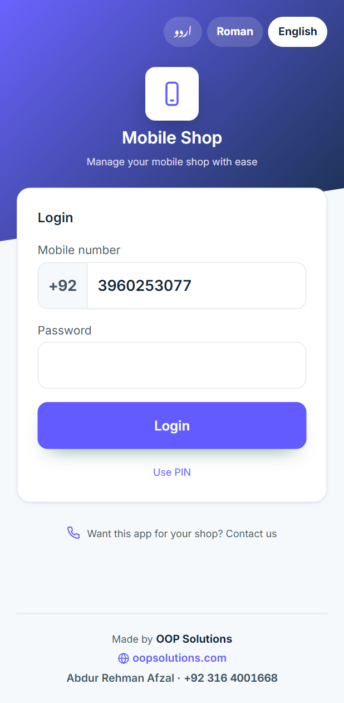

### Password se login
1. Ooper zubaan chunein: **اردو**, **Roman** ya **English**.
2. **Mobile number** mein **+92** pehle se likha hai. Baqi number **shuru ke 0 ke baghair** likhein,
   maslan `0300 1234567` ke liye `3001234567`. (`0300…` ya `+92300…` paste karna bhi chalta hai.)
3. **Password** likhein.
4. **Login** dabayein.

### Password bhool gaye
Login form ke neeche **Password bhool gaye?** dabayein aur apna mobile number check karein.
- **WhatsApp par code bhejein**: us number par 6 hindson ka code aata hai (10 minute chalta hai, 10
  minute mein 3 code, 5 koshishein). Likhein, **Code ki tasdeeq**, **Naya password** chunein, aur aap
  login ho jate hain. Kisi aur ki zaroorat nahi.
- WhatsApp nahi, ya server abhi code nahi bhej sakta: **Maalik / provider se reset ki darkhwast
  karein**. **Dukaan ke malik** ki request software provider ko jaati hai (Super admin dashboard aur
  WhatsApp); **staff** ki dukaan ke malik ko (Paighaam aur WhatsApp), jo **Mazeed → Staff → banda →
  Password reset** mein naya rakhta hai.

Jab software provider *SIGNUP_OTP* on kare to public **Dukaan ka account banayein** page bhi dukaan
kholne se pehle number par code maangta hai.

### Jaldi PIN (apne phone par tez login)
Ek dafa set karein:
1. Ooper **Mazeed** → **Jaldi PIN banayein** dabayein.
2. **Aap ka password** likhein, phir **Apna PIN likhein** mein 4 se 6 hindse (maslan `1234`).
3. **Mehfooz karein** dabayein.

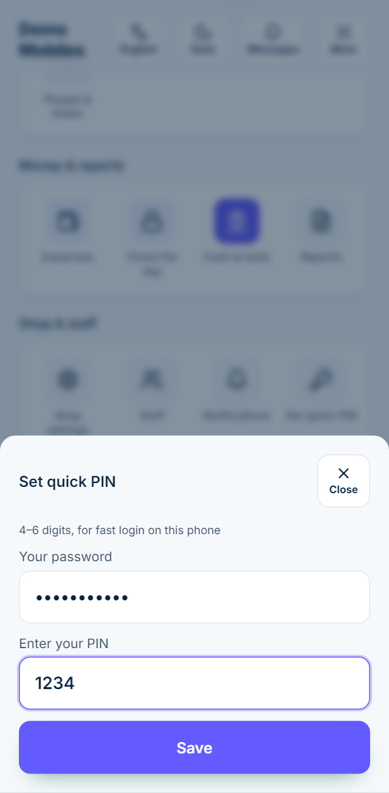

Agli dafa yeh phone aap ke naam ke saath **Apna PIN likhein** screen kholega. Keypad par PIN dabayein
aur **Aage** dabayein.

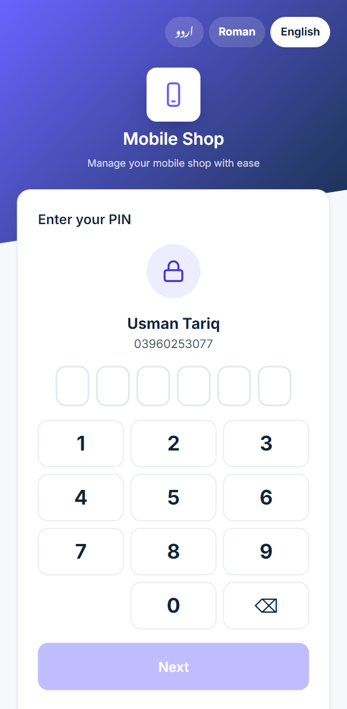

- **PIN bhool gaye? Password lagayein** — password wali screen par wapas.
- **Doosra account lagayein** — usi phone par kisi aur staff ke liye.
- **Password bhool gaye?** Dukaan ke **maalik** se kahein: Mazeed → **Staff** → aap ka naam →
  **Naya password** → **Mehfooz karein** ([hissa 17](#17-staff-aur-un-ke-ohde)). Maalik ka apna
  password OOP Solutions reset karti hai.

### Logout
**Mazeed** → neeche jayein → **Logout**.

---

## 2a. Fingerprint se login

Ek dafa password se login karne ke baad: **Mazeed → Fingerprint login → Is phone ke liye on karein** aur sensor par ungli rakhein. Agli dafa login page par **Fingerprint se login** aata hai: ek touch aur aap andar. Yeh Android app (phone ka fingerprint) aur website (us device ka fingerprint, face ya Windows Hello) dono par chalta hai. Aap ka fingerprint phone se bahar nahi jata.

- **Malik** hamesha use kar sakta hai. Staff tab hi kar sakta hai jab malik **Settings → Staff bhi fingerprint se login kar sake** on kare.
- Isi card mein har woh phone ya browser dikhta hai jo is tarah login kar sakta hai; **Hatayein** dabane se woh foran band (malik ko staff ke bhi dikhte hain). Staff wali setting band karne se staff ke saare fingerprint login band ho jate hain.
- Dukaan ke shared phone par phone ki settings mein darj har ungli account khol sakti hai: sirf apne phone par on karein.

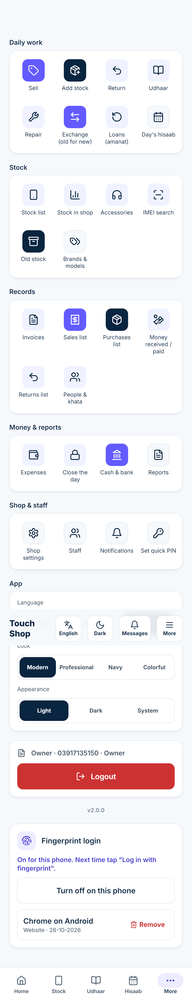

## 3. Home screen

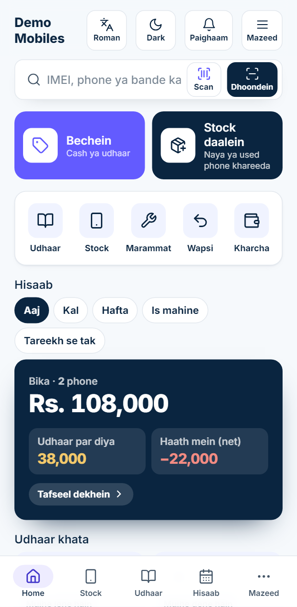

Ooper se neeche:

| Hissa | Kya karta hai |
|---|---|
| Ooper wali patti | Dukaan ka naam, **Roman** (zubaan), **Dark** / **Light**, **Paighaam**, **Mazeed**. Chhote phone (jaise iPhone SE) par naam alag line mein buttons ke ooper. |
| Salaam | "Subah bakhair / Assalam-o-Alaikum / Shaam bakhair" aap ke naam ke saath |
| Search box | IMEI, phone ka model ya bande ka naam likhein aur **Dhoondein** dabayein. **Scan** camera se IMEI barcode parhta hai. |
| **Bechein** | Phone bechein (cash ya udhaar) — [hissa 6](#6-phone-bechna) |
| **Stock daalein** | Naya ya used phone khareeda — [hissa 4](#4-stock-daalein-phone-khareedna) |
| **Baqi kaam** | **Udhaar**, **Stock**, **Marammat**, **Wapsi**, **Bill**, **Kharcha**, har ek apne rang mein |
| **Hisaab** | **Aaj**, **Kal**, **Hafta**, **Is mahine** ya **Tareekh se tak** chunein. Dark card mein **Bikri** aur bike phone, **Pichle 7 din** ka chart (kisi bar ko dabayein to us din ki bikri), **Haath mein (net)**, **Udhaar par diya**, **Munafa** (maalik aur manager) aur **Kharche**. Poore hisaab ke liye card ya **Sab dekhein** dabayein. |
| **Udhaar khata** | **Mujhe lene hain** (log aap ke dene wale) aur **Mujhe dene hain** (aap ne dene hain) |
| **Dukaan mein stock** | **Stock mein phone** aur un ki **Maliyat** (lakh mein bhi). **Tafseel dekhein** brand → model dikhata hai. |
| **Munafa aur report** | Sirf maalik aur manager — [hissa 10](#10-munafa-report-aur-download) |
| **Dhyan dein** | maslan "2 phone: shanakhti card check baqi", "1 marammat ke kaam baqi" |

Neeche patti mein **Home**, **Stock**, **Udhaar**, **Hisaab**, **Mazeed** hain.

Laptop par kaam side menu mein aate hain, keyboard ke button ke saath: **F2** Bechein, **F3** Stock
daalein, **F4** Udhaar, **F6** Stock, **F7** Marammat, **F8** Kharcha, **F9** Wapsi.

---

## 4. Stock daalein (phone khareedna)

Jab bhi dukaan mein phone aaye, **Stock daalein** istemal karein. Teen qadam hain:
**1 Kis se liya? → 2 Kaun sa phone, kitne ka? → 3 Ho gaya**.

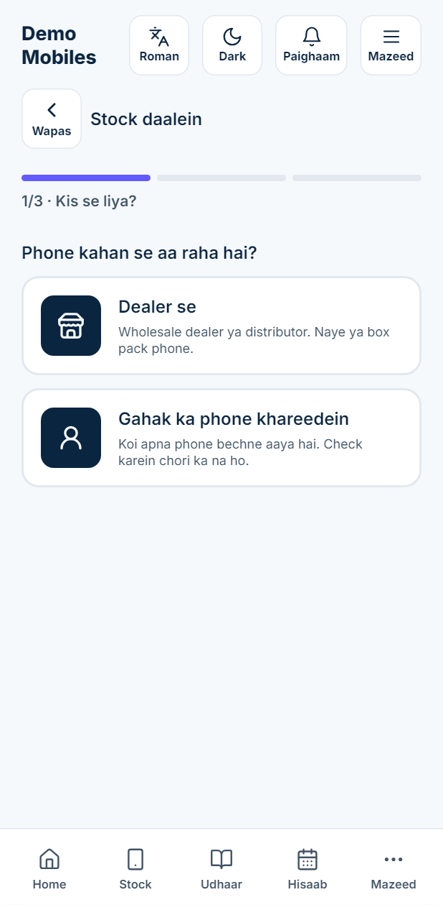

### 4a. Dealer se
**Misaal:** Aap ne **Rehman Traders** se box pack **Samsung Galaxy A55 256GB Blue** **Rs. 92,000**
cash mein liya, **Rs. 1,00,000** (100,000) mein bechenge. Dabba aur taar saath aaye; charger dealer
3 din mein dega.

1. Home par **Stock daalein** dabayein.
2. **Dealer se** dabayein.
3. **Dealer chunein** mein naam ke chand harf likhein (`Rehman`) aur **Rehman Traders** dabayein.
   Naya dealer hai? Hare **+** ko dabayein aur form bharein (4c dekhein).
4. **Aage** dabayein.

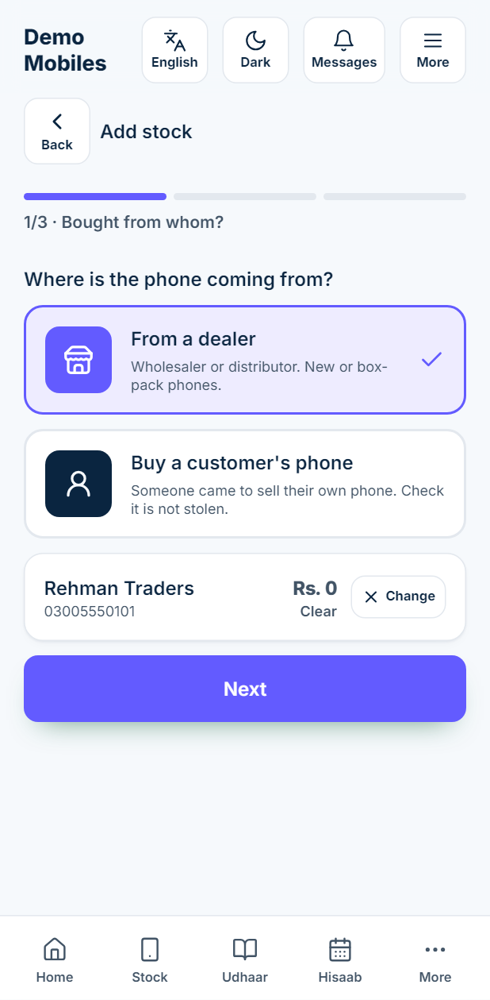

5. **Phone daalein** dabayein. Form khulta hai:
   - **IMEI**: 15 hindse likhein (`356938035643809`) ya **Scan** daba kar dabbe ka barcode parhein.
     Neeche **Naya IMEI, pehle nahi aaya** ya **Yeh IMEI pehle aap ki dukaan mein aa chuka hai** likha aata hai.
     Jo phone abhi stock mein hai woh dobara nahi daala ja sakta.
   - **IMEI 2**: do SIM wale phone ke liye (zaroori nahi; is ke saath bhi **Scan** hai).
   - **Brand**: **Samsung** dabayein.
   - **Model**: search mein `A55` likhein aur **Galaxy A55** dabayein.
   - **Memory**: `256GB`. **Rang**: `Blue`.

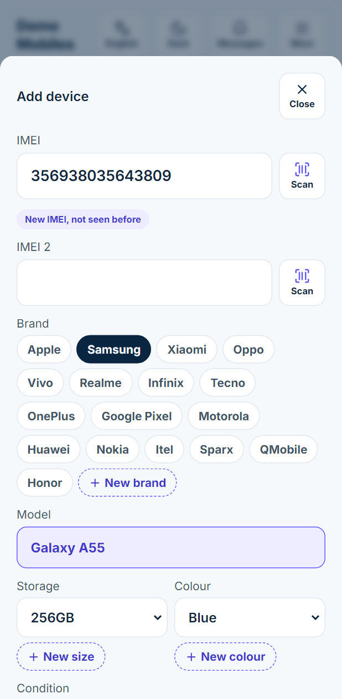

   - **Haalat**: **Box pack**, **Open box**, **Used** ya **Patch wala** (patch wale ke liye **Patch ki tafseel** likhni hogi).
   - **PTA status**: **PTA approved**, **Non-PTA** ya **JV**. Non-PTA aur JV ke liye **SIM time (mahine)** zaroori hai.
   - **Khareed qeemat**: `92000` (jitne mein liya).
   - **Bechne ki qeemat**: `100000` (jitne mein bechna hai). Yeh **khareed qeemat se kam nahi ho sakti** —
     *"Bechne ki qeemat khareed qeemat se kam nahi ho sakti"* likha aayega aur **Daalein** ka button nahi chalega.
   - **Warranty**: dealer ke phone par 12 mahine pehle se likha hota hai.

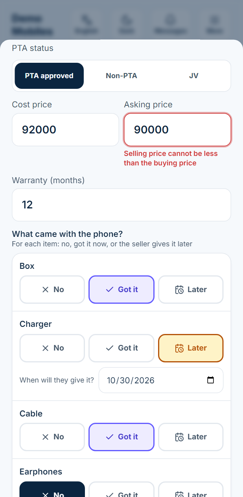

   - **Phone ke saath kya kya aaya?** **Dabba**, **Charger**, **Taar**, **Handsfree**, **AirPods** — har ek ke liye
     **Nahi**, **Mil gaya** ya **Baad mein** dabayein. **Baad mein** par **Kab dega?** mein tareekh chunein.
     Yahan: Dabba **Mil gaya**, Charger **Baad mein** (tareekh), Taar **Mil gaya**.

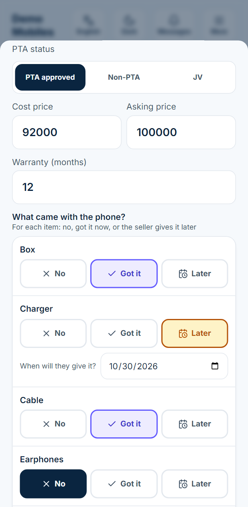

6. **Daalein** dabayein. Phone list mein aa jata hai. Aur phone ke liye dobara **Phone daalein**.
   Dealer ke saath **+ Charger, cover ya aur saamaan** bhi daal sakte hain.
7. **Paise kaise diye?** **Cash** dabayein (ya Easypaisa / bank account, agar **Mazeed → Cash aur Bank**
   mein banaya hai), ya **Udhaar** (4d dekhein).
8. **Kab khareeda?** **Abhi** rehne dein, ya **Pehle** daba kar tareekh aur waqt chunein.
9. **Riayat, bill number** (agar ho): discount aur dealer ka bill number.
10. **Kul** (Rs. 92,000) dekhein aur **Stock mein daalein** dabayein.

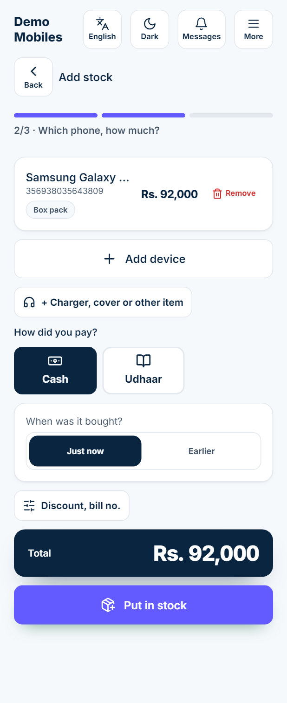

**Khareedari mehfooz**, raqam aur bill number (maslan `PUR-000001`) nazar aata hai.

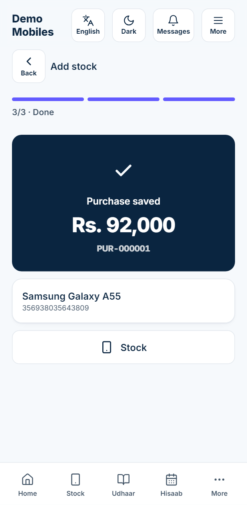

### 4b. List mein brand, model, memory ya rang nahi hai
**Phone daalein** form mein **+ Naya brand**, **+ Naya model**, **+ Nayi memory** ya **+ Naya rang**
dabayein, naam likhein (maslan brand `Dcode`, model `Bold 3`, memory `48`) aur **Mehfooz karein**.
Woh foran chun liya jata hai aur agli dafa list mein hoga. Apne daale hue naam baad mein
**Mazeed → Brand aur model** mein badal ya mita sakte hain (pehle se bane aur istemal shuda nahi mitte).

### 4c. Gahak ka phone khareedna (naya banda, +92 number, CNIC)
**Misaal:** **Ali Raza** apna used **Infinix Hot 40 128GB** **Rs. 28,000** mein bechne aaya. Aap abhi
Rs. 20,000 dete hain, Rs. 8,000 baad mein. Aap Rs. 34,000 mein bechenge.

1. **Stock daalein** → **Gahak ka phone khareedein**.
2. **Phone kaun bech raha hai?** ke neeche **Naya banda** dabayein:
   - **Naam**: `Ali Raza`
   - **Mobile number**: +92 pehle se hai; `3005550606` likhein (3 se shuru 10 hindse).
   - **CNIC**: 13 hindse `3740512345673`; yeh `37405-1234567-3` ban kar nazar aata hai.
   - **Shehar**, **Pata** (agar ho). **Mehfooz karein** dabayein.

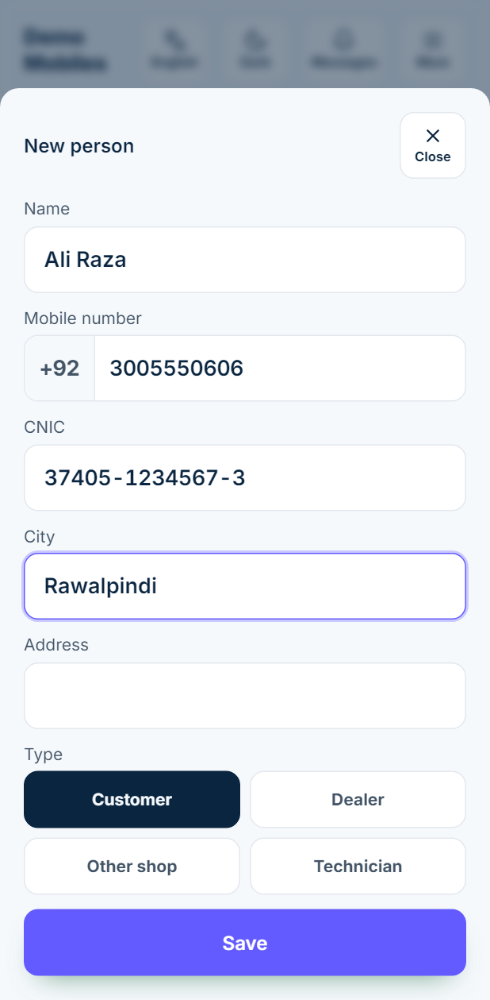

3. **Aage** → **Phone daalein** → IMEI `490154203237518`, **Infinix**, **Hot 40**, `128GB`, **Used**,
   **Khareed qeemat** `28000`, **Bechne ki qeemat** `34000` → **Daalein**.
4. **Paise kaise diye?** mein **Udhaar** dabayein aur **Abhi kitne diye (agar diye)** mein `20000` likhein.
   **Abhi dene hain** mein **8,000** aata hai — yeh Ali Raza ke khate mein *Mujhe dene hain* ban jata hai.
5. **Shanakhti card check**: **Abhi ya baad mein check** (aam tor par) ya **Chhorein, main isay jaanta hoon**.
6. **Stock mein daalein** dabayein.

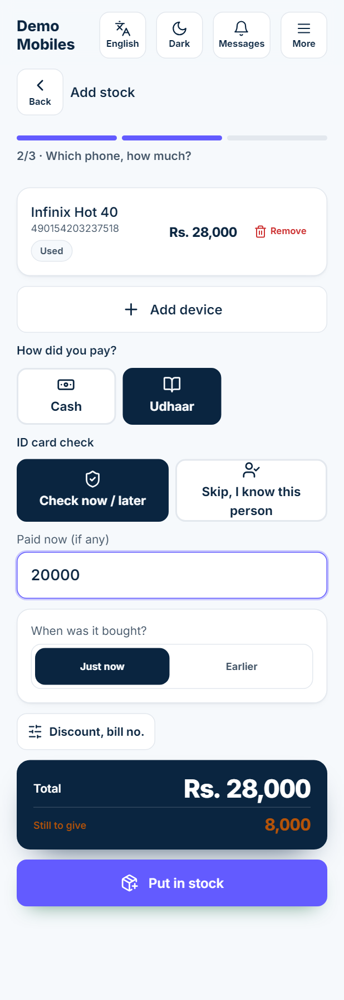

7. Aakhri screen par **Check karein phone chori ka na ho** aur teen button:
   **Abhi shanakhti card check karein** ([hissa 5](#5-gahak-ke-phone-ka-shanakhti-card-check)),
   **Chhorein, main isay jaanta hoon**, aur **Print karein** (bechne wale ka iqrar nama).

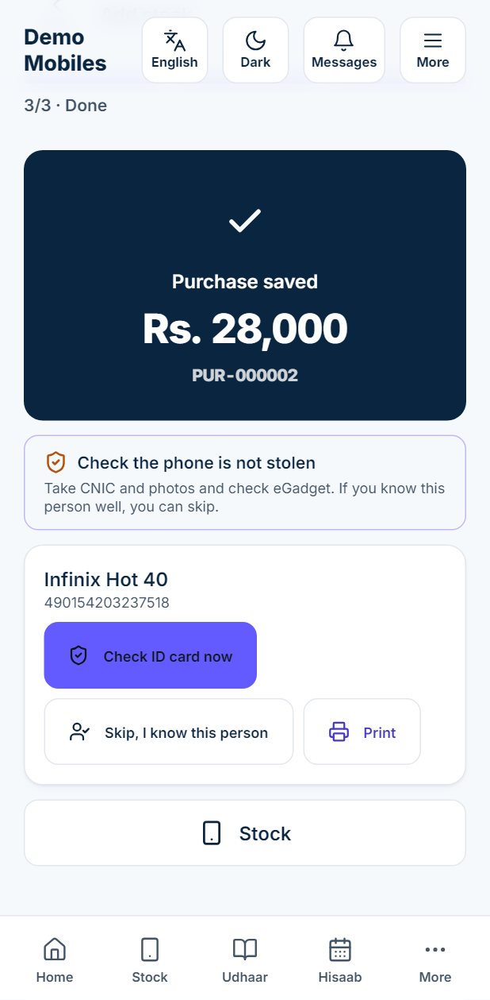

Chhorne par phone par **Check chhor diya, jaan pehchan wala** likha aata hai aur aap ka naam us ki kahani mein mehfooz hota hai.

### 4d. Udhaar par khareedna
Qadam 2 mein **Udhaar** + **Abhi kitne diye (agar diye)** = kuch abhi diye, baqi us dealer ya bande
ke dene hain. Baad mein **Udhaar → Paise diye** se adaa karein ([hissa 8](#8-udhaar-khata-kis-ne-kis-ko-dene-hain)).

### 4e. Purana stock jo pehle se dukaan mein hai
Woh phone jo app shuru karne se **pehle** dukaan mein the: na dealer, na cash.
1. **Mazeed** → **Purana stock**.
2. **Phone daalein** dabayein, form ooper ki tarah bharein, **Daalein**. Har phone ke liye dohrayein.
3. **Mehfooz karein** dabayein. **Khareedari mehfooz** aa jayega.

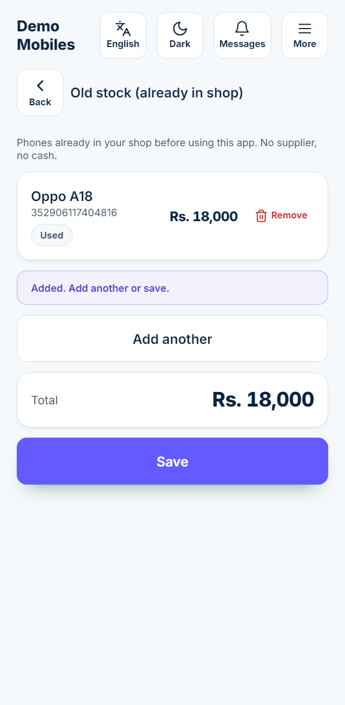

Agar purane stock ka phone ghalti se daal diya, stock list se kholein aur
**Purane stock ki entry hatayein** dabayein (wajah likhein).

---

## 5. Gahak ke phone ka shanakhti card check

Har used phone jo kisi bande se khareedein, us ka check karein taake chori ka phone na aaye.

1. Kholein: khareedne ke baad **Abhi shanakhti card check karein**, ya phone ke page par
   **Shanakhti card check**, ya Home → **Dhyan dein** → *phone: shanakhti card check baqi*.
2. **Bechne wala** pehle se bhara hota hai (maslan Ali Raza). **CNIC number** ke 13 hindse dekh lein.
3. Har tasweer wale dabbe ko daba kar camera se tasweer lein:
   **CNIC aage**, **CNIC peeche**, **Bechne wale ki tasweer**, **Mobile ki tasweer**.
4. **eGadget (Punjab Police)**: **eGadget portal kholein** dabayein, wahan IMEI check karein, wapas aa kar
   **Saaf**, **Report shuda** ya **Check nahi kiya** chunein. Portal number de to **Reference number** likhein.
5. **PTA check kiya (SMS 8484)**: **SMS 8484** daba kar IMEI PTA ko bhejein, phir dabba tick karein aur nateeja chunein.
6. **Bechne wale ne iqrar nama sign kiya**: **Print karein** daba kar iqrar nama print karein, sign karwayein, phir tick karein.
7. **Phone ki haalat ke note** (agar ho), maslan "peeche halki kharaash".
8. **Mehfooz karein** dabayein. **Abhi baqi** mein woh cheezein aati hain jo abhi nahi hui.

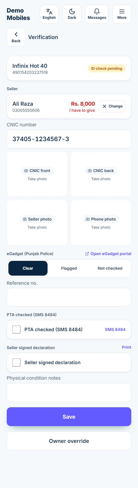

- eGadget **Report shuda** ho to phone par **Chori ka shak, na bechein** aata hai. Phir bhi sirf
  **maalik** wajah likh kar bech sakta hai.
- **Maalik ki ijazat** (maalik/manager) baghair sab cheezon ke check mukammal kar deta hai; wajah zaroori hai aur mehfooz hoti hai.

---

**Save** ke baad nateeje ki screen batati hai aap kahan hain: **"ID check mukammal. Ye phone becha ja
sakta hai."** **Ye phone abhi bechein** ke button ke saath, ya **"Save ho gaya, lekin check abhi mukammal
nahi. Baqi: …"** (maalik ka override bhi mukammal shumar hota hai), ya **Flagged**. Wahan se: phone par
wapas, iqrar nama print, ya kuch badalein.

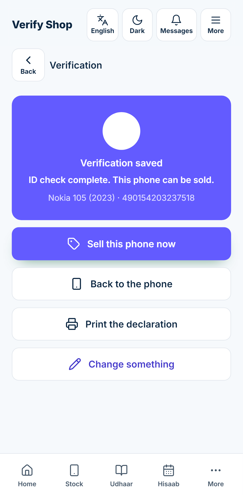

### 5a. CNIC likhne ki jagah scan karein

**Naya shakhs** mein (aur ID check par) **CNIC scan (aage ki tasweer)** dabayein aur roshni mein card ke aage ki saaf tasweer lein. Chand second mein **naam** aur **CNIC number** khud bhar jate hain, aur walid ka naam, paidaish ki tareekh aur card ki muddat **Notes** mein aa jati hai. Card expire ho chuka ho to warning aati hai. Save karne se pehle bhare hue khane zaroor dekh lein; Urdu pata parha nahi jata, woh khud likhein.

Tasweer aap ke phone par hi parhi jati hai: parhne ke liye kahin nahi bheji jati (parhne wala program pehli dafa ek baar download hota hai).

## 6. Phone bechna

Teen qadam: **1 Kaun sa phone? → 2 Kitne ka? → 3 Ho gaya**.

### 6a. Cash bikri
**Misaal:** **Vivo Y36** **Rs. 50,000** cash mein, 1 mahina warranty, charger abhi de diya, handsfree baad mein denge.

1. Home → **Bechein**.
2. List mein phone dabayein (ya IMEI / model se dhoondein, ya dabba **Scan** karein).

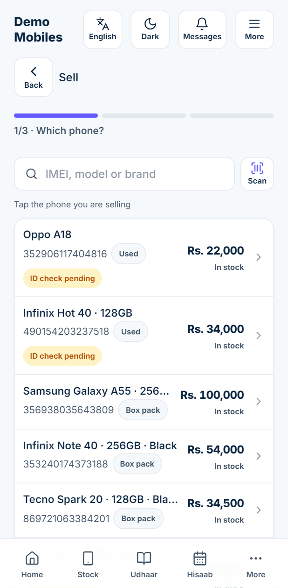

3. **Kitne mein becha (Rs)** mein bechne ki qeemat (`50000`) pehle se likhi hoti hai. Doosri qeemat tay hui to badal dein.
4. **Warranty**: **Koi nahi**, **7 din**, **1 mahina**, **3 mahine**, **6 mahine** ya **1 saal**.
5. **Phone ke saath kya kya de rahe hain?** har cheez ke liye **Nahi**, **De diya** ya **Baad mein**
   (**Kab denge?** tareekh ke saath). Jo cheezein phone ke saath aayi thin woh pehle se **De diya** hoti hain.
6. Aur phone ya saamaan: **+ Ek aur phone**, **+ Charger, cover ya aur saamaan**.
   **Discount aur customer** se discount aur gahak (agar batana ho) aata hai.
7. **Paise kaise mile?** **Cash** dabayein (ya Easypaisa / bank account).
8. **Kul** dekhein aur **Bikri mukammal karein** dabayein.

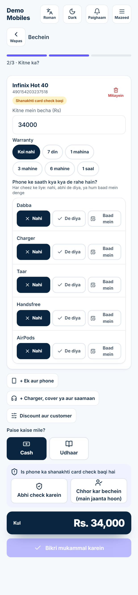

9. **Bikri ho gayi** par raqam aur bill number (maslan `INV-000001`). **Raseed print (80mm)** ya
   **Bill print (A4)** (sirf website par), **Ek aur bikri** ya **Bikri dekhein**.

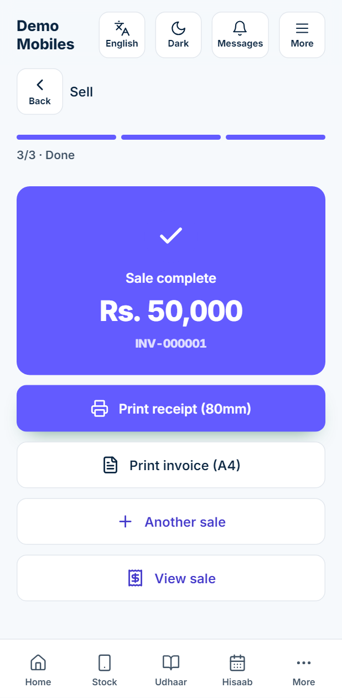

### 6b. Udhaar par bikri
**Misaal:** **Redmi Note 13** **Rs. 58,000** mein **Imran Ali** ko, woh abhi **Rs. 20,000** deta hai.
1. Phone chunein, qeemat dekhein.
2. **Udhaar** dabayein.
3. **Udhaar kaun le raha hai?** — `Imran` likh kar **Imran Ali** dabayein (naya banda ho to **+**).
4. **Abhi kitne mile (agar mile)**: `20000`. **Baqi udhaar** mein **38,000** aata hai.
5. **Bikri mukammal karein**. Ab Imran Ali **Udhaar → Mujhe lene hain** mein Rs. 38,000 ke saath hai.

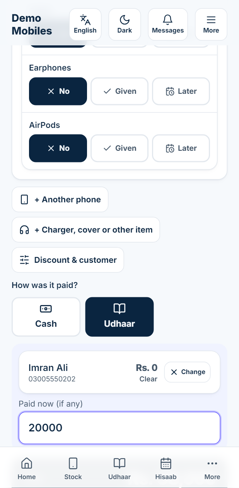

Bina gahak ke cash bikri mein poore paise lene zaroori hain; kuch paise baad mein hon to **Udhaar** chunein.

### 6c. Khareed qeemat se kam par bechna
Agar **Kitne mein becha** khareed se kam ho to laal dabba aata hai:
*"Yeh qeemat khareed qeemat (Rs. 380,000) se kam hai. Is mein nuqsan hai."*
- **Maalik ya manager**: **Mujhe pata hai, nuqsan par bechein** daba kar ijazat dein.
- **Salesman**: bikri nahi hogi — *"Khareed qeemat se kam par sirf malik ya manager bech sakta hai. Qeemat barhaein."*

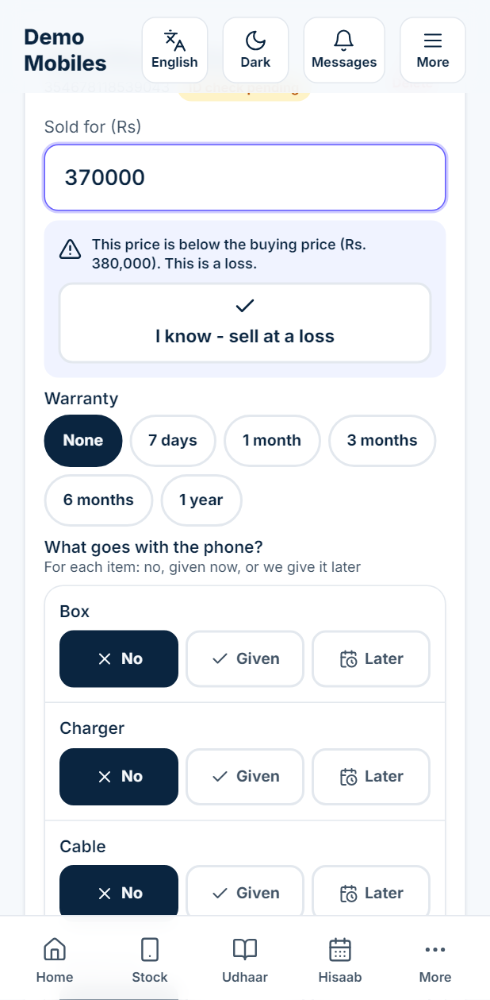

### 6d. Jis phone ka shanakhti card check baqi hai
Agar phone kisi bande se khareeda aur check nahi hua, bikri par *"Is phone ka shanakhti card check baqi hai"*
aata hai aur **Bikri mukammal karein** nahi chalta. Chunein:
- **Abhi check karein** — check khul jata hai ([hissa 5](#5-gahak-ke-phone-ka-shanakhti-card-check)), ya
- **Chhor kar bechein (main jaanta hoon)** — jo bhi bech raha hai yeh kar sakta hai; us ka naam phone ki kahani mein mehfooz hota hai.

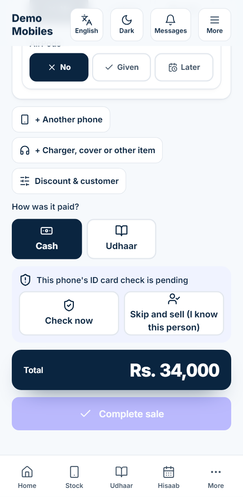

### 6e. Raseed print, download aur share karna
Raseed dukaan ki zubaan mein print hoti hai (**Dukaan ki settings → Dukaan ki zubaan**). Print ka button
print window kholta hai: thermal (80 mm) printer chunein. Neeche **PDF download** bill ko PDF file bana kar
save karta hai aur **PDF share karein** phone ki share list (WhatsApp, Gmail…) file ke saath kholta hai.
Yehi do button har bikri ke page, exchange ke baad aur repair job par bhi hain.

**Document ki zubaan.** Print / download / share ke buttons ke theek ooper (bikri mukammal, bikri ka
page, repair job, ID check, aur har report ki Download ya Share sheet mein) **Document ki zubaan:
English | اردو** hai. By default English hoti hai; Urdu raseed, bill, job sheet, iqrar nama ya report ke
liye **اردو** dabayein. Jab tak app band na karein, ye intikhab rehta hai.

### 6f. Bill par tax (marzi se)
Har sale par tax **band** hota hai. Lagana ho to **Is bill par tax lagayein** par tick karein: **Tax %** ka
khana aata hai (dukaan ka rate, aam tor par 18) aur tax qeemat ke ooper jud jata hai. Total ke neeche
"tax shamil Rs. …" likha aata hai. Tick na karein to koi tax nahi lagta.

### 6g. Sale hold karna (pehle agle customer ko farigh karein)
Customer paise lene gaya? **Bikri mukammal karein** ke neeche **Sale hold karein** dabayein, dhoondne ke liye
naam likhein (marzi se) aur **Hold karein** dabayein. Screen agle customer ke liye khaali ho jati hai; abhi
kuch nahi bika aur phone stock mein hi rehta hai. Baad mein sale screen ke ooper **Hold sales (n)** →
**Dobara kholein**: bill bilkul waisa wapas aata hai (qeemat, tax, payment). Dukaan ke kisi bhi phone se
khol sakte hain. Agar is dauran bill ka koi phone bik gaya ho to woh bill se nikal diya jata hai aur screen batati hai.

---

### 6a. Paise kaise diye? (sale aur stock daalna)

**How was it paid?** ke neeche ek bara button dabayein:

| Button | Kab | Kya poochta hai |
|---|---|---|
| **Cash** | haath mein paise | kuch nahi |
| **Online** | bank app, IBFT, Raast, Easypaisa, JazzCash, SadaPay… | kaunsa bank ya app (naam dabayein, ya **Koi aur bank / wallet** se poori list); TID agar ho |
| **Cheque** | cheque | cheque ka bank, cheque number, cheque ki tareekh |
| **Bahar se** (sirf sale) | khareedne wale ke ghar wale doosre mulk se paise bhejte hain | mulk / currency, kitne aaye (maslan **500 SAR**), rate (**1 SAR = Rs. 74.20**) → app khud **Rs. 37,100** dikhati hai; bhejne wale ka naam; Western Union, MoneyGram… (agar pata ho); MTCN (agar ho) |
| **Udhaar** | baad mein dena | gahak, aur abhi kitne diye |

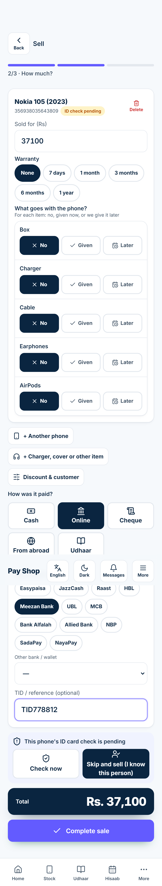

Har tareeqe ka apna khata hai (Cash, Bank / Online, Cheques, Remittance), is liye din ke hisaab mein nazar aata hai ke kis tareeqe se kitna aaya. Easypaisa / JazzCash dukaan ke apne Easypaisa / JazzCash account mein jate hain agar aap ne **Mazeed → Money accounts** mein banaya ho. Raseed aur bill par likha hota hai ke paise kaise aaye, maslan *Online · Meezan Bank · Ref TID778812*.

**Misaal (bahar se):** Usman ka bhai Riyadh se Rs. 37,100 ke phone ke liye Western Union se 500 SAR bhejta hai. **Bahar se → SAR** dabayein, 500 aur 74.20 likhein, bhejne wala "Ahmed Raza", **Western Union** dabayein, **Complete sale**. Agar bahar se aaye paise bill se kam hon to baqi gahak ke udhaar mein chale jate hain (gahak chunein).

### 6b. Ghariyan aur accessories (ginti se)

Aam ghariyan (Casio, Naviforce…) aur accessories (charger, cable, cover, glass, handsfree, power bank) **ginti se** rakhi jati hain: IMEI nahi, sirf kitne pieces hain.

**Khareedna:** Stock daalein → dealer chunein → **Accessory / ghari daalein** → list se chunein, ya **Nayi cheez (list mein nahi)**: naam, yeh kya hai (**Ghari**, **Charger**, **Speaker**, … ya **+ Nayi qism** se apna naam, maslan *Ring light*), ek ki bechne ki qeemat → **Save kar ke daalein**. Kitne (**Qty**) aur ek ki khareed (**Unit cost**) likhein. Save karne par ginti barh jati hai.

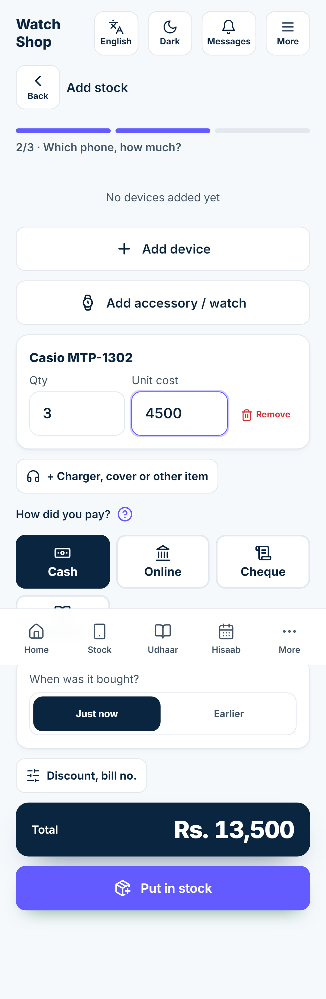

**Bechna:** Sell → **Accessory / ghari** (phone ke saath charger bechna ho to phone ke neeche bhi yahi button) → item par tap karein. Line par likha hota hai stock mein kitne hain; is se zyada nahi bik sakte. Ginti kam ho jati hai aur munafa khareed qeemat se khud nikalta hai.

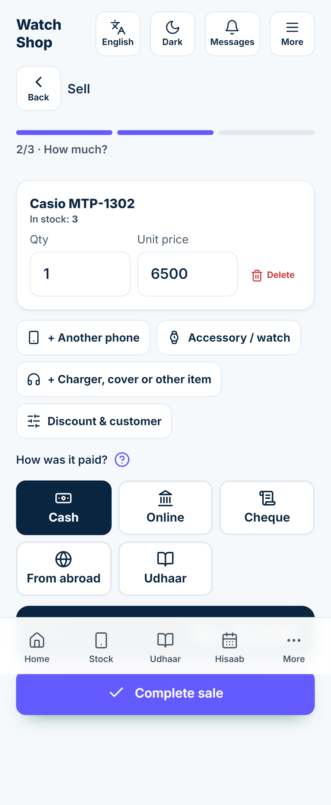

**Misaal:** 3 Casio MTP-1302 Rs. 4,500 mein khareedin, ek Rs. 6,500 mein bechi: stock 2 dikhata hai, munafa Rs. 2,000. Smart watch aur tablet (ek ek piece, serial / IMEI ke saath) agla kaam hai.

### 6c. Tablet aur smart watch (ek ek piece)

**Add device** mein pehle **Mobile**, **Tablet** ya **Smart watch** dabayein. Sirf woh brands aate hain jo yeh cheez banate hain (maslan tablet ke liye Apple, Samsung, Lenovo; watch ke liye Apple, Samsung, Huawei, Amazfit), un ke models ke saath (iPad, Galaxy Tab, Apple Watch, Galaxy Watch…).

Har cheez sirf apni baatein poochti hai:

| | Mobile | Tablet | Smart watch |
|---|---|---|---|
| SIM? | hamesha | **Sirf Wi-Fi** ya **Wi-Fi + SIM** | **SIM nahi (GPS)** ya **SIM wali (Cellular)** |
| IMEI | IMEI 1 aur IMEI 2 | sirf SIM ke saath (ek IMEI) | sirf SIM ke saath |
| Serial number | — | SIM na ho to zaroori | SIM na ho to zaroori |
| PTA | PTA approved · Non-PTA · JV | sirf SIM ke saath, JV nahi | sirf SIM ke saath, JV nahi |
| Storage | haan | haan | nahi — is ki jagah **Dial ka size** (38–49 mm, ya doosra) |
| Condition | Box pack · Open box · Used · Patched | Box pack · Open box · Used | Box pack · Open box · Used |
| Battery health % | — | open box / used ke liye (marzi se) | open box / used ke liye (marzi se) |
| Accessories | box, charger, cable, earphones, AirPods | box, charger, cable, **Pen / stylus**, **Keyboard cover** | box, charger, **Extra strap** |

- SIM na ho to IMEI nahi hota, is liye **Serial number** (dabbe par, ya Settings → About) IMEI ki tarah dhoonda aur dikhaya jata hai.
- Stock list mein kaam ki baat dikhti hai, maslan *Watch Series 9 · 45mm · GPS · Battery 91%*.
- Gahak se khareeda purana tablet ya watch bhi **ID check** se guzarta hai, mobile ki tarah.

Bechte waqt stock list ke upar **Sab · Mobile · Tablet · Smart watch** ke buttons se chhantein.

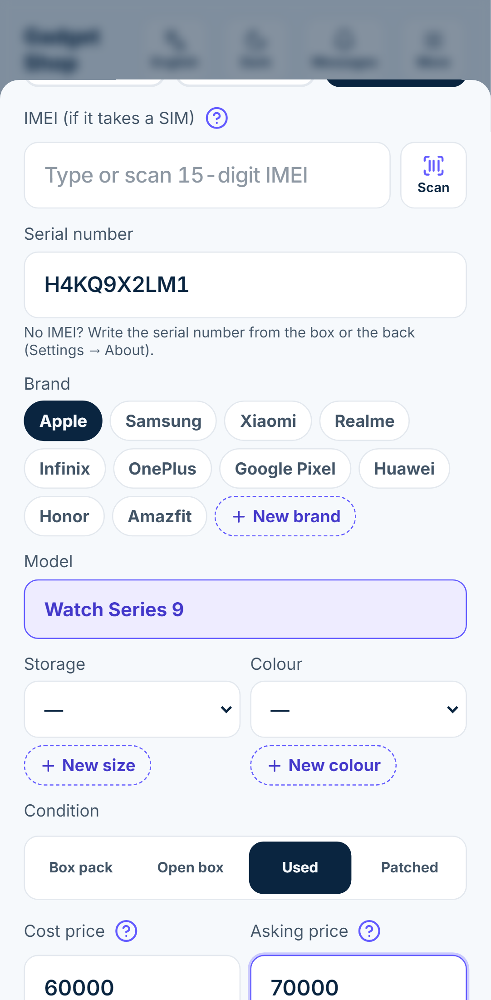

## 7. Wapsi (gahak phone wapas laya)

**Misaal:** **Bilal Ahmed** ne **Samsung Galaxy A55** **Rs. 1,00,000** cash mein liya. Woh wapas le aaya.
Dukaan **Rs. 10,000** kaat-ti hai aur **Rs. 90,000** wapas deti hai.

1. Home → **Wapsi** (ya bike hue phone ke page par **Wapsi**).
2. **Bika hua phone IMEI ya naam se dhoondein** mein IMEI ka hissa (`3809`) ya naam likhein, ya
   **Ya haal ki bikri mein se chunein** se chunein. Phone dabayein.
3. **Kaun wapas laya?** — **Bilal Ahmed** chunein (bina gahak ki cash bikri mein zaroori hai).
4. **Gahak ne diye the** mein **100,000**.
5. **Paise kahan se diye**: **Cash** (ya account). Jaan pehchan wale gahak ke liye cash ki jagah
   **Khate mein rakhein** bhi chun sakte hain.
6. **Gahak ko wapas (Rs)**: `90000` likhein. **Dukaan ne kaate** mein **10,000** khud aa jata hai.
7. **Kyun? (agar batana ho)**: maslan "irada badal gaya".
8. **Wapas lein** dabayein.

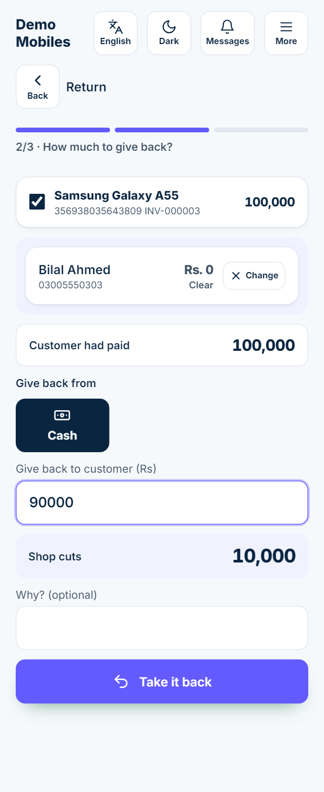

**Wapsi ho gayi — Phone wapas stock mein aa gaya.** Kaate gaye 10,000 aamdani mein gine jate hain; din ke
hisaab mein **Wapsi par diye** aur **Wapsi par kaate** aate hain aur bikri par lakeer lag kar **Wapas** likha aata hai.

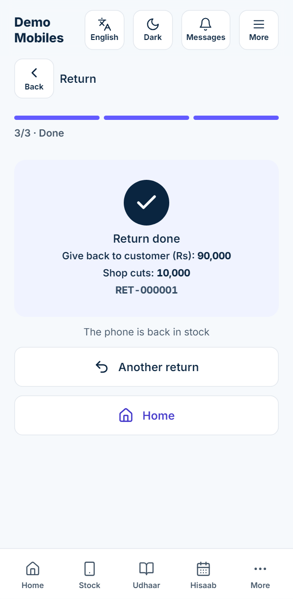

Agar phone udhaar par bika tha aur paise nahi mile the to app likhti hai
*"Is ke paise nahi diye the; udhaar se kam ho jayega"*.

---

## 8. Udhaar khata (kis ne kis ko dene hain)

Home → **Udhaar** (ya neeche patti mein **Udhaar**).

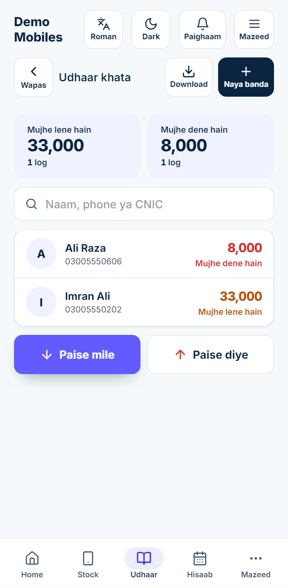

- **Mujhe lene hain** — logon ne aap ko kitne dene hain (aur kitne log). Dabane par sirf woh log.
- **Mujhe dene hain** — aap ne kitne dene hain.
- **Naam, phone ya CNIC** se dhoondein. **Download** se poora khata PDF / Excel / CSV mein.
- **Naya banda** se gahak, dealer, doosri dukaan ya karigar daalein.

### Paise mile (gahak ne paise diye)
**Misaal:** Imran Ali apne Rs. 38,000 mein se **Rs. 5,000** deta hai.
1. **Paise mile** dabayein (ya **Imran Ali** khol kar **Paise mile**).
2. Banda chunein (agar pehle se khula na ho).
3. **Raqam**: `5000`. **Tareeqa**: **Cash**, **Bank**, **Easypaisa**, **JazzCash**…
   **Reference / TID** aur **Note** (agar ho).
4. **Paise lein** dabayein. Us ka baqaya Rs. 33,000 reh jata hai.

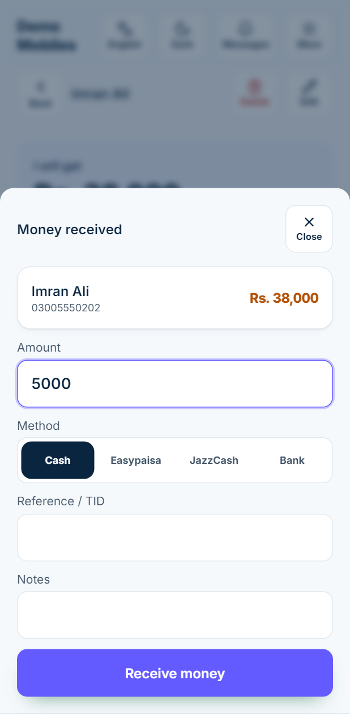

### Paise diye (aap ne dealer ya bande ko diye)
Yehi tareeqa, **Paise diye** → **Paise dein**. Misaal: Ali Raza ko phone ke baqi Rs. 8,000 dein.

### Bande ka page
Naam dabayein: baqaya card (**Mujhe lene hain** / **Mujhe dene hain** / **Saaf**), **Paise mile**,
**Paise diye**, **Khate ka record** (har bikri, paise, wapsi, chalte baqaye ke saath), **Badlein**,
**Mitayein** aur **Download** (us ka khata).

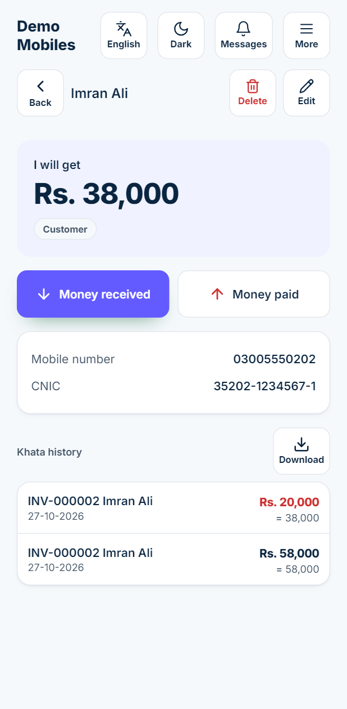

Baqaya hamesha record se hisaab hota hai; haath se kabhi nahi likha jata. Ghalti nayi entry se theek
hoti hai (maslan bill khatam karein), purani entry badal kar nahi.

### WhatsApp par udhaar ki yaad dahani
Udhaar khata ke ooper **Yaad dahani** dabayein. Jin par udhaar hai sab aate hain, bara baqaya pehle,
saath mein kitne din se khata ruka hai aur aakhri yaad dahani kab gayi. **7 / 15 / 30 din se purana**
se chhantein.

- Naam ke saath hara button dabayein: WhatsApp likhe hue paighaam ke saath khulta hai ("Bilal, Al-Madina
  Mobile ki taraf se yaad dahani: aap ke khate mein Rs. 12,000 baqi hain…"); aap send dabayein.
- **Sab ko bhejein** ek ek kar ke kholne ki list deta hai.
- **Khud-ba-khud**: Mazeed → Paighaam → *Udhaar ki yaad dahani* → **Customers ko khud-ba-khud yaad
  dahani** tick karein, kitne din baad aur kis waqt chunein. Phir yaad dahani khud jaati hai — is ke
  liye server par WhatsApp Business API lagi honi chahiye (product owner se kahein); warna woh
  **Paighaam** mein aap ke tap ka intezar karti hai.

### Raat ki report
Mazeed → Paighaam → *Malik ko raat ki report*: **Malik ka WhatsApp number** aur/ya **Malik ki email**
likhein, **Har raat din ka hisaab bhejein · WhatsApp** aur/ya **· Email** tick karein aur waqt chunein
(maslan 21:30). Email tab khud jaati hai jab software provider server par SMTP account set kar de
(screen batati hai set hai ya nahi); WhatsApp ke liye Business API chahiye. Har raat malik ko ek paighaam milta hai:
kitne phone bike aur kitne ke, haath mein, udhaar diya aur wasool, kharche, munafa, lene / dene hain,
stock mein phone. **Aaj ka hisaab abhi bhejein** foran bhejta hai.

### Qiston par bechna (installments)
**Bechein** kholein, phone chunein aur **Qiston par bechein** par tick karein (tab dikhta hai jab
aap ki dukaan mein *Qistein* module on ho). Customer chunein, **abhi advance** likhein (ooper chune
tareeqe se wasool hota hai: cash, online, cheque), **kitne mahine** dabayein (3 · 6 · 9 · 12 · 18 · 24);
**mahana** raqam khud bhar jati hai = (qeemat − advance) ÷ mahine; agar aur raqam tay hui hai to badal
dein, aakhri qist mein jo bacha wo aa jata hai. **Mahine ki tareekh** aur zaroorat ho to **pehli qist**
ki tareekh rakhein (khaali = agle mahine isi tareekh ko). **Zamin** likhein: naam, mobile, CNIC. Sale
mukammal karein: raseed par plan chhapta hai (advance, N × mahana, pehli tareekh, zamin) aur baqi
raqam hamesha ki tarah customer ke khate par rehti hai.

Mazeed → **Qistein** mein saare plan: **Aaj ki**, **Late**, **Jari**, **Mukammal**; naam, phone,
bill number ya zamin se dhoondein. Plan kholein to har qist *Ada*, *Juzwi*, *Aaj*, *Late* ya *Baqi*
nazar aati hai, customer Call / WhatsApp ke saath, aur zamin.

- **Qist lein**: agli qist ki raqam bhari hoti hai; juzwi ya ek saath kai qiston ke liye badal dein;
  cash / online / cheque chunein. Ye usi bill par aam adaigi hai, is liye khata, din ka hisaab aur
  bande ka statement sab ek jaise rehte hain.
- **WhatsApp yaad dahani**: WhatsApp khulta hai "aap ki Rs. … ki qist … ko bani hai" (ya "… N din
  late hai"); server par WhatsApp Business API ho to khud chali jati hai. Jin plans ki qist kal bani
  hai ya late hai unhein raat ka job bhi khud yaad dilata hai (3 din mein zyada se zyada ek baar),
  jab *Customers ko khud yaad dilao* on ho.
- Home ke **Tawajjo chahiye** mein *qistein aaj banti hain* aur *qist ke plan late* dikhte hain.

---

## 9. Din ka hisaab aur "Aaj haath mein bacha"

Neeche patti → **Hisaab** (ya Home → hisaab card → **Tafseel dekhein**).
**Aaj**, **Kal**, **Hafta**, **Is mahine** ya **Tareekh se tak** chunein (do tareekhein; shuru wali
aakhri se baad nahi ho sakti, aur aane wali tareekh nahi chal sakti).

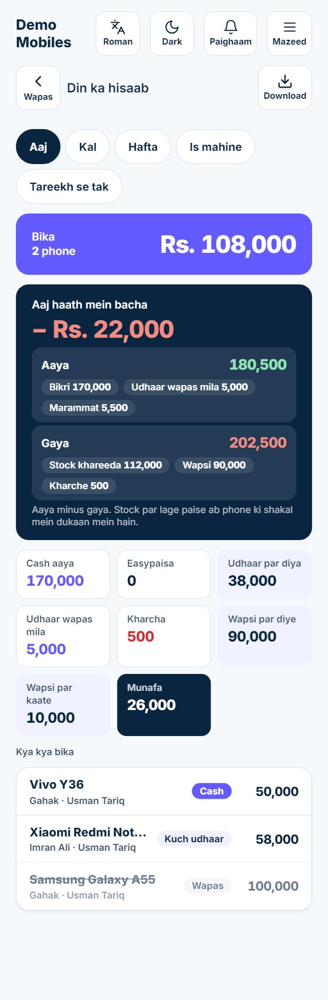

Kya nazar aata hai:
- **Bika** — kitne phone bike aur kul raqam (wapas hui bikri nahi gini jati).
- **Aaj haath mein bacha** — **Aaya** minus **Gaya**, wajah ke saath:
  - Aaya: **Bikri**, **Udhaar wapas mila**, **Marammat**, **Kuch aur**
  - Gaya: **Stock khareeda**, **Wapsi**, **Kharche**, **Logon ko diye**, **Kuch aur**
- Dabbe: **Cash aaya**, **Easypaisa**, **Udhaar par diya**, **Udhaar wapas mila**, **Kharcha**,
  **Wapsi par diye**, **Wapsi par kaate**, **Munafa** (maalik/manager).
- **Kya kya bika** — har bikri, paise kaise mile (**Cash**, **Udhaar**, **Kuch udhaar**…) aur kis ne bechi.
- **Download** — din ka hisaab PDF / Excel / CSV mein.

### "Haath mein bacha" ka matlab — misaal
"Haath mein bacha" asal paise hain: us din galle/accounts mein jo aaya minus jo gaya. Stock par lage
paise zaya nahi hue — woh ab shelf par phone ki shakal mein hain.

| Aaj kya hua | Aaya | Gaya |
|---|---:|---:|
| Dealer se phone liya, cash diya | | 750,000 |
| Ek phone becha | 800,000 | |
| Gahak ne woh phone wapas kiya, aap ne wapas diye | | 750,000 |
| **Kul** | **800,000** | **1,500,000** |

- Haath mein bacha = 800,000 − 1,500,000 = **− 700,000**.
- **Sirf bikri + wapsi** se **800,000 − 750,000 = 50,000** haath mein bache (yehi us jodi ka munafa hai).
- Baqi **− 750,000** woh stock hai jo aap ne khareeda — woh phone ab bhi dukaan mein hai.

Demo tasweer mein: aaya 180,500 (bikri 170,000 + udhaar wapas 5,000 + marammat 5,500),
gaya 202,500 (stock 112,000 + wapsi 90,000 + kharcha 500) → **− 22,000**.

---

## 10. Munafa, report aur download

Maalik aur manager: Home → **Munafa aur report** (ya **Mazeed → Report**).

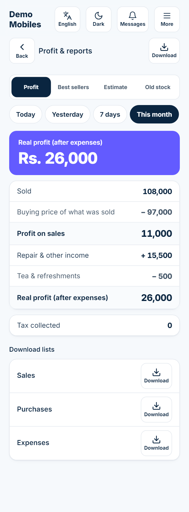

- Tabs: **Munafa**, **Sab se zyada bika**, **Andaza**, **Purana stock**.
- Waqt: **Aaj**, **Kal**, **7 din**, **Is mahine**, **Tareekh se tak**.
- **Munafa** mein bikri, **Bike maal ki khareed qeemat**, **Bikri par munafa**,
  **Marammat aur doosri aamdani** (marammat, wapsi par kaate paise), har kharcha, aur
  **Asal munafa (kharche nikal kar)**. Saath **Tax jama hua** aur **Maalik ne nikale (kharcha nahi)**.
- **Sab se zyada bika** — kaun se model sab se zyada bikte hain.
- **Andaza** — pichle 4 hafton se **Agle 7 din (andaza)**, aur **Kaun sa phone khatam hone wala hai**
  ke saath mashwara **Aur mangwayein**, **Theek** ya **Nahi bik raha**. Yeh andaza hai, pakki baat nahi.
- **Purana stock** — phone kitne din se stock mein hain.

### Download aur share (PDF, Excel, CSV)
1. **Download** ya **Share** dabayein (report ke ooper daayein, ya **List download karein** mein list ke saath).
2. Chunein:
   - **PDF** — PDF file, bhejne ya rakhne ke liye (Urdu report Nastaliq mein hi rehti hai).
   - **Excel** — Excel ya Google Sheets ke liye.
   - **CSV** — kisi bhi software ke liye saada file.
   - **Print** (sirf Download mein) — kaghaz par print.
3. Download file save karta hai (website: Downloads; Android app: Documents › MobileShop). Share phone ki
   share list kholta hai. Jo computer file share nahi kar sakta woh file download kar deta hai aur bata deta hai.

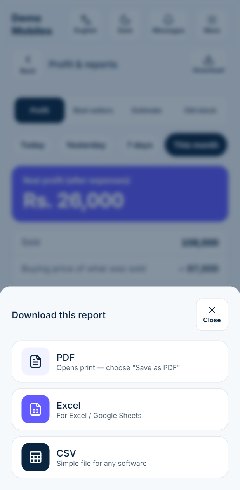

**Download** ka button Din ka hisaab, Dukaan mein stock, Udhaar khata, bande ke page, Stock list,
Kharche, Bikri ki list aur Khareedari ki list par bhi hai, har ek ke saath **Share** bhi.

---

## 11. Marammat (repair)

Marahil: **Phone liya → Theek ho raha hai → Tayyar → Wapas de diya**.

**Misaal:** **Zahid Hussain** **Samsung A54** laya, screen tooti hai. Andazan kharcha Rs. 6,000,
advance Rs. 1,000. Mazdoori aakhir mein Rs. 5,500; lete waqt woh Rs. 4,500 deta hai.

### Phone lena
1. Home → **Marammat** → **Marammat ke liye phone lein**.
2. Gahak chunein ya **Naya banda** (`Zahid Hussain`, `3005550505`).
3. **Phone ka naam (jaise Samsung A54)**: `Samsung A54`.
4. **Kya kharabi hai?** kharabi ke button dabayein aur/ya **Koi aur kharabi (likhein)**: `screen broken`.
5. **Andazan kharcha**: `6000`. **Advance liya**: `1000`.
6. **Kab tak tayyar**: **Aaj**, **Kal**, **3 din** ya tareekh.
7. **IMEI, phone ke saath chhori cheezein** (agar ho): IMEI, SIM, memory card, cover…
8. **Mehfooz karein aur parchi print karein** dabayein (parchi website par print hoti hai).

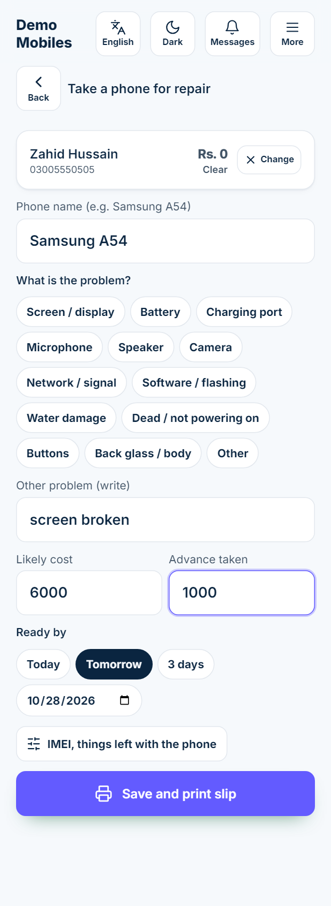

### Jab theek ho jaye
1. Kaam kholein (Home → **Marammat**). Yahan **Purzon ka intezar**, **Kaam shuru** ya **Theek nahi hua** bhi daba sakte hain.
2. **Theek ho gaya** dabayein. **Purze aur mazdoori** mein **+ Purza** se purze (ya **Stock se** apne
   accessory stock se), **Mazdoori** `5500`, **Bahar ke karigar ko diye** aur **Warranty ke din (agar ho)**.

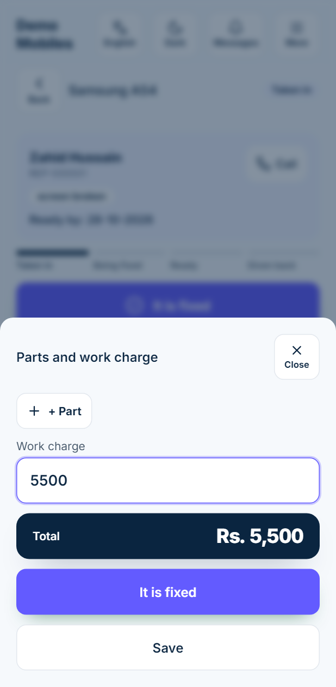

3. **Theek ho gaya** dabayein. Kaam **Tayyar** ho jata hai aur bill: kul 5,500 − advance 1,000 =
   **Baqi lene hain 4,500**. **Call** daba kar gahak ko phone karein.

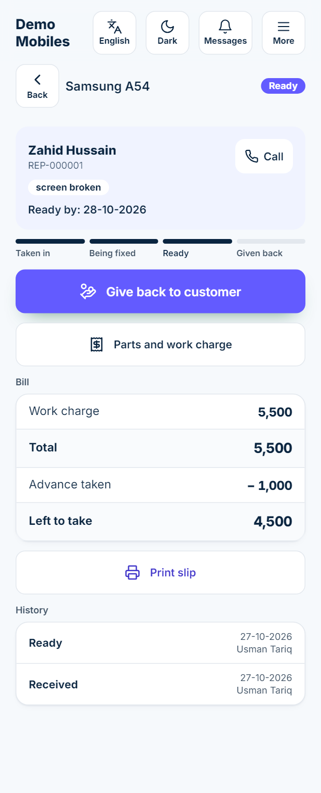

### Wapas dena
1. **Gahak ko wapas dein** dabayein.
2. **Abhi kitne mile**: `4500` (kam de to *"Baqi raqam gahak ke khate mein jayegi"*).
3. **Gahak ko wapas dein** dabayein. Kaam **Wapas de diya** ho jata hai.

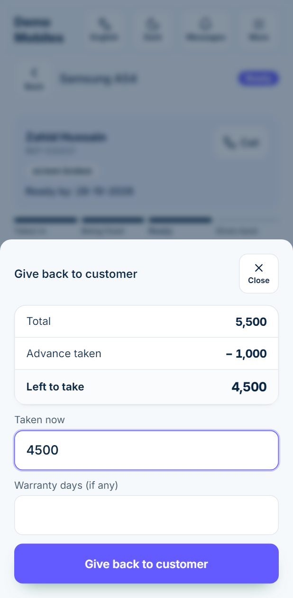

---

## 12. Accessories (charger, cover waghera)

**Mazeed → Accessories** se **Charger, Cover waghera** khulta hai, teen tabs: **Stock mein**,
**Stock kam**, **Baqi accessories**.

### Nayi cheez daalna
**Misaal:** 10 **Fast charger 25W**, fi cheez Rs. 900 ka, Rs. 1,500 mein bechna, 3 reh jayen to yaad dilaye.
1. **Nayi cheez** dabayein.
2. **Naam** `Fast charger 25W`, **Qism** **Charger**, **Bechne ki qeemat** `1500`, **Kam se kam** `3`,
   **Shuru ki tadaad** `10`, **Fi cheez qeemat** `900`.
3. **Mehfooz karein** dabayein.

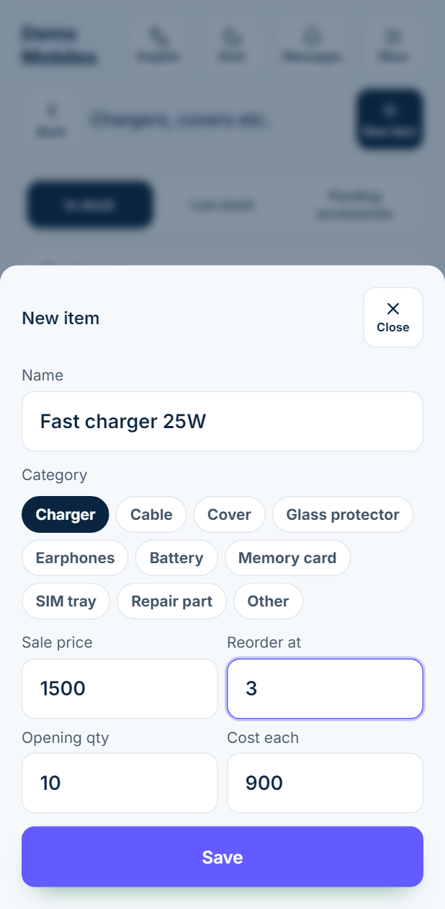

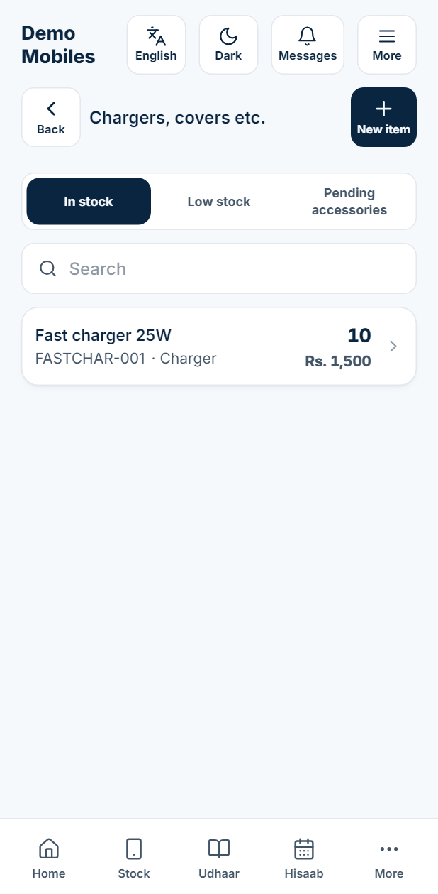

Cheez dabayein: **Stock theek karein** (maslan **Tabdeeli (+/−)** `-2` note ke saath), **Cheez badlein**
ya **Mitayein** (sirf jab stock khatam ho). **Stock kam** mein woh cheezein jo had se kam hain.

### Accessories bechna
**Bechein** mein **+ Charger, cover ya aur saamaan** dabayein, **Saamaan**, **Tadaad** aur
**Fi cheez qeemat** likhein. Yeh bill mein aa jata hai. **Charger, Cover waghera** ki ginti theek
rakhne ke liye **Stock theek karein** istemal karein.

### Baqi accessories
Jo cheezein waade par hain, abhi di/li nahi:
- **Dealer se** — maslan dealer ne Galaxy A55 ka charger abhi dena hai (tareekh ke saath).
- **Gahak ko** — maslan Vivo Y36 ke saath handsfree ka waada.

Jab de/le lein to **De diya** dabayein.

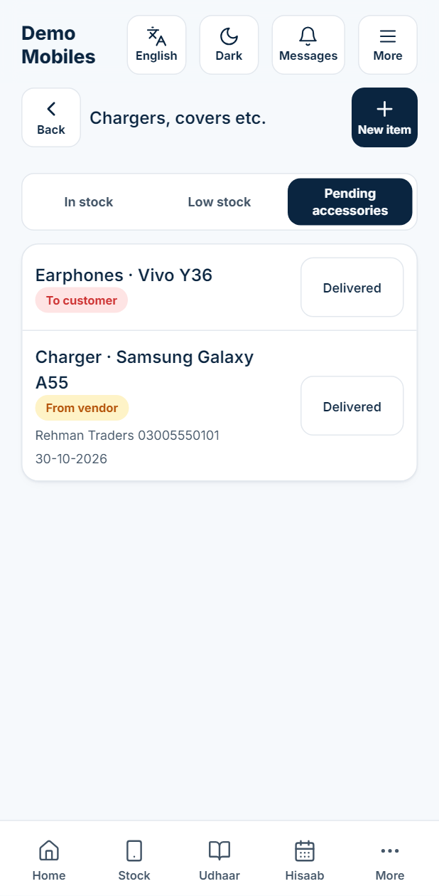

---

### Stock alert
Har cheez ka **Reorder level** hota hai (cheez add ya edit karte waqt). Jab ginti us level par ya neeche
aa jaye to Home par *Dhyan dein* mein **"N cheezein kam stock mein"** aata hai; us par dabane se yahan
**Kam stock** ka tab khulta hai. Malik ki raat ki report mein bhi "Items low on stock" hota hai.

### Phone number se search
Jahan banda shamil ho wahan phone se dhoondein: stock list aur bikri / wapsi ki screens (khareedar ya
bechne wale ka naam ya phone, IMEI / model / brand ke ilawa), marammat (job no, IMEI, naam ya phone),
udhaar khata aur log, aur Bill.

## 13. Kharche aur din band karna

Maalik aur manager. Home → **Kharcha** (ya **Mazeed → Kharche**).

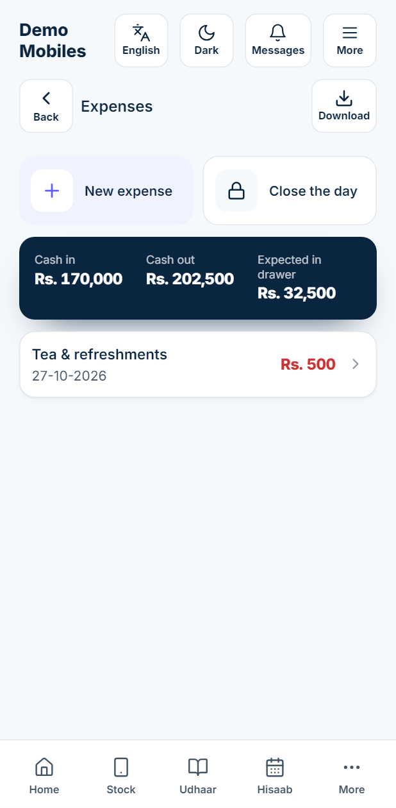

### Kharcha daalna
**Misaal:** gahakon ke liye chai, **Rs. 500**.
1. **Naya kharcha** dabayein.
2. **Qism**: **Tea & refreshments** (doosri: **Shop rent**, **Electricity**, **Salary**, **Staff advance**,
   **Repair parts**, **Transport**, **Phone & internet**, **Taxes & fees**, **Owner drawing**; **Qismein** se apni qism banayein).
3. **Raqam**: `500`. **Tafseel** (agar ho).
4. **Mehfooz karein** dabayein.

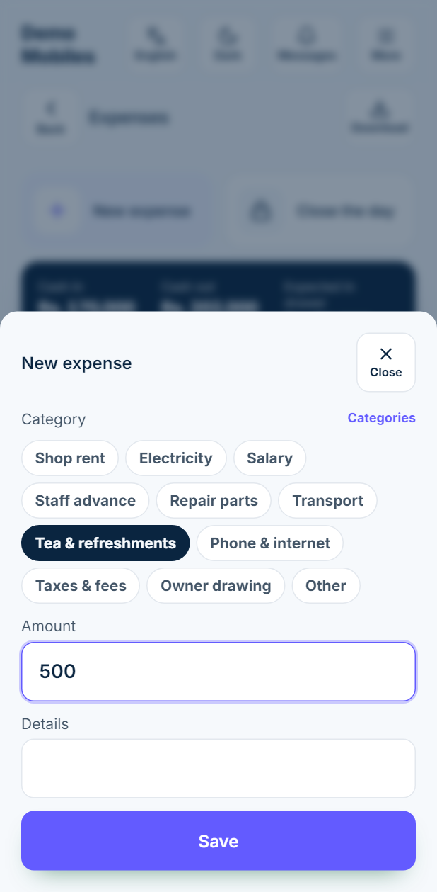

Kharche par daba kar **Badlein** ya **Yeh kharcha khatam karein** (wajah likhein). Purana record lakeer ke saath rehta hai.

### Din band karna
1. **Kharche** par **Din band karein** dabayein.
2. **Shuru ka cash**, **Aaya**, **Gaya** aur **Galle mein hona chahiye** nazar aata hai.
3. Galla gin kar **Gina hua cash** mein likhein (maslan `32000`).
4. **Farq** kami ya zyadti dikhata hai (yahan −500).
5. **Din band karein** dabayein.

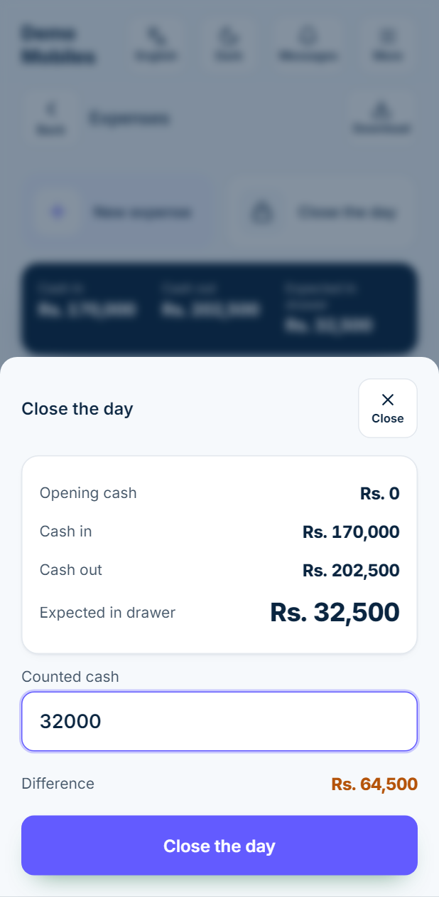

---

## 14. Exchange (purana de kar naya)

**Misaal:** **Bilal Ahmed** apna purana **Oppo A17** deta hai (aap us ki qeemat **Rs. 18,000** lagate hain) aur
**Infinix Note 40** **Rs. 54,000** mein leta hai. Abhi **Rs. 30,000** deta hai; **Rs. 6,000** khate mein.

1. **Mazeed → Purana de kar naya**.
2. **Gahak chunein**: `Bilal Ahmed` → **Aage**.
3. **Purana phone darj karein** dabayein aur **Phone daalein** ki tarah bharein: IMEI `358812091717195`,
   **Oppo**, **A17**, **Khareed qeemat** `18000` (= purane ki qeemat), **Bechne ki qeemat** `22000` →
   **Daalein** → **Aage**. Purana phone apni qeemat ke saath card mein dikhta hai; **Purana phone badlein**
   se dobara khulta hai.
4. **Stock se naya phone chunein** → **Infinix Note 40** dabayein. **Bechne ki qeemat** `54000` → **Aage**.
5. **Hisaab**: dono phone, phir **Naya phone** 54,000, **Purane ki qeemat** − 18,000, aur ek rangeen card
   jo lafzon mein batata hai **Farq gahak de ga Rs. 36,000** (ya **Farq aap wapas dein ge** jab purana
   phone mehanga ho, ya **Kisi ko kuch nahi dena**). **Abhi mile**: `30000`; farq se kam ho to baqi khate
   par. **Naya baqaya** **6,000**.
6. **Exchange mukammal karein** dabayein. **Exchange ho gaya** → **Raseed print (80mm)**, **A4**,
   download / share, **Ek aur exchange**, **Bill kholein**.

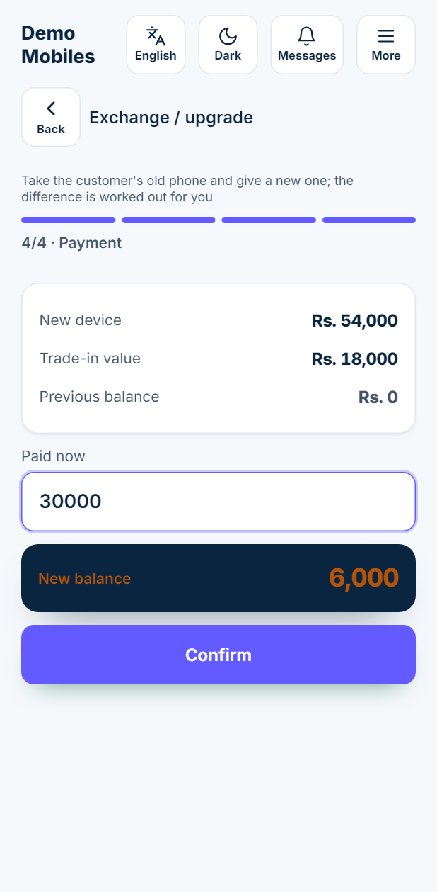

Purana phone Bilal se khareeda hua ban kar stock mein jata hai; aam gahak ke phone ki tarah us ka
**Shanakhti card check** karein. Agar purana phone naye se mehanga ho to **Gahak ko wapsi** aata hai.

---

## 15. Doosri dukaan ko amanat

Doosri dukaan ko dikhane ya bechne ke liye diya gaya phone. Bikne ya wapas aane tak **aap ka** rehta hai.

**Misaal:** **Tecno Spark 20** **Madina Mobiles** ko dena.
1. **Mazeed → Amanat**. Ooper ka card batata hai is waqt kitne phone doosri dukaanon par hain.
2. **Phone amanat par dein** → **Kaun sa phone?** list mein Tecno dabayein (ya search / scan) →
   **Kis dukaan ko?** `Madina` likhein (nai dukaan wahin **+** se ban jati hai) → **Wapsi** 3 / 7 / 15 / 30
   din ya **Tareekh nahi** → **Note** → **Amanat par dein**.
   Yehi button phone ke apne page par bhi hai (Stock → phone dabayein → **Amanat par dein**).
3. Phone stock mein **Amanat par** dikhta hai aur yahan ek card mein: phone, kitne din se bahar hai
   (ya **Der ho gayi**), dukaan apni tareekhon ke saath aur **Dukaan** button jis se us ka page khulta hai.

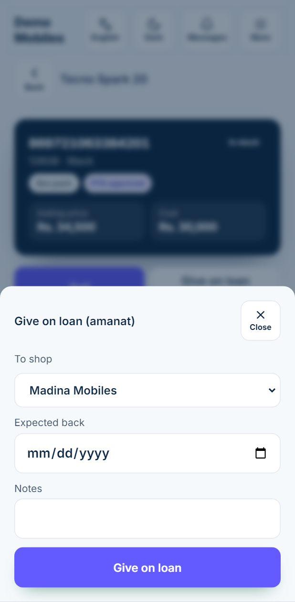

Card ke neeche, tab **Bahar**:
- **Phone wapas aa gaya** — chhoti si tasdeeq, phir phone wapas **Stock mein**.
- **Unhon ne rakh liya (bikri)** — **Tay shuda qeemat** (maslan 34,500) aur **Abhi mile** (maslan 20,000)
  likhein; card **Un ke khate par** 14,500 dikhata hai. **Pakka karein**: Sales mein bill ban jata hai aur
  baqi us dukaan ke khate par. Tab **Unhon ne rakh liya** mein **Bill kholein** rehta hai.

Der wali amanat **Der ho gayi** dikhati hai aur ooper ke card mein ginti hai.

Der wali amanat par **Der ho gayi** likha aata hai.

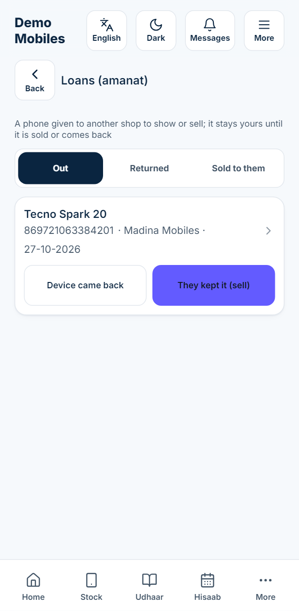

---

## 16. Stock list, IMEI check aur phone ki puri kahani

### Dukaan mein stock (kitne ka hai)
Neeche patti → **Stock**: **Mera stock kitne ka hai?** — kul phone aur qeemat, brand ke hisaab se.
Brand dabayein, model nazar aayenge. **Sab phone dekhein** se list.

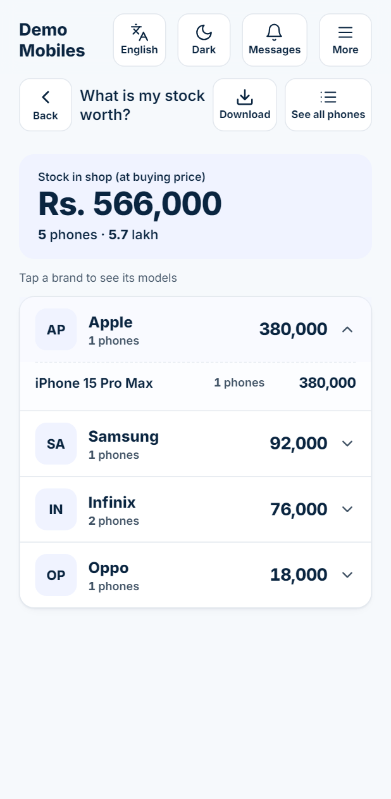

### Stock list
**Mazeed → Stock list** (ya **Sab phone dekhein**). **IMEI, model ya brand** se dhoondein (ya **Scan**),
brand dabayein, **Stock mein**, **Amanat par**, **Bik gaya**, **Kharab**, **Sab** se chhantein, aur
**Tarteeb** badlein. Ooper buttons: **Download**, **IMEI check karein**, **Stock daalein**.

### IMEI check ("yeh phone pehle aaya tha?")
1. Stock list → **IMEI check karein** (ya **Mazeed → IMEI dhoondein**).
2. 15 hindse likhein ya **Scan** karein.
3. **Naya IMEI, pehle nahi aaya**, ya **Yeh IMEI pehle aap ki dukaan mein aa chuka hai · 1 baar khareeda**
   aur phone; daba kar kholein. Aakhri hindsa ghalat ho to *"IMEI ghalat lag raha hai, dobara dekhein"*.

### Phone ka page aur puri kahani
Phone dabayein: IMEI, memory, rang, haalat, PTA, **Bechne ki qeemat**, **Khareed qeemat** (maalik/manager),
accessories aur **Puri kahani** — har waqia tareekh, bande aur raqam ke saath
(khareeda, check hua, bika, wapas, amanat, marammat…).

Buttons: **Bechein**, **Shanakhti card check**, **Amanat par dein**, **Kharab likhein**,
**Marammat ko bhejein**, **Qeemat badlein**, **Note likhein**, **Tafseel badlein**, aur bike hue phone par **Wapsi**.

## 15a. Rate ka mashwara (pichli baar kitne mein becha)

Jahan bhi qeemat likhein, ek sabz box us model ki aap ki apni kahani dikhata hai: **Aakhri baar Rs. …
mein bika, …**, kitne din mein bika, **6 mahine mein n bike: Rs. kam – zyada**, **Aam tor par Rs. …
mein khareeda** (sirf maalik/manager) aur yehi model abhi stock mein kitne aur kis qeemat par. **…
rakhein** dabayein to mashware wali qeemat lag jati hai (pichli bikri ka darmiyan, sau tak round).
Ye **Bechein** mein *Kitne mein becha* ke neeche, **Stock daalein** mein model chunte hi *Bechne ki
qeemat* ke neeche, aur phone ke **Qeemat badlein** mein aata hai. Sirf aap ki dukaan ki bikri parhta
hai, kisi aur dukaan ki nahi.

## 15b. Assistant aur tasveer parhna (AI)

Jab software provider AI on kar de to **Mazeed → Assistant** (aur Home par ek card) se aap apni dukaan
ke baare mein Urdu, English ya Roman Urdu mein pooch sakte hain: *"Aaj kitna bika?"*, *"Sab se zyada
udhaar kis par hai?"*, *"Is mahine kya sab se zyada bika?"*, *"IMEI 3568… kahan hai?"*, *"Samsung A15 ka
mera rate kya hai?"*. Jawab sirf aap ke record se aata hai (hisaab, khata, stock, zyada bikne wale, rate,
phone ki kahani) aur batata hai kya dekha; jo staff khareed qeemat nahi dekh sakta use jawab us ke
baghair milta hai. Har dukaan ki rozana sawaal aur tasveer ki had hai; screen "aaj m mein se n istemal"
dikhati hai. Key ke baghair screen kehti hai assistant off hai aur baqi kuch nahi badalta.

Tasveerein: AI on ho to **CNIC scan** (naya banda, ID check) aur phone ke dabbe ke label ki tasveer par
**Scan** server par parhe jate hain, jo kharab roshni aur tirche angle mein behtar hai; na ho sake to
phone ka apna reader pehle ki tarah chalta hai. Tasveer sirf parhne ke liye jaati hai, mehfooz nahi hoti.

## 15c. Har phone ka apna paisa, har bande ke phones

Koi bhi phone kholein (Stock → dabayein): **Is phone ka paisa** mein **Laagat · Abhi dene hain · Bika ·
Abhi lene hain · Munafa**, phir do card: **Khareeda** (kis se, khareed ka bill, tay qeemat, usi waqt ada,
baad ki har adaigi apni raseed ke saath, abhi kitne dene hain) aur **Becha** (bikri ke liye yehi). **Is
phone ki adaigi** / **Is phone ki wasooli** se jo raqam aati hai wo usi bill par lagti hai, is liye phone
ka baqi aur bande ka khata saath saath chalte hain. Neeche ki kahani pehle din se ek hi timeline hai:
khareeda, adaigiyan, becha, wasooliyan, wapsi, marammat, note — har paise wali line batati hai us ke
baad is phone par kitna baqi raha.

Koi bhi banda kholein: bara balance **Un par baqi (phones)**, **Hum ne dene (phones)** aur **Deegar /
ibtidai** mein bata hota hai (dena aur lena kabhi chupke se minus nahi hote), phir **Phones**: us se
khareeda ya use becha har phone **Tay shuda · Ada/Wasool · Abhi dene/lene** ke saath, *Bebaaq*, *Un par
baqi* ya *Hum ne dene hain*, aur baqi wali line par ada/wasool ka button. Neeche statement wahi hai;
adaigi wali lines apni raseed print karti hain.

Misaal (Vivo): A se 35,000 mein khareeda, 30,000 diye (A: hum ne 5,000 dene); B ko 40,000 mein becha,
35,000 liye (B: un par 5,000); A ko is phone ke 2,000 diye (A: 3,000); B ne is phone ke 3,000 diye (B:
2,000). Phone dikhata hai laagat 35,000 / dene 3,000 / bika 40,000 / lene 2,000 / munafa 5,000 — wahi
hindse A aur B ke page par.

Khareed ke hindse (laagat, bechne wale ko dena, munafa) sirf maalik aur manager ko dikhte hain. Jis bill
mein kai phone hon us ki har adaigi un par qeemat ke tanasub se batti hai; line par "… ka bill, aur
cheezein bhi" likha hota hai taake wajah saaf rahe.

**Adaigi ki raseed**: har di ya li gayi raqam thermal ya A5 raseed mein print hoti hai (number, banda,
raqam, kaise di, kis bill aur phone ke liye, us bill par kitna baqi, baad ka khata balance) — adaigi ki
screen, phone ke paisa card ya khate ki line se.

## 16a. Barcode wale qeemat ke sticker

Har phone aur item par sticker lag sakta hai: dukaan ka naam, model, storage · rang, **qeemat**, **IMEI
ka Code 128 barcode** (accessories ke liye SKU) neeche number ke saath, haalat, PTA aur tareekh.
Barcode app ke camera ya USB scanner se scan karein to phone search aur sale mein mil jata hai.

Kahan se print:
- **Phone ka page → Sticker print** (ek phone).
- **Stock → Stickers**: phones par tick karein (ya **Sab chunein**), phir **Stickers (n)**.
- **Stock daalne** ke foran baad: **In phones ke sticker print karein**.
- **Items** (accessories) → item dabayein → **Sticker print** (chargers ke dabbe ke liye copies).

Sheet ek baar poochti hai: **Sticker ka size** (38×25, 50×25, 50×30, 60×40, 70×40 mm roll label
printer ke liye, **A4 sheet** 65 stickers, ya **Apna size mm**), **Is par kya ho** (koi bhi line band
karein), **Har aik ki copies**, phir **Print** (page sticker ke size ka hota hai, is liye label printer ek
sticker fi page nikalta hai), ya **PDF download / share**. **Ye intikhab yaad rakhein** dukaan ke liye
mehfooz kar deta hai.

**Laagat code**: maalik aur manager khareed qeemat harfon mein laga sakte hain. **Dukaan ki settings →
Sticker ka laagat code** mein 10 mukhtalif harfon ka lafz (maslan `BLACKHORSE`): hindsa 0 = pehla harf,
1 = doosra …, to 45,000 `KHBBB` chhapta hai. Salesman ko code kabhi nahi milta, tick kare to bhi.

---

## 16b. Mobile Shop apne PC par (bina internet)

Jin dukaanon mein internet theek nahi, wahan yehi software Windows PC par chalta hai: **MobileShop-
Setup.exe** install karein, Desktop se **Mobile Shop** kholein; tray mein icon aata hai aur app browser mein
`127.0.0.1:8787` par khulti hai. Ek baar dukaan ka account banayein, phir aam tareeqe se kaam karein. Sab
kuch usi PC par rehta hai (AppData mein `MobileShop` folder); tray menu mein **Backup now** (tareekh wali
copy `backups` mein aur Desktop par), **Open data folder** aur **Quit**. `settings.env` mein
`MOBILESHOP_HOST=0.0.0.0` rakh kar aur firewall mein port khol kar dukaan ke Wi-Fi par phones bhi khol
sakte hain. Update: naya Setup chalayein; data wahin rehta hai. Tafseel docs/15 mein.

## 17. Staff aur un ke ohde

Sirf maalik: **Mazeed → Staff**.

### Staff daalna
**Misaal:** salesman **Kashif Mehmood**.
1. **Staff daalein** dabayein.
2. **Naam** `Kashif Mehmood`, **Mobile number** `3005550707`, **Password** (6 ya zyada harf),
   **Jaldi PIN (4-6 hindse)** `4321`.
3. **Ohda**: **Salesman**, **Karigar** ya **Manager**. **Mehfooz karein** dabayein.

Staff ke naam par daba kar **Ohda** badlein, **Naya password** (**Mehfooz karein**), ya **Band karein** / **Chalu karein**.

### Kaun kya kar sakta hai
| | Maalik | Manager | Salesman | Karigar |
|---|:-:|:-:|:-:|:-:|
| Bechna, stock daalna, paise mile/diye | ✓ | ✓ | ✓ | – |
| Khareed qeemat aur munafa dekhna | ✓ | ✓ | – | – |
| Khareed se kam bechna ("Mujhe pata hai, nuqsan par bechein") | ✓ | ✓ | – | – |
| Bill khatam karna, kharche, report | ✓ | ✓ | – | – |
| Chori ke shak wala phone bechna (wajah ke saath) | ✓ | – | – | – |
| Marammat | ✓ | ✓ | phone lena | kaam karna |
| Staff aur dukaan ki settings | ✓ | – | – | – |

### Hazri
Jab *Staff ki hazri* module on ho to Home par sab ko **Hazri** ka card dikhta hai: aate hi **Hazri
lagayein**, jaate waqt **Chhutti karein**; phir card kehta hai "Aamad 9:05 AM · Chhutti 7:10 PM · 10.1
ghante". Din mein ek baar hazri.

Maalik: **Mazeed → Staff → Hazri** tab. Arsa chunein (aaj, hafta, is mahine, se–tak). Har bande ka
card: aaj ki haalat, kaam ke ghante, aur **Hazir**, **Aadha din**, **Chhutti**, **Ghair hazir** aur
**Record nahi** (jab se aaya, jin dinon kuch darj nahi) ki ginti. Bande par dabayein to **din khud darj
karein** (din, haalat, note; maslan kal = Chhutti, "Eid") aur us ke din aamad/chhutti ke waqt ke saath
dekhein. Tankhwah aur advance **Kharche** mein hi rehte hain.

### Kis ne kya kiya (kaam)
**Mazeed → Staff → Kaam** tab: arse ke liye har staff ki **Bikri (tadaad · Rs)**, **Wasooli**,
**Khareed**, **Kharche**, **Marammat** aur kul **Kaam**, aakhri login aur aaj ki hazri ke saath.
Bande par dabayein to poori list: har bill, adaigi, khareed, kharcha, marammat, phone, banda,
mansookhi aur settings ki tabdeeli jo us ne ki, waqt, number aur raqam ke saath. Ye us record se
aata hai jo app har tabdeeli ka rakhta hai, is liye kuch chhoot nahi sakta.

---

## 18. Dukaan ki settings (dukaan, tax, raseed)

Sirf maalik: **Mazeed → Dukaan ki settings**. Har baat ka apna card, apne icon ke saath:
- **Dukaan** — **Dukaan ka naam**, **Shehar**, **Phone** (raseed par chhapta hai, paighaamon mein aata hai).
- **Print aur paighaam ki zubaan** — **Urdu** / **English**: raseedein, iqrar name aur WhatsApp paighaam
  isi zubaan mein jate hain; screen ki zubaan har koi apni chunta hai.
- **Staff ka login** — **Staff fingerprint se login kar sakta hai**.
- **Sales tax** — **Sales tax lagayein** ka switch, phir **Tax rate %**, **Qeemat mein tax shamil hai**, **NTN**, **STRN**.
- **Raseed** — **Bill number ka shuru** (misaal number dikhta hai, maslan `INV-000123`), **Raseed ke neeche**
  (maslan "7 din ke baad wapsi nahi"), **Raseed ke neeche (Urdu)**; ek preview box dikhata hai line kaise chhape gi.

Jaise hi kuch badle, neeche ke tabs ke ooper **Mehfooz karein** ki patti aati hai "Abhi mehfooz nahi hua"
ke saath; dabayein to **Mehfooz ho gaya** aata hai.

**Mazeed** mein yeh bhi hai: **Cash aur Bank** (Easypaisa, JazzCash ya bank account daalein taake
paise ke tareeqe mein aayein), **Paighaam settings** (bikri aur stock par WhatsApp/email ki ittila, agar chahein),
**Brand aur model**.

---

## 18a. Software fees

**Mazeed → Software fees** (sirf malik; app ke ooper ka renewal notice bhi yahin laata hai).
- Aap ka plan, mahana fees aur **adaigi is tareekh tak**.
- **In mein se kisi account mein bhejein**: software provider ke accounts (Easypaisa, JazzCash, SadaPay,
  bank) number ke **Copy** button ke saath.
- Apni app ya bank se paise bhejein, phir **Main ne ada kar di**: raqam (fees se bhari hui), mahine, kaun sa
  account, **transaction ID** aur **screenshot**, aur **Bhejein**.
- Provider check karta hai; manzoor hote hi aap ki tareekh aage barh jati hai aur WhatsApp par paighaam
  aata hai. Neeche **Aap ki adaigiyan** mein har ek *Check ho rahi hai*, *Wasool ho gayi* ya *Qabool nahi
  hui* (wajah ke saath).

## 19. Zubaan, Dark/Light aur andaaz

- **Zubaan**: ooper zubaan ka button dabayein (Roman mein **Roman** likha hota hai), phir **اردو**,
  **Roman Urdu** ya **English**. App ek waqt mein ek hi zubaan dikhati hai; Urdu daayein se baayein.
  Hindse hamesha 0–9. **Mazeed → Zubaan** mein bhi hai.

- **Dark / Light**: ooper **Dark** (ya **Light**) dabayein. **Mazeed → Theme** mein **Phone ke mutabiq** bhi hai.
- **Andaaz**: **Mazeed → Andaaz** — **Modern**, **Professional**, **Navy**, **Rangeen**.

---

## 20. Super admin: gahak ke liye dukaan kholna

Sirf product ke maalik (OOP Solutions) ke liye. **Mazeed → Super admin** (doosron ko nazar nahi aata).

**Misaal:** **Hamza Mobile Centre**, Multan, maalik **Hamza Iqbal**.
1. **Nayi dukaan kholein** dabayein.
2. **Dukaan ka naam** `Hamza Mobile Centre`, **Shehar** `Multan`, **Maalik ka naam** `Hamza Iqbal`,
   **Maalik ka mobile (login)** (+92 ke baad 10 hindse), **Maalik ka password** (6 ya zyada harf),
   **Dukaan ki zubaan** **Urdu** ya **English**.
3. **Nayi dukaan kholein** dabayein.

4. **Dukaan khul gayi** par **Mobile number** aur **Password** nazar aata hai. **WhatsApp par bhejein**
   daba kar maalik ke WhatsApp par bhej dein. **Ek aur dukaan kholein** se dobara.

**Customers ki dukaanein** mein har dukaan apne maalik, plan aur fees ke saath; search se dhoondein.

### Website se dukaan ki requests
Public page **/welcome** (jo bina login site ke root par dikhta hai) software ko module-wise screenshots,
sample video, qeemat aur adaigi ke accounts ke saath samjhata hai, aur **Meri dukaan kholein** ka form
rakhta hai. Har request Super admin ke ooper **Website se dukaan ki requests** mein WhatsApp button ke
saath aati hai; wahan **Nayi dukaan kholein** malik ka naam, number, shehar aur plan pehle se bhar deta hai
(password khud banta hai) — dukaan khulte hi request band.

### Software fees: accounts aur wasool shuda adaigiyan
- **Adaigi ke accounts** (*Software fees* card mein): jin accounts mein dukaanein fees bhejti hain — naam
  (maslan Easypaisa), account holder, number ya IBAN, note. Sirf database mein rehte hain aur har dukaan ki
  *Software fees* screen par dikhte hain.
- Dukaanon ki bheji hui adaigiyan isi card mein: dukaan, raqam, tareeqa, hawala, mahine aur **screenshot**.
  **Wasool · +N mahine** us dukaan ki tareekh utne mahine barhata hai aur malik ko WhatsApp par tasdeeq
  bhejta hai; **Mustarad** wajah poochta hai jo malik dekhta hai.
- Card ke ooper is mahine ki wasooli aur kitni adaigiyan check honi hain.

### Modules: har dukaan kya istemal kar sakti hai
Dukaan kholte waqt (aur baad mein us ki sheet mein **Is dukaan ke modules**) aap tay karte hain dukaan
ko kya milega. Basic hamesha on: stock, bikri, khareedari, wapsi, udhaar khata, adaigi, bill, ID check,
hisaab, settings, staff. Baqi on/off: accessories aur watches, marammat, kharche aur din band, sale hold,
bill par tax, exchange, munafa aur reports, download aur share, WhatsApp paighaam aur yaad dahani, amanat.

**Plan ke mutabiq** plan ke defaults leta hai (trial aur chain: sab; basic: accessories, kharche, hold,
tax; pro: amanat ke ilawa sab). Tick hata kar haath se chunein. Band module dukaan ke Home, More aur
buttons se ghaib ho jata hai; us ka address *"Ye sahulat aap ke plan mein shamil nahi"* dikhata hai,
aap ke WhatsApp ke button ke saath.

### Password ki requests, malik ka password, dukaan kholna
- Page ke ooper **Password ki requests** mein har woh malik jis ne *Password bhool gaye?* dabaya (naam,
  dukaan, number, waqt). **Password rakhein** us dukaan ki sheet kholta hai; tick request ko "ho gaya"
  karta hai.
- Dukaan ki sheet mein **Malik ka password (bhool jane par)**: naya likh kar **Save**; phir **WhatsApp
  par bhejein** login aur naya password malik ko bhejta hai. Request khud band ho jati hai.
- **Ye dukaan kholein** aap ko us dukaan ke andar poore haqooq ke saath le jata hai (us ka data,
  screens, settings), dukaan ke audit log mein darj hota hai; wapas **Mazeed → Meri dukaanein** se.

### Plan, mahana fees aur "adaigi is tareekh tak"
List mein dukaan dabayein. **Plan** chunein (trial / basic / pro / chain), **Mahana fees (Rs)** aur
**Adaigi is tareekh tak** likhein, ya jab maalik fees de to **+1 / +3 / +12 mahine** dabayein (maujooda
tareekh mein jurta hai, is liye pehle dene se baqi din zaya nahi hote). **Unlimited** tareekh hata deta hai.

Dukaan ka maalik kya dekhta hai: tareekh se **7 din** pehle ooper peela notice ("Aap ki subscription 3
din mein khatam ho rahi hai") aap ke WhatsApp ke button ke saath; tareekh ke baad **15 din ki mohlat**;
mohlat ke baad app sirf data dikhati hai aur jab tak aap barhayein save nahi karti. Pehle se khuli
dukaanein **Unlimited** hain jab tak aap tareekh na rakhein. List ke ooper **Fees baqi** aur **Band** ke
filter batate hain kis ko call karni hai.

### Branches: ek maalik, kai dukaanein
Isi sheet mein **Branch shamil karein**, branch ka naam aur shehar. Maalik pehle ki tarah login karta hai
aur **Mazeed → Meri dukaanein** mein dukaan badalta hai; har dukaan ka apna stock, khata, bill aur number
hote hain, aur plan sab branches ko mila kar hota hai.

---

## 20a. Invoices / Bill: koi bhi bill dhoondein

**Home → Bill** (ya **Mazeed → Invoices / Bill**) par dukaan ka har bill ek list mein hai: sale, khareed (sirf malik aur manager ko), wapsi aur repair. Naya bill sab se upar.

1. Muddat chunein (**Aaj**, **Hafta**, **Is mahine**, **From – to**) ya search box mein likhein. Search **saari tareekhon** mein dhoondta hai.
2. **Bill number** (maslan `INV-000012`), **gahak ka naam ya phone**, ya mobile ke **IMEI** ka hissa likhein. IMEI ka barcode parhne ke liye **Scan** dabayein.
3. Mazeed chhantein: **Sale / Khareed / Wapsi / Repair**, aur **Udhaar baqi / Ada ho gaya / Repair mein / Wapis / Cancel**.
4. Upar ke do dabbe batate hain ke list ke billon par gahakon se **abhi kitne lene hain** aur dealers ko **abhi kitne dene hain**.
5. Bill par tap karein to woh khul jata hai; raseed wahan se print karein. Wapsi ka bill us sale ya khareed par le jata hai jis ki wapsi hai.

**Misaal:** ek gahak mahine baad Galaxy A54 le kar aata hai aur kehta hai "yahin se liya tha". IMEI ke aakhri 6 hindse likhein: sale ka bill (aur us phone ki koi repair) tareekh, qeemat aur baqi udhaar ke saath saamne aa jata hai.

## 20b. Internet ke baghair kaam

Market ka internet chala gaya? Bechte rahein.

- Jo aap ne internet ke saath khola tha (stock, khata, bikri ki list, bande ka page) ek din tak phone
  mein rehta hai aur internet ke baghair khulta hai.
- Internet ke baghair ki gayi **bikri, stock daalna, adaigi ya kharcha phone mein save** ho jata hai.
  Header ke neeche patti kehti hai *"Is phone mein save ho gaya. Internet aate hi bhej diya jaye ga."*
  aur phir *"1 bhejne ke intezar mein"*. Us par dabayein to list.
- Internet aate hi woh khud, tarteeb se, har ek **sirf ek baar** jaate hain (chahe beech mein internet
  phir toot jaye). Bill number server par pahunch kar milta hai.
- Agar server kisi ko mana kar de (maslan wohi phone is dauran doosre phone se bik gaya) to woh list
  mein laal rang mein wajah ke saath rehta hai: theek kar ke **Dobara koshish**, ya mita dein.
- Internet ke baghair nahi ho sakta: jis mein server ka jawab chahiye (ID card check, reports,
  download, WhatsApp bhejna).

## 21. Aam masle

**Scan se IMEI nahi parha ja raha.**
- **Dabbe ke label par IMEI wale barcode** ki taraf karein (dukaan ka barcode nahi), ya mobile par
  **`*#06#`** mila kar screen scan karein. Roshni mein, haath rok kar.
- Camera na khule (*"Camera nahi khula. Tasweer le kar parhein."*) to **Tasweer le kar parhein** daba kar
  barcode ki saaf tasweer lein.
- Label par IMEI 1 aur IMEI 2 dono hon to app poochti hai **Kaunsa IMEI?** — sahi wala dabayein.
- 15 hindse haath se likhna hamesha chalta hai.

**Android app mein print ya download Chrome kholta hai.** Yahi tareeqa hai: Chrome print ki
screen dikhata hai ya file save karta hai. Agar Chrome kahe ke link expire ho gaya, wapas aa kar
Print / Download dobara dabayein (link 2 minute chalta hai).

**Password ya PIN bhool gaye.** PIN: **PIN bhool gaye? Password lagayein**. Password: dukaan ke maalik se
kahein (**Mazeed → Staff** → aap ka naam → **Naya password**). Maalik OOP Solutions se raabta kare.

**"Bechne ki qeemat khareed qeemat se kam nahi ho sakti".** **Bechne ki qeemat** **Khareed qeemat** se kam hai.
Bechne ki qeemat barhayein (ya likhi hui khareed qeemat dekh lein).

**Bikri par "Yeh qeemat khareed qeemat … se kam hai. Is mein nuqsan hai."** **Kitne mein becha** barhayein,
ya maalik/manager se **Mujhe pata hai, nuqsan par bechein** karwayein.

**Bikri mukammal karein nahi chal raha.** Dekhein: qeemat likhi hai; **Udhaar** mein gahak chuna hai;
baqi shanakhti card check ho gaya ya chhor diya (**Chhor kar bechein (main jaanta hoon)**); khareed se kam
qeemat par maalik/manager ki ijazat chahiye.

**"3 se shuru hone wala 10 hindson ka mobile number likhein".** +92 ke baad shuru ka 0 chhor kar likhein:
`3001234567`. **"Shanakhti card mein poore 13 hindse hone chahiyein"** / **"IMEI mein poore 15 hindse hone chahiyein"**: hindse gin lein.

**IMEI keh raha hai phone pehle se stock mein hai.** Ek phone do dafa nahi daala ja sakta. Stock list dekhein —
shayad pehle daala ja chuka hai.

**Tasweer lete waqt page dobara load ho gaya.** Jo likha tha woh mehfooz rehta hai; wahin se aage chalein.

---

## 22. Alfaaz ke maani

| Lafz | Matlab |
|---|---|
| **Udhaar** | Maal abhi diya, paise baad mein (ya woh paise jo aap ne abhi dene hain). |
| **Khata** | Kisi bande ka hisaab ka record: jo becha, khareeda, diya, liya, baqaye ke saath. |
| **Hisaab** | Ek din ya muddat ka khulasa. |
| **Amanat** | Doosri dukaan ko bharose par diya phone; ab bhi aap ka. |
| **IMEI** | Phone ka 15 hindson ka number (`*#06#` milayein). Do SIM wale phone mein IMEI 1 aur IMEI 2. |
| **CNIC** | Pakistani shanakhti card number, 13 hindse (`12345-1234567-1`). |
| **PTA** | Pakistan Telecommunication Authority. **PTA approved** phone Pakistani SIM ke saath chalta hai. |
| **Non-PTA** | PTA mein register nahi; local SIM sirf kuch muddat (**SIM time**) chalti hai. |
| **JV** | PTA se bachne ke liye lock/patch kiya hua phone; is ka bhi SIM time hota hai aur khatra zyada. SIM time likhein. |
| **eGadget** | Punjab Police ka portal jahan IMEI check hota hai ke phone chori ka report to nahi. |
| **Box pack / Open box / Used / Patch wala** | Phone ki haalat. |
| **Bechne ki qeemat / Khareed qeemat** | Jitne mein bechna hai / jitne mein liya. |
| **Haath mein bacha** | Muddat mein jo paise aaye minus jo gaye. |
