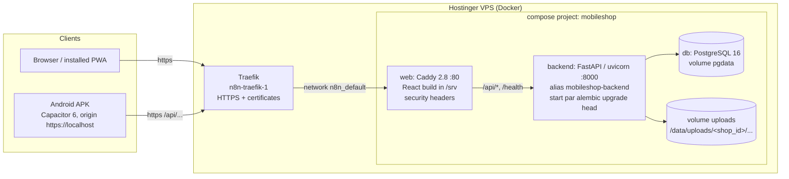

# Mobile Shop SaaS: Technical Reference (Roman Urdu)

Yeh guide un developers ke liye hai jo is system ko chalayenge ya aage barhayenge. Is mein code waisa hi likha hai jaisa `develop` branch par hai (October 2026; live: https://mobileshop.oopsolutions.com). Purani planning docs (`docs/03`, `docs/04`) aur code mein jahan farq hai, wahan **code sahi hai**. Yeh farq section 15 mein list hain.

Saath ki documents:
- Business rules: `docs/02-FUNCTIONAL-REQUIREMENTS.md` (FR ids jaise `FR-DEV-04`)
- Faisle: `docs/10-DECISIONS.md` (ADR-001 … ADR-013)
- Design system: `docs/11-DESIGN-SYSTEM.md`
- Deployment ke steps: `docs/12-DEPLOYMENT.md`; Android app: `docs/13-MOBILE-APP.md`
- Progress aur known issues: `docs/06-PROGRESS.md`; history: `docs/09-SESSION-LOG.md`

---

## 1. System ka overview

Yeh Pakistan ki mobile shops ke liye multi-tenant SaaS hai. Is mein yeh sab hai:
- naye aur purane phones (har IMEI ki ek row, jo hamesha rehti hai)
- purana phone khareedte waqt bechne wale ka ID check
- cash ya udhaar par sale
- doosri dukaan ko phone amanat par dena
- exchange, repair, accessories, kharche
- din ke cash ki ginti, reports aur exports

UI ek waqt mein ek hi zubaan dikhata hai: Urdu (Nastaliq, RTL), Roman Urdu ya English.

Code do baaton par khara hai:

1. **Paise ya device ko chhoone wali koi cheez kabhi edit nahi hoti.** Paisa sirf balanced, append-only ledger groups se chalta hai. Device ka status sirf append-only `device_events` se badalta hai. Balance aur status in logs ki *projection* hain. Galti ho jaye to reversal post hota hai, row edit nahi hoti (ADR-002). Isi wajah se dukaandaar kisi bhi jhagre mein poori history dikha sakta hai.
2. **Har tenant row mein `shop_id` hai aur har query usi par filter hoti hai.** Active shop logged-in user aur `X-Shop-Id` header se aati hai, aur har request par user ki assignments se check hoti hai.

### Architecture



Yahi cheez simple text mein:

```
Browser / PWA / Android APK
        │  HTTPS
        ▼
Traefik (VPS par shared; TLS yahan khatam)  ── Docker network n8n_default
        │  HTTP :80
        ▼
web  = Caddy: SPA serve karta hai (try_files → index.html), headers lagata hai,
       /api/* aur /health aage bhejta hai ──► backend = FastAPI :8000 ──► db = PostgreSQL 16
                                                         │
                                                         └──► uploads volume (photos, PDFs)
```

Traefik ke network par sirf `web` hai. `db` aur `backend` private `internal` network par hain. Stack koi port publish nahi karta.

### Ek request ka safar (udhaar sale)

1. React app `POST /api/v1/sales` bhejti hai, saath `Authorization: Bearer <access JWT>` aur `X-Shop-Id: <uuid>`.
2. Traefik TLS khatam karta hai aur Caddy ko deta hai. Caddy `/api/*` ko `mobileshop-backend:8000` par bhejta hai.
3. FastAPI `CurrentContext` banata hai (`core/tenancy.py`):
   - JWT decode hota hai aur user load hota hai;
   - check hota hai ke `X-Shop-Id` wali shop user ki active shops mein hai;
   - `require_cap(Cap.TRANSACT)` role check karta hai.
4. `sales.service.create_sale` kaam karta hai:
   - checks: stock status, ID check, price ≥ cost, paid ≤ total, aur udhaar ke liye customer zaroori;
   - invoice number deta hai aur ek `Posting` banata hai;
   - `ledger.service.post()` call karta hai;
   - har device par `devices.service.apply_event()` ke zariye `SOLD` event likhta hai;
   - optional notifications queue karta hai aur audit row likhta hai;
   - aakhir mein **sirf ek dafa** commit karta hai.
5. Kahin bhi error aaye to jawab `{"error": {code, message_en, message_ur, details}}` hota hai, sahi HTTP status ke saath.

---

## 2. Tech stack

Versions ke do column hain. "Declared" `backend/pyproject.toml` ya `frontend/package.json` ki range hai. "Installed" woh version hai jo dev machine par lockfile/venv ne install kiya (2026-10-27 ko check kiya).

### Backend

| Component | Declared | Installed | Kaam |
|---|---|---|---|
| Python | `>=3.12,<3.13` | 3.12 | runtime (`python:3.12-slim` image) |
| FastAPI | `>=0.115,<1` | 0.159.1 | HTTP API, `/docs` par OpenAPI (prod mein band) |
| uvicorn[standard] | `>=0.30` | 0.54.0 | ASGI server, `--workers ${WEB_WORKERS:-2}` |
| SQLAlchemy | `>=2.0.30,<3` | 2.1.6 | typed ORM, `Mapped[...]` models |
| Alembic | `>=1.13` | 1.20.1 | migrations (`backend/alembic/versions`) |
| Pydantic / pydantic-settings | `>=2.8,<3` / `>=2.4` | 2.14.1 | schemas, env/`.env` se settings |
| PyJWT | `>=2.9` | 2.15.1 | HS256 access/refresh tokens |
| bcrypt | `>=4.1,<5` | 4.3.0 | password aur PIN hash (12 rounds) |
| openpyxl | `>=3.1,<4` | 3.1.5 | `.xlsx` exports |
| python-multipart | `>=0.0.9` | — | file uploads |
| psycopg[binary] | `>=3.2` (extra `postgres`) | — | production mein PostgreSQL driver |
| pytest, httpx, hypothesis, ruff | dev extra | pytest 9.1.1 | tests aur lint (`ruff`, line length 100) |
| PostgreSQL | `postgres:16-alpine` | 16 | production DB |
| SQLite | built in | — | local dev aur test suite |

### Frontend

| Component | Declared | Installed | Kaam |
|---|---|---|---|
| React / react-dom | `^18.3.1` | 18.3.1 | UI |
| TypeScript | `^5.6.3` | 5.9.3 | types (`npm run typecheck`) |
| Vite | `^5.4.10` | 5.4.21 | dev server (5173), build |
| Tailwind CSS | `^3.4.14` | 3.4.19 | CSS-variable tokens par utility CSS |
| @tanstack/react-query | `^5.59.0` | 5.104.5 | server state; cache har shop ka alag |
| react-router-dom | `^6.27.0` | 6.30.6 | routing (`createBrowserRouter`) |
| i18next / react-i18next | `^23.16.0` / `^15.1.0` | 23.16.8 / 15.7.4 | `en`, `ur`, `roman` locales |
| zustand | `^5.0.0` | 5.0.16 | auth aur theme stores (persisted) |
| lucide-react | `^0.453.0` | 0.453.0 | stroke icons (emoji nahi) |
| @zxing/browser / @zxing/library | `^0.1.5` / `^0.21.3` | — | IMEI barcode reading (lazy load) |
| vite-plugin-pwa | `^0.20.5` | 0.20.5 | manifest + app-shell service worker |
| @capacitor/core, android, camera, share | `^6.x` | 6.2.0 | Android shell (`pk.mobileshop.app`) |
| vitest + Testing Library + jsdom | `^2.1.3` | 2.1.9 | unit tests |
| @playwright/test | `^1.48.2` | 1.48.2 | phone size par E2E |
| @vitejs/plugin-basic-ssl | `^1.2.0` | — | `npm run dev:phone` (LAN par https) |

### Infrastructure

- Docker Compose (`deploy/docker-compose.yml`)
- Caddy 2.8 (`deploy/web.Dockerfile`; build stage `node:22-alpine`)
- Traefik (shared hai, is repo ka hissa nahi)
- GitHub Actions (`ci.yml`, `deploy.yml`, `android.yml`)
- images `ghcr.io` par

---

## 3. Multi-tenancy, roles aur capabilities

### 3.1 Organisation → shop → user

| Table | Ahem columns | Note |
|---|---|---|
| `organisations` | `name`, `plan` (default `trial`), `plan_expires_at`, `is_active` | Plan save hota hai lekin abhi enforce nahi hota (FR-AUTH-07 shuru nahi hua). |
| `shops` | `organisation_id`, `name`, `name_ur`, tax fields (`tax_enabled`, `tax_rate`, `tax_inclusive`, `ntn`, `strn`), `invoice_prefix`, counters (`next_invoice_no`, `next_purchase_no`, `next_repair_no`, `next_payment_no`, `next_return_no`, `next_expense_no`, `next_exchange_no`), `notification_settings` (JSON), `timezone` (`Asia/Karachi`), `default_locale` (`ur`) | Shop ki settings isi row par hain. |
| `users` | `organisation_id`, `name`, `phone` (**poore system mein unique**), `password_hash`, `pin_hash`, `role`, `locale`, `is_active` | Login sirf phone se hota hai. Phone poore system mein unique hai, is liye organisation chunne ki zaroorat nahi. |
| `user_shops` | `user_id`, `shop_id` (composite PK) | User kin shops mein kaam kar sakta hai. |

### 3.2 Tenant tables par `shop_id`

`app/db/base.py` mein `ShopScoped` mixin hai: `shops.id` ki taraf non-null `shop_id` FK (ON DELETE RESTRICT), index ke saath. Har bari business table isay use karti hai:

`parties`, `devices`, `device_events`, `invoices`, `purchases`, `payments`, `loans`, `returns`, `exchanges`, `repair_jobs`, `accessories`, `accessory_movements`, `expenses`, `day_closes`, `cash_accounts`, `ledger_groups`, `ledger_entries`, `verifications`, `messages`, `audit_log`.

Kuch exceptions hain, aur sab jaan boojh kar hain:
- **Child line tables** (`invoice_lines`, `purchase_lines`, `repair_parts`, `repair_status_log`, `device_accessory_items`) mein `shop_id` nahi. Yeh hamesha apne parent ke zariye milti hain, aur parent shop-scoped hai.
- **Catalogue aur expense categories** (`brands`, `models`, `storages`, `colours`, `expense_categories`) mein `shop_id` *nullable* hai.
  - `NULL` ka matlab global row: seed hoti hai aur har shop ko nazar aati hai.
  - Value ho to shop ne khud add ki hai, aur sirf wohi shop dekhti hai.
  - "Global + apni shop" ke andar naam unique hona service check karti hai, kyunke unique index NULL ko cover nahi karta.

### 3.3 Request ko shop kaise milti hai (`core/tenancy.py`)

```python
def get_current_context(current, db, x_shop_id: str | None = Header(alias="X-Shop-Id")):
    assigned = <is user ki active shops, user_shops ke zariye>
    if not assigned:            -> 403 no_shop
    if x_shop_id is None:
        if len(assigned) == 1:  -> wohi shop
        else                    -> 403 shop_required
    if x_shop_id UUID nahi      -> 403 shop_invalid
    if x_shop_id assigned mein  -> CurrentContext(user, shop)
    else                        -> 403 shop_forbidden   # shop ho ya na ho, jawab ek jaisa
```

Aakhri line jaan boojh kar aisi hai, taake koi doosri shops ki IDs na dhoond sake.

**Queries scope kaise hoti hain:** koi automatic ORM filter nahi hai aur PostgreSQL row-level security bhi nahi. Har service function `shop_id` leta hai aur khud filter lagata hai. ID se dhoondne ka pattern yeh hai:

```python
inv = db.get(Invoice, invoice_id)
if inv is None or inv.shop_id != shop_id:
    raise NotFound(code="invoice_not_found")
```

Iske upar do aur check hain:
- Ledger: `ledger.service._check_account_belongs()` aisi posting line rad kar deta hai jis ki party ya cash account doosri shop ki ho.
- Files: upload ka path `<shop_id>/...` se shuru hona zaroori hai.

`backend/tests/test_tenancy.py` (8 tests) do shops banata hai aur check karta hai ke ek shop doosri ka data na dekh sake na chhoo sake.

> Nayi query likhein to `shop_id` ka filter lazmi lagayen. Isay bhoolne se sirf code review bachata hai.

### 3.4 Roles aur capabilities (`core/permissions.py`)

Roles: `owner`, `manager`, `salesman`, `technician`. Endpoints role ka naam check nahi karte, **capability** check karte hain: `require_cap(Cap.X)` ya `ctx.can(Cap.X)`.

| Capability | owner | manager | salesman | technician | Kahan use hoti hai |
|---|:-:|:-:|:-:|:-:|---|
| `TRANSACT` | ✓ | ✓ | ✓ | – | sale, purchase, payments, loans, returns, exchange, ID check, device writes |
| `VIEW_COST` | ✓ | ✓ | – | – | responses mein cost/profit; cost se kam sale (`below_cost_ok`); doosre staff ki purchase details |
| `VOID` | ✓ | ✓ | – | – | sale/purchase/payment/expense void, ledger reverse, history wali cheez delete |
| `EXPENSES` | ✓ | ✓ | – | – | kharche aur day close |
| `REPAIR_CREATE` | ✓ | ✓ | ✓ | – | repair lena; party add karne ki ijazat bhi isi se |
| `REPAIR_WORK` | ✓ | ✓ | – | ✓ | repair ka status aur parts |
| `CATALOGUE_EDIT` | ✓ | ✓ | – | – | shop ke apne brands/models/storages/colours ka naam badalna ya delete |
| `REPORTS_ALL` | ✓ | ✓ | – | – | `/reports/profit-loss`, `cash-flow`, `tax`, `stock-ageing`, `top-sellers`, `forecast`, saare `/exports/*` |
| `REPORTS_OWN` | ✓ | ✓ | ✓ | ✓ | define hai magar **abhi kisi endpoint par use nahi hoti** |
| `MANAGE_STAFF` | ✓ | – | – | – | `/staff` |
| `MANAGE_SETTINGS` | ✓ | – | – | – | `PATCH /shops/current`, cash accounts, notification settings, `/audit` |
| `VERIFY_OVERRIDE` | ✓ | – | – | – | **flagged** phone ko bechne layak banana |

Owner ke paas har capability hai (`frozenset(Cap)`). `VERIFY_OVERRIDE` code mein sirf owner ke paas hai, halanke kuch comments aur docs "owner/manager" likhte hain (section 15 dekhein).

Kuch endpoints par sirf `Ctx` chahiye, yani shop ka koi bhi logged-in staff:
- `/reports/dashboard`, `/reports/day`, `/reports/stock-summary`
- catalogue reads, party reads

In ke jawab mein cost aur profit tab hi aata hai jab caller ke paas `VIEW_COST` ho. Misaal:
- `stock-summary` owner/manager ke liye stock ki qeemat cost par lagata hai, baqi sab ke liye asking price par;
- `day` mein baqi staff ke liye `profit: null` aata hai.

### 3.5 Super user aur band signup (ADR-012)

- **`PUBLIC_SIGNUP`** (default `false`). Jab false ho to `POST /api/v1/auth/signup` `403 signup_closed` deta hai. Sirf test setup aur CI stack isay on karte hain, taake tests aarzi shops bana saken.
- **`SUPERUSER_PHONES`**: comma se alag mobile numbers, `03XXXXXXXXX` mein normalise. Jis user ka phone is list mein ho woh super user hai:
  - `/me` mein `user.is_superuser = true` aata hai;
  - `GET/POST /api/v1/admin/shops` us ke liye kaam karte hain; baqi sab ko `403 superuser_only`;
  - wahan shop kholne se organisation, shop, owner login aur default cash account ban jate hain. Us owner ke tor par login nahi karna parta.
- **Khaali server par pehla login** CLI se banta hai, kyunke signup band hai:
  ```
  docker compose exec backend python -m app.cli create-owner   # optional --shop --name --phone --city
  ```
  Password `getpass` se do dafa poocha jata hai, is liye shell history mein nahi jata. Agar number `SUPERUSER_PHONES` mein na ho to command yaad-dihani print karti hai.

---

## 4. Authentication

| Endpoint | Kaam |
|---|---|
| `POST /api/v1/auth/signup` | organisation + shop + owner banana (sirf jab `PUBLIC_SIGNUP=true`) → `{tokens, me}` |
| `POST /api/v1/auth/login` | `{phone, password}` → `{tokens, me}` |
| `POST /api/v1/auth/pin-login` | `{phone, pin}` (4–6 digits) → `{tokens, me}`: counter ke shared device par jaldi staff badalna |
| `PUT /api/v1/me/pin` | apna PIN set ya khatam karna; mojooda password chahiye |
| `POST /api/v1/auth/refresh` | `{refresh_token}` → naya token pair |
| `GET /api/v1/me` | `{user, shops, active_shop_id}`; `user.has_pin`, `user.is_superuser` |

**Tokens** (`core/security.py`):
- HS256 JWT, `SECRET_KEY` se sign.
- Claims: `sub` (user id), `org`, `typ` (`access`/`refresh`), `iat`, `exp`, `jti`.
- Muddat: `ACCESS_TOKEN_MINUTES=30`, `REFRESH_TOKEN_DAYS=30`.
- `decode_token` yeh teen cheezen rad karta hai: ghalat `typ` (`token_wrong_type`), expire token (`token_expired`), kharab signature (`token_invalid`).
- Refresh stateless hai: `jti` kahin save nahi hota, is liye server se token revoke nahi ho sakta.
- User ko disable karne (`is_active=false`) se us ki agli request aur agla refresh dono band ho jate hain (`user_inactive`).

**Hashing:** passwords aur PINs dono bcrypt 12 rounds (`hash_pin` = `hash_password`). PIN chhota hota hai, is liye us ki hifazat attempt limiter par hai.

**Attempt limiter** (`core/ratelimit.py`):
- Process ki memory mein sliding window hai: har key par 10 minute mein 5 ghalat koshishen. Keys `pw:<phone>` ya `pin:<phone>` hain.
- Is ke baad `429 too_many_attempts`. Sahi login par ginti reset ho jati hai.
- Ginti memory mein hai, is liye har uvicorn worker (production mein 2) apni alag ginti rakhta hai. Section 14 dekhein.

**Phone normalisation** (`core/pk.py`):
- `normalise_phone` yeh sab qubool karta hai: `+92…`, `0092…`, `92…`, `03…`, spaces, dashes aur Urdu/Arabic-Indic digits. Save `03XXXXXXXXX` ki shakal mein hota hai.
- `normalise_cnic` `#####-#######-#` save karta hai.
- `latin_digits` `۰۱۲…` ko `012…` banata hai.

**Frontend ki taraf** (`lib/auth.ts`, `lib/api.ts`):
- zustand store localStorage key `mobileshop.auth` mein `accessToken`, `refreshToken`, `me` aur `activeShopId` rakhta hai.
- `api()` har request par `Authorization` aur `X-Shop-Id` lagata hai.
- 401 aaye (`bad_credentials` ke ilawa) to **sirf ek** refresh ki koshish karta hai, phir request dobara bhejta hai. Ek waqt mein chalne wali saari calls yehi ek refresh share karti hain.
- Refresh fail ho to logout.

---

## 5. Paisa aur ledger

### 5.1 Usool

- **Float kabhi nahi.**
  - DB columns `Money = Numeric(14, 2)` hain (`db/base.py`). `Base.type_annotation_map` har `Decimal` annotation ko isi type par map karta hai.
  - Python mein `Decimal` use hota hai, aur har raqam `ledger.service.money()` se guzarti hai (0.01 tak, `ROUND_HALF_UP`).
  - API paisa string ki shakal mein bhejta hai, jaise `"45000.00"`. Currency hamesha PKR.
  - Sirf ek jagah float banta hai: `.xlsx` export writer, jo cells ko Excel numbers mein badalta hai.
- **Append-only.** `ledger_groups` aur `ledger_entries` ki rows kabhi update ya delete nahi hoti. Sirf ek tabdeeli hoti hai: reversal post ho to asal group par `reversed_by_group_id` set hota hai.
- **Balance hisaab se nikalta hai.** `parties.balance` sirf cache hai. Jab bhi koi posting us party ko chhooti hai, `refresh_party_balance()` isay `Σ(debit − credit)` se dobara likhta hai. Har API schema mein yeh read-only hai.

### 5.2 Tables

| Table | Columns |
|---|---|
| `cash_accounts` | `kind` (`cash`, `bank`, `easypaisa`, `jazzcash`), `name`, `name_ur`, `account_no`, `opening_balance`, `opening_date`, `is_default`, `is_active`. Har shop ko ek default "Cash / نقد" galla milta hai. |
| `ledger_groups` | `document_type` (`invoice`, `purchase`, `payment`, `expense`, `sale_return`, `exchange_refund`, `repair_advance`, …, ya `reversal:<type>`), `document_id`, `memo`, `posted_by`, `at`, `reverses_group_id`, `reversed_by_group_id` |
| `ledger_entries` | `group_id`, `seq`, `account`, `party_id`, `cash_account_id`, `device_id`, `debit`, `credit`, `memo`, `at` |

### 5.3 Account keys (`ledger/accounts.py`)

| Key | Matlab |
|---|---|
| `party:<uuid>` | customer, supplier ya doosri dukaan ka khata. Debit = woh humein zyada dega. |
| `cash:<uuid>` | paisa rakhne ka account (galla, bank, Easypaisa, JazzCash). Har qism `cash:` prefix use karti hai. |
| `sales` | bikri ki aamdani (discount ke baad, tax ke baghair) |
| `cogs` / `inventory` | biki hui cheez ki laagat / stock cost par |
| `purchases` | woh purchase lines jo stock nahi (misc) |
| `tax_payable` | jama kiya hua sales tax |
| `repair_income`, `other_income` | aamdani. `other_income` mein return par shop ki kati hui raqam aur stock adjust ka plus hissa bhi aata hai. |
| `expense:<category_key>` | jaise `expense:rent`, `expense:stock_loss` |
| `equity` | opening stock aur opening balances |
| `discounts`, `suspense` | `SysAccount` mein define hain, magar aaj koi module in par post nahi karta |

Sign ka usool:
- Party balance = `party:<id>` par Σ(debit − credit).
- **Positive = party ne shop ko dena hai ("lene hain"). Negative = shop ne party ko dena hai ("dene hain").**
- Cash balance = `opening_balance` + us `cash_account_id` par Σ(debit − credit).

### 5.4 Posting service (`ledger/service.py`)

Docs mein jise "PostingService" kaha gaya hai, woh yeh functions hain:

```python
posting = Posting(document_type="invoice", document_id=invoice.id, memo="INV-000012 Ali")
posting.debit(acc.party_account(ali.id), 45000).credit(acc.SysAccount.SALES, 45000)
group = post(db, shop_id, user_id, posting)       # check, likhna, balance refresh; commit nahi
...
reverse(db, shop_id, user_id, group.id, reason)   # ulta group, dono taraf link, audit row
```

`post()` yeh kaam karta hai:
1. zero lines nikal deta hai; khaali posting rad (`422 ledger_empty`);
2. negative raqam ya aisi line jis mein debit aur credit dono hon, rad (`500 ledger_unbalanced`);
3. Σdebit == Σcredit lazmi (`500 ledger_unbalanced`). Yeh programming ki ghalti hai, user input ki nahi;
4. har party aur cash account isi shop ka ho (`404 party_not_found` / `cash_account_not_found`);
5. group aur entries ek hi timestamp ke saath likhta hai, phir jin parties ko chhua un ka cached balance refresh karta hai.

`post()` **commit nahi karta.** Document service device events, stock movements aur audit rows bhi likh leti hai, phir ek dafa commit karti hai. Is tarah ek document ya poora save hota hai ya bilkul nahi.

Exchange isi par chalta hai. Ek `try/except` ke andar yeh teen kaam hote hain, aur koi bhi error aaye to sab rollback:
- `create_purchase(..., commit=False)`
- `create_sale(..., commit=False)`
- optional refund posting

`reverse()` ke qaide:
- jo group pehle reverse ho chuka, use dobara reverse nahi karta (`409 already_reversed`);
- reversal ko reverse nahi karta (`cannot_reverse_reversal`).

Generic endpoint `POST /api/v1/ledger/groups/{group_id}/reverse` hai (`VOID`). Document voids (`/sales/{id}/void` waghera) bhi isi ko call karte hain, aur saath document ke baqi asraat bhi ulte karte hain: device events, stock, allocations.

Parhne wale helpers: `party_balance`, `cash_balance`, `account_total`, `party_statement` (`date_from` se pehle ka opening balance, har row par running balance, `reversed` flag), aur har account ki cash book.

### 5.5 Posting recipes (jaise code mein hain)

| Document | Lines |
|---|---|
| Purchase (`purchase`) | Dr `inventory` (har device apni net cost par, discount ka hissa kaat kar) · Dr `inventory` (accessory lines) ya Dr `purchases` (baqi misc) · Cr `party` total · paid ho to: Dr `party` / Cr `cash` |
| Opening stock (device) | Dr `inventory` cost / Cr `equity` |
| Sale (`invoice`) | har device: Dr `cogs` / Cr `inventory` us ki cost par · Dr `party` total (walk-in cash sale mein Dr `cash`) / Cr `sales` net / Cr `tax_payable` tax · udhaar par paid ho to: Dr `cash` / Cr `party` |
| Payment in / out (`payment`) | in: Dr `cash` / Cr `party` · out: Dr `party` / Cr `cash` |
| Sale return (`sale_return`) | har wapas line: Dr `sales` net, Dr `tax_payable` tax, Dr `inventory` / Cr `cogs` cost · Cr `party` line total · refund: Dr `party` / Cr `cash` · kati hui raqam: Dr `party` / Cr `other_income` |
| Purchase return (`purchase_return`) | Dr `party` amount / Cr `inventory` (device lines) ya Cr `purchases` (misc) net cost par · refund: Dr `cash` / Cr `party` |
| Expense (`expense`) | Dr `expense:<key>` / Cr `cash` |
| Repair advance | Dr `cash` / Cr `party` |
| Repair delivery | parts: Dr `cogs` / Cr `inventory` · Dr `party` total / Cr `repair_income` · Dr `cash` / Cr `party` paid · bahar ke technician ki cost (us ki party par ya cash se) |
| Accessory adjust | plus: Dr `inventory` / Cr `other_income` · minus: Dr `expense:stock_loss` / Cr `inventory` |
| Party opening balance | woh denge: Dr `party` / Cr `equity` · hum denge: Dr `equity` / Cr `party` |
| Loan out / wapsi | **koi ledger line nahi**; sirf device events aur `loans` row |

### 5.6 Misaal: udhaar sale, kuch paisa naqd, phir wapsi par cut

Ali ek purana Samsung khareedta hai.
- Shop ki cost: Rs. 38,000
- Qeemat: Rs. 45,000 (tax nahi)
- Ali abhi Rs. 15,000 naqd deta hai

`POST /api/v1/sales`
```json
{"party_id": "<ali>", "devices": [{"device_id": "<d1>", "price": 45000}], "paid": 15000}
```

Group `invoice` (INV-000012):

| # | Account | Debit | Credit |
|---|---|---:|---:|
| 1 | `cogs` (device d1) | 38,000.00 | |
| 2 | `inventory` (device d1) | | 38,000.00 |
| 3 | `party:<ali>` | 45,000.00 | |
| 4 | `sales` | | 45,000.00 |
| 5 | `cash:<galla>` | 15,000.00 | |
| 6 | `party:<ali>` | | 15,000.00 |
| | **Total** | **98,000.00** | **98,000.00** |

Natija:
- Ali ka balance = 45,000 − 15,000 = **+30,000** (Ali ne shop ko dena hai).
- Invoice `partially_paid` hai, `paid = 15000`.
- Device d1 par `SOLD` event; status `sold`, `current_party_id = ali`.
- Galle mein 15,000 barh gaye.

Ek hafte baad Ali phone wapas le aata hai. Shop use Rs. 13,000 wapas deti hai aur Rs. 2,000 apna cut rakhti hai.

Pehle service hisaab lagati hai ke wapas aane wali cheez ka kitna paisa Ali waqai de chuka tha:
- `outstanding_before = total − returned_total − paid = 45,000 − 0 − 15,000 = 30,000`
- `excess_paid = max(0, amount − max(0, outstanding_before)) = 45,000 − 30,000 = 15,000`

Is ke qaide:
- Wapsi + cut zyada se zyada 15,000 ho sakte hain, warna `exceeds_excess`.
- Walk-in sale ho to dono mil kar bilkul 15,000 hone chahiye (`walk_in_settle_all`).

`POST /api/v1/returns/sale`
```json
{"invoice_id": "<inv>", "line_ids": ["<line>"], "settlement": "refund",
 "refund_amount": 13000, "kept_amount": 2000, "reason": "customer did not like it"}
```

Group `sale_return` (RET-000003):

| # | Account | Debit | Credit |
|---|---|---:|---:|
| 1 | `sales` | 45,000.00 | |
| 2 | `inventory` (d1) | 38,000.00 | |
| 3 | `cogs` (d1) | | 38,000.00 |
| 4 | `party:<ali>` | | 45,000.00 |
| 5 | `party:<ali>` | 13,000.00 | |
| 6 | `cash:<galla>` | | 13,000.00 |
| 7 | `party:<ali>` | 2,000.00 | |
| 8 | `other_income` | | 2,000.00 |
| | **Total** | **98,000.00** | **98,000.00** |

Natija:
- Ali ka balance = 30,000 − 45,000 + 13,000 + 2,000 = **0**.
- Is phone ke liye sales aur COGS dono zero ho gaye. Shop ka munafa `other_income` wale 2,000 hain.
- Galle mein net +2,000.
- Device d1 par `SALE_RETURNED`; wapas `in_stock`. Invoice ka `returned_total` 45,000 ho gaya.
- Kuch edit nahi hua. Asal invoice group wahin mojood hai, aur Ali ki statement par dono groups nazar aate hain.

Doosri soorten:
- `"settlement": "credit"` (na refund, na cut): sirf lines 1–4 bante hain. Ali ka balance **−15,000** ho jata hai, yani shop ke paas us ka paisa advance hai jo agli khareed mein kaam aayega.
- `"settlement": "income"`, raqam diye baghair: poora excess paid (15,000) `other_income` mein rakh liya jata hai.
- `credit` ke saath refund ya cut bhejein to `settlement_mismatch`.

---

## 6. Device ki zindagi

### 6.1 Har phone ki ek row, hamesha ke liye

`devices` par `UNIQUE(shop_id, imei1)` hai. Pehle bika hua phone wapas khareeda jaye to wohi row dobara use hoti hai:
- `cycle_no` ek barh jata hai;
- poori history (dono malkiyat ke cycles) ek hi timeline par rehti hai.

Projection fields **sirf** `devices.service.apply_event()` likhta hai: `status`, `current_party_id`, `verification_status`, `cost_price`, `asking_price`, `cycle_no`, `event_count`, `last_event_at`.

### 6.2 `device_events` (append-only)

Columns: `device_id`, `seq` (har device mein unique, `UNIQUE(device_id, seq)`), `type`, `status_after`, `party_id`, `amount`, `ledger_group_id`, `document_type`, `document_id`, `data` (JSON), `user_id`, `at`.

`GET /api/v1/devices/{id}/history` yeh events party aur user ke naam ke saath deta hai. Device history screen yahi hai.

### 6.3 State machine (`devices/state.py`)

Statuses: `in_stock`, `on_loan`, `with_customer_for_approval`, `sold`, `in_repair`, `faulty`, `returned_to_supplier`.

| Se | Event | Tak |
|---|---|---|
| (naya) | `purchased` | `in_stock` |
| `sold` / `returned_to_supplier` | `purchased` | `in_stock` (naya cycle) |
| `in_stock` | `loaned_out` | `on_loan` |
| `on_loan` | `loan_returned` | `in_stock` |
| `on_loan` | `sold` | `sold` (amanat us dukaan ko sale ban gayi) |
| `in_stock` | `approval_out` | `with_customer_for_approval` |
| `with_customer_for_approval` | `approval_returned` / `sold` | `in_stock` / `sold` |
| `in_stock` | `sold` | `sold` |
| `sold` | `sale_returned` | `in_stock` |
| `in_stock` / `faulty` | `sent_to_repair` | `in_repair` |
| `in_repair` | `repair_returned` | `in_stock` |
| `in_stock` / `in_repair` | `marked_faulty` | `faulty` |
| `faulty` | `faulty_cleared` | `in_stock` |
| `in_stock` / `faulty` | `returned_to_supplier` | `returned_to_supplier` |
| koi bhi | `verified`, `price_changed`, `note` | wohi status (neutral) |

Koi aur jora ho to `409 invalid_transition`, saath `details: {status, event}`.

`POST /api/v1/devices/{id}/events` generic endpoint hai, jis par paisa nahi chalta. Is ki hifazati deewarein:
- `MONEY_EVENTS` (`purchased`, `sold`, `sale_returned`, `returned_to_supplier`) → `422 money_event`. Yeh kaam purchase, sale ya return document se karein, taake ledger hamesha post ho.
- `loaned_out` / `loan_returned` → `use_loans_endpoint`.
- `verified` → `use_verification_endpoint`.
- `approval_out` ke liye `party_id` zaroori (`party_required`).
- Amanat sirf `shop` kind wali party ko (`loan_party_must_be_shop`).

### 6.4 IMEI validation

- **Backend** (`devices/schemas.clean_imei`):
  - Urdu digits badalta hai, digits ke ilawa sab hata deta hai, aur **bilkul 15 digits** maangta hai; warna 422.
  - Luhn check (`core/pk.is_valid_imei`) sirf batata hai, rokta nahi: device output mein `imei_luhn_ok`, aur `GET /api/v1/devices/imei/{imei}` par `luhn_ok`. Yeh endpoint `found`, `seen_before`, `times_bought` bhi deta hai.
  - Wajah: kuch asli phones aur test devices ka IMEI Luhn pass nahi karta, is liye server unhein jaane deta hai. UI flag dikhata hai.
- **Frontend** (`components/FieldInputs.ImeiInput`): sirf digits, zyada se zyada 15.
- **Scanner** (`lib/scan.ts`): sirf woh 15 digits jo lagatar hon aur Luhn bhi pass karein. Is tarah usi box label par lage EAN, serial aur 32-digit EID barcodes nazar-andaz ho jate hain.
- Duplicates:
  - `409 imei_exists`: is IMEI ka device pehle se hai;
  - `409 imei_in_stock`: jo phone abhi stock mein hai use dobara khareedna.

### 6.5 ID check (verification) ka flow (`modules/verification`)

Walk-in se purana phone khareedte waqt shop record karti hai ke bechne wala kaun tha.

**Table:** `verifications` mein har device ki **har cycle** (`cycle_no`) ki ek row hoti hai. Columns: `seller_party_id`, `cnic_no`, `cnic_front_path`, `cnic_back_path`, `seller_photo_path`, `device_photos`, `egadget_result` (`clear` / `flagged` / `not_checked`), `egadget_ref`, `egadget_screenshot_path`, `pta_checked`, `pta_result`, `declaration_signed`, `declaration_path`, `physical_notes`, `result`, `missing`, `checked_by/at`, `override_by/reason/at`.

**Record karna:** `PUT /api/v1/devices/{id}/verification` (`TRANSACT`) upsert karta hai aur result nikalta hai:
- `egadget_result == "flagged"` → **flagged** (chori ya block ka shak);
- warna **clear** sirf tab jab yeh sab mojood hon: CNIC number, CNIC ki dono photos, seller ki photo, eGadget `clear`, declaration signed;
- warna **pending**, saath `missing` ki list.

Yeh ek `verified` event likhta hai (status nahi badalta) jo `devices.verification_status` set karta hai. Har file path is shop ki id se shuru hona chahiye, warna `file_not_found`.

**Purchase ke waqt:** supplier se box-pack phone ko `verification_status = not_required` milta hai. Baqi sab `pending` se shuru hote hain, jab tak purchase line kuch aur na kahe (add-stock screen par "skip" chuna ja sakta hai).

**Sale par:** `assert_sellable()` call hota hai:
- `flagged` → `409 device_flagged`
- `pending` → `409 not_sellable`

**Skip / override** (`POST /api/v1/devices/{id}/verification/override`, `{reason}`):
- `TRANSACT` wala koi bhi **pending** check skip kar sakta hai ("is bande ko jaanta hoon").
- **Flagged** phone ke liye `VERIFY_OVERRIDE` chahiye, jo code mein sirf owner ke paas hai.
- Override ek `verified` event likhta hai (`data.override = true`, reason aur pehla result), saath audit row.
- Sale request mein `override_reason` bhej kar yahi kaam wahin ho sakta hai.

**Declaration:** `GET /api/v1/devices/{id}/verification/declaration?lang=en|ur` bechne wale ka declaration (A5 HTML) shop ki zubaan mein deta hai, print ke liye.

### 6.6 Qeemat ke qaide

- **Asking ≥ cost.**
  - Opening stock aur purchase lines mein `asking_price < cost_price` rad hai (422, schema validator).
  - `PATCH /api/v1/devices/{id}` mein asking cost se kam ho to `422 asking_below_cost`.
  - Qeemat badalne par `price_changed` event likha jata hai.
- **Cost se kam sale** (`409 below_cost`):
  - Agar sale line ki price phone ki `cost_price` se kam ho to sale rad hoti hai.
  - Sirf tab chalti hai jab request mein `"below_cost_ok": true` ho **aur** user ke paas `VIEW_COST` ho (owner/manager).
  - Sale screen par lal warning aati hai. Owner/manager ko "I know - sell at a loss" ka button milta hai; salesman ko kaha jata hai ke qeemat barhaye.
- PTA status `non_pta` ya `jv` ho to `sim_time_months` zaroori hai (`sim_time_required`).

---

## 7. Module-wise reference

Saare paths `/api/v1` se shuru hote hain. "Cap" woh capability hai jo router maangta hai (`Ctx` = shop ka koi bhi staff). Poori list `app.openapi()` se aati hai. Dev mein `http://localhost:8000/docs` kholein.

### 7.1 auth, shops, staff, audit (`modules/auth`, `modules/audit`)
- `POST /auth/signup`, `POST /auth/login`, `POST /auth/pin-login`, `POST /auth/refresh`, `GET /me`, `PUT /me/pin`: section 4 dekhein.
- `GET /shops` (user ki shops), `POST /shops`, `GET /shops/current` (poori settings, `ShopSettingsOut`), `PATCH /shops/current` (`MANAGE_SETTINGS`).
- `GET/POST /staff`, `PATCH /staff/{staff_id}` (`MANAGE_STAFF`): role, password, PIN, active. Hifazat: `cannot_disable_self`, `cannot_demote_owner`, `phone_taken`.
- `GET /audit` (`MANAGE_SETTINGS`): `audit_log` rows (`entity`, `entity_id`, `action`, `before`, `after`, `user_id`, `at`). Har create/update/void par services `record_audit()` call karti hain.
- Errors: `bad_credentials`, `bad_pin`, `too_many_attempts` (429), `signup_closed`, `user_inactive`, `token_expired`, `token_invalid`, `token_wrong_type`, `no_shop`, `shop_required`, `shop_forbidden`.

### 7.2 admin (`modules/admin`)
- `GET /admin/shops?q=`, `POST /admin/shops`: sirf super user (`superuser_only`). Body signup jaisi hai.

### 7.3 catalogue (`modules/catalogue`, `seeds/catalogue.py`)
- `GET|POST /catalogue/brands`, `/catalogue/models` (`?brand_id=&q=&limit=`), `/catalogue/storages`, `/catalogue/colours`.
- `PATCH|DELETE /catalogue/{brands|models|storages|colours}/{row_id}` (`CATALOGUE_EDIT`).
- Global catalogue startup par seed hota hai (`main.py` ka `lifespan`; `APP_ENV=test` mein nahi). Dobara chalne se kuch double nahi hota. Is mein:
  - taqreeban 465 models, 37 colours, 16 GB se upar storages;
  - Urdu naam saath.

  Shops apni rows bhi add kar sakti hain.
- Qaide:
  - global + apni shop mein naam unique (case-insensitive): `brand_exists`, `model_exists`, `storage_exists`, `colour_exists`. UI mein pehle se mojood colour add karo to wohi chun liya jata hai;
  - global rows nahi badalti (`catalogue_builtin`);
  - use mein hon to archive hoti hain, delete nahi (`catalogue_in_use`);
  - model usi brand ka ho (`catalogue_mismatch`).

### 7.4 parties (`modules/parties`)
- `GET /parties?kind=&q=&with_balance=&include_inactive=&limit=`, `POST /parties`, `GET /parties/by-phone/{phone}`, `GET|PATCH|DELETE /parties/{party_id}`.
- Customers, suppliers, doosri dukanen aur technicians, sab ek hi table mein (`kinds` JSON list).
- Phone har shop mein unique hai: `UNIQUE(shop_id, phone)`, error `party_phone_exists`.
- CNIC aur phone normalise hote hain. Search naam, Urdu naam, phone aur CNIC sab par chalti hai.
- `balance` read-only hai (ledger se aata hai).
- Delete ka qaida (`db/refs.count_references`):
  - koi reference nahi → asal delete;
  - history hai → archive (`is_active=false`, `VOID` chahiye);
  - balance zero nahi → rad (`party_has_balance`).
- Likhne ke liye `TRANSACT` ya `REPAIR_CREATE` chahiye.

### 7.5 ledger (`modules/ledger`)
- `GET|POST /ledger/accounts`, `PATCH|DELETE /ledger/accounts/{account_id}`: cash/bank/wallet accounts. Banane aur badalne ke liye `MANAGE_SETTINGS`. Hifazat: `cash_account_default` (default galla nahi hat sakta), `cash_account_has_balance`.
- `GET /ledger/accounts/{account_id}/book`: cash book.
- `GET /ledger/parties/{party_id}/statement?date_from=&date_to=`: khata.
- `POST /ledger/parties/{party_id}/opening-balance`.
- `GET /ledger/groups/{group_id}`, `POST /ledger/groups/{group_id}/reverse` (`VOID`).

### 7.6 devices + verification (`modules/devices`, `modules/verification`)
- `GET /devices?status=&q=&brand_id=&condition=&pta_status=&limit=`: `q` IMEI, model, brand aur serial par chalta hai.
- `GET /devices/imei/{imei}`: "kya yeh phone pehle yahan aaya hai?"
- `POST /devices/opening-stock`: dukaan mein pehle se para purana stock (Dr `inventory` / Cr `equity`, opening source ke saath `purchased` event).
- `POST /devices/{id}/cancel-opening` (`VOID`): ghalti se dala purana-stock phone hatana. Sirf tab jab us ke saath aur kuch na hua ho.
- `GET|PATCH /devices/{id}`: details aur asking price; cost dekhne ke liye `VIEW_COST`.
- `GET /devices/{id}/history`, `POST /devices/{id}/events`.
- `PUT /devices/{id}/accessories`:
  - kinds: box, charger, cable, earphones, airpods, other;
  - fields: `came_with`, `pending_from` (`none|vendor|shop`), `expected_at`, `given_at_sale`, `promised_to_customer_at`.
- Verification endpoints: section 6.5.
- Device fields:
  - `condition`: `box_pack`, `open_box`, `used`, `patched`
  - `pta_status`: `pta_approved`, `non_pta`, `jv`, `unknown`
  - aur: `sim_time_months`, `warranty_months`, `warranty_start`, `patch_details`, `photos`

### 7.7 purchases (`modules/purchases`)
- `POST /purchases` (`TRANSACT`).
- `GET /purchases?party_id=&date_from=&date_to=&limit=` (**`VIEW_COST`**: salesman purchases ki list nahi dekh sakta).
- `GET /purchases/{id}` (`VIEW_COST`, ya woh staff jis ne banayi).
- `POST /purchases/{id}/void` (`VOID`).
- `kind`: `supplier`, `walk_in`, `shop`, `trade_in`. Numbering `PUR-000001`. Device lines aur misc lines.
- Document ka discount lines mein un ki raqam ke hisaab se baant diya jata hai (`_allocate_discount`; rounding ka bacha hissa aakhri line ko). Is liye har device ki cost mein us ke hisse ka discount pehle se shamil hota hai.
- `purchased_at` (migration `3f1c2a7b9d10`) batata hai ke phone asal mein kab khareeda gaya:
  - zone ke baghair time ko Pakistan time samjha jata hai;
  - mustaqbil ka time rad (`purchase_in_future`, 5 minute ki gunjaish);
  - phone ke aakhri event se pehle ka time rad (`purchase_before_history`).
- Jis cash account ka din band ho chuka, us se payment rad (`day_closed`).
- Errors: `discount_too_big`, `paid_exceeds_total`, `imei_in_stock`, `party_not_shop`, `device_changed` (phone aage chala gaya ho to void nahi), `already_voided`.

### 7.8 sales (`modules/sales`)
- `POST /sales`, `GET /sales?party_id=&date_from=&date_to=&status=&limit=`, `GET /sales/{invoice_id}`, `POST /sales/{invoice_id}/void` (`VOID`).
- `GET /sales/{invoice_id}/receipt?format=thermal|a4&lang=en|ur`: print wala HTML.
- Invoice number = `shops.invoice_prefix` (default `INV`) + 6-digit counter. Statuses: `open`, `partially_paid`, `paid`, `returned`, `void`.
- Tax shop ki settings se: `compute_tax(base, rate, inclusive)`.
  - Inclusive: `tax = base·r/(100+r)`.
  - Exclusive: `tax = base·r/100`, jo upar jurta hai.
  - 2 decimal par round. Discount aur tax har line mein baant'te hain (`discount_share`, `tax_share`).
- Device line: `price`, `warranty_days`, `accessories_given`, `accessories_pending[{kind, promised_at}]`.
- Misc line: `description`, optional `accessory_id` (average cost par accessory stock kam karta hai), `qty`, `unit_price`, `cost`.
- Errors: `device_not_in_stock`, `device_on_loan`, `device_with_other_customer`, `device_flagged`, `not_sellable`, `below_cost`, `discount_too_big`, `paid_exceeds_total`, `credit_needs_customer` (walk-in ko poora paisa dena hoga), `already_voided`, `device_changed`.

### 7.9 returns (`modules/returns`)
- `POST /returns/sale`, `POST /returns/purchase`, `GET /returns?kind=&party_id=&limit=`, `GET /returns/{return_id}`. Numbering `RET-000001`.
- **Sale return:**
  - line ke hisaab se (`line_ids`), `settlement` `refund | credit | income`, optional `refund_amount` + `kept_amount` (shop ka cut);
  - walk-in sale ho to wapas laane wale ka `party_id` chahiye (`return_needs_customer`), aur hisaab poora wahin barabar karna hoga;
  - misaal 5.6 mein hai;
  - errors: `invoice_closed`, `line_already_returned`, `settlement_mismatch`, `exceeds_excess`, `walk_in_settle_all`.
- **Purchase return:**
  - line ke hisaab se, supplier se optional refund (`refund_exceeds_return`);
  - `returned_to_supplier` events likhta hai aur purchase ka `returned_total` update karta hai.

### 7.10 payments (`modules/payments`)
- `POST /payments`, `GET /payments?party_id=&limit=`, `GET /payments/{payment_id}`, `POST /payments/{payment_id}/void` (`VOID`). Numbering `PAY-000001`.
- Fields: `direction` `in|out`, `method` `cash|bank|easypaisa|jazzcash|card|other`, `cash_account_id`.
- Allocation by default FIFO hai: sab se purani khuli invoices (in) ya unpaid purchases (out). Khud `allocations` bhi bheje ja sakte hain.
- Jo paisa wajib raqam se zyada ho, woh advance ban jata hai (negative balance).
- Void allocations wapas leta hai aur ledger group reverse karta hai.
- Errors: `over_allocation`, `allocation_exceeds_amount`, `allocation_direction`.

### 7.11 loans / amanat (`modules/loans`)
- `POST /loans` (`device_id`, shop kind wali `party_id`, `expected_back_at`), `GET /loans?status=out|returned|sold`, `GET /loans/{loan_id}`, `POST /loans/{loan_id}/return`, `POST /loans/{loan_id}/sell` (`price`, `paid`, `discount`, `warranty_days`).
- Amanat dene ya wapas aane par paisa nahi chalta; sirf `loaned_out` / `loan_returned` events.
- `sell` doosri dukaan ke naam aam invoice banata hai (`invoice.loan_id` ke saath).
- Output mein `overdue` flag hai.
- Errors: `loan_party_must_be_shop`, `device_not_in_stock`, `loan_not_open`.

### 7.12 exchanges (`modules/exchanges`)
- `POST /exchanges`, `GET /exchanges`, `GET /exchanges/{exchange_id}`. Numbering `EXC-000001`.
- **Ek hi transaction** mein teen kaam:
  - customer ke purane phone ki `trade_in` purchase (`trade_in` lines);
  - nayi cheez ki sale (`devices`/`misc`, `discount`, `paid`);
  - optional cash `refund` (`exchange_refund` group).
- Save hota hai: `trade_in_value`, `new_total`, `previous_balance`, `paid`, `new_balance`.
- Koi bhi ghalti ho to sab rollback (test maujood hai). Error: `exchange_needs_new_item`.

### 7.13 repairs (`modules/repairs`)
- `GET /repairs/fault-codes` (EN/UR quick picks), `GET|POST /repairs`, `GET|PATCH /repairs/{job_id}`, `PUT /repairs/{job_id}/parts`, `POST /repairs/{job_id}/status`, `POST /repairs/{job_id}/deliver`, `GET /repairs/{job_id}/job-sheet?lang=`.
- Do qism ke jobs:
  - customer ka device (free-text `device_desc`, optional `imei`);
  - stock ka device (use `in_repair` bhej deta hai).
- Status ka flow: `received → diagnosed → waiting_parts → in_progress → repaired → delivered | returned_unrepaired | unclaimed`. Transition table `repairs/models.py` mein hai; `unclaimed → delivered` ki ijazat hai. Har tabdeeli `repair_status_log` mein jati hai.
- Paisa:
  - advance ledger mein jata hai (Dr cash / Cr party, `advance_group_id`);
  - deliver par bill post hota hai (`bill_group_id`): parts cost par, labour, discount, `repair_income`, payment;
  - bahar ke technician ki cost stock device ki cost mein jur jati hai.
- Bina repair wapsi par stock device `faulty` ban jata hai. Setting on ho to "repair ready" WhatsApp message queue hota hai.
- Errors: `repair_closed`, `invalid_transition`, `use_deliver_endpoint`, `advance_needs_customer`, `fault_code`.

### 7.14 accessories (`modules/accessories`)
- `GET /accessories/categories`, `GET|POST /accessories`, `GET|PATCH|DELETE /accessories/{id}`, `POST /accessories/{id}/adjust`, `GET /accessories/{id}/movements` (`VIEW_COST`), `GET /accessories/pending`, `POST /accessories/pending/{item_id}/deliver`.
- Stock quantity mein hai, moving **average cost** (`avg_cost`) ke saath. Har tabdeeli `accessory_movements` ki ek row hai (purchase, sale, return, repair, adjust).
- `UNIQUE(shop_id, sku)` (`sku_exists`). Kam stock ki list `reorder_level` se banti hai.
- "Pending" mein device ki woh accessories hain jo vendor ne abhi deni hain ya customer se wada hai.
- Errors: `insufficient_stock`, `accessory_has_stock`.

### 7.15 kharche aur day close (`modules/expenses`)
- Endpoints (sab par `EXPENSES` chahiye):
  - `GET|POST /expenses/categories`, `PATCH|DELETE /expenses/categories/{category_id}`
  - `GET|POST /expenses`, `GET|PUT /expenses/{expense_id}` (edit = void + dobara post), `POST /expenses/{expense_id}/void`
  - `GET /expenses/day-close/preview?cash_account_id=&date=`, `POST /expenses/day-close`, `GET /expenses/day-close`
- Categories seed hoti hain, dono zubaanon mein. Built-in ka naam nahi badalta (`category_builtin`).
- Numbering `EXP-000001`. Posting Dr `expense:<key>` / Cr `cash`. Staff (tankhwah) ya party se optional link.
- **Day close** har cash account ka har tareekh par ek (`UNIQUE(shop_id, cash_account_id, date)`):
  - save hota hai: `opening`, `cash_in`, `cash_out`, `expected`, `counted`, `difference`;
  - dobara band karne par `day_already_closed`;
  - band din ke account se purchase ki payment rad (`day_closed`).

### 7.16 reports (`modules/reports`)

| Endpoint | Cap | Kya deta hai |
|---|---|---|
| `GET /reports/dashboard` | Ctx | aaj ki sales ki ginti/total, aaj mila paisa, aaj ka munafa (cost roles), haath mein cash, lene/dene, stock ginti/qeemat, pending ID checks, amanat bahar, khule repairs |
| `GET /reports/day?date=` ya `?date_from=&date_to=` | Ctx | **din ya period ka hisaab**: `money_in`, `money_out`, `cash_net`, `came_in` {`sales`, `udhaar_back`, `repairs`, `other`}, `went_out` {`stock`, `returns`, `expenses`, `paid_out`, `other`}, `returns_refunded`, `returns_kept`, `sales_count`, `phones_sold`, `sales_total`, `received` {cash, bank, easypaisa, jazzcash}, `udhaar_given`, `udhaar_received`, `expenses`, `profit` (`VIEW_COST` ke baghair null), `items` (har biki line; `sold_by`, `how`, `returned` ke saath) |
| `GET /reports/stock-summary` | Ctx | brand → model stock ki qeemat (`basis` `cost` ya `asking`) |
| `GET /reports/profit-loss` | REPORTS_ALL | sales, cogs, gross, repair/other income, category-wise kharche, net munafa, owner drawing, tax |
| `GET /reports/cash-flow` | REPORTS_ALL | har cash account: opening, in, out, closing |
| `GET /reports/tax` | REPORTS_ALL | invoices, tax wali invoices, taxable sales, invoices par tax, returns ke baad tax |
| `GET /reports/stock-ageing` | REPORTS_ALL | umar ke buckets; cost roles ko cost par qeemat |
| `GET /reports/top-sellers` | REPORTS_ALL | model/item ke hisaab se sab se zyada bikne wali cheezen; cost roles ko munafa |
| `GET /reports/forecast` | REPORTS_ALL | agle 7 din ki andaazan sale (pichhle 4 hafton ke usi din ki average) + har model ka stock pichhle 30 din ki raftaar se kitne din chalega; `advice` `buy_more`/`ok`/`slow`. Sirf andaaza hai, wada nahi. |

`came_in`/`went_out` `_cash_by_reason()` se aate hain. Yeh cash accounts ki ledger entries ko un ke group ke `document_type` ke hisaab se jama karta hai:
- `invoice` → sales
- `payment` → udhaar_back ya paid_out
- `repair*` → repairs
- `purchase` → stock
- `sale_return` / `exchange_refund` → returns
- `expense` → expenses
- baqi sab → other

Range na di jaye to default mojooda mahina hai. `from > to` ho to `422 bad_date_range`.

### 7.17 exports (`modules/exports`)
- Endpoints:
  - `GET /exports/{stock|parties|sales|purchases|expenses}`
  - `/exports/parties/{party_id}/statement`
  - `/exports/{profit-loss|top-sellers|day|stock-summary|khata|forecast|stock-ageing}`

  Purane `*.csv` paths bhi chalte hain. Sab par `REPORTS_ALL` chahiye.
- `?format=csv|xlsx|pdf` (default csv):
  - **csv**: UTF-8 **BOM ke saath**, taake Excel Urdu theek dikhaye;
  - **xlsx**: openpyxl; header bold aur shaded, pehli row frozen, columns ki chaurai fit;
  - **pdf**: asal mein **print ke liye HTML page** hai (A4; 6 se zyada columns hon to landscape; Manrope + Noto Nastaliq). Browser ka "Save as PDF" Nastaliq ko sahi jorta hai; server ki PDF libraries nahi jortin.
- Cost aur munafe ke columns sirf `VIEW_COST` walon ko.

### 7.18 notifications (`modules/notifications`)
- `GET|PUT /notifications/settings` (`MANAGE_SETTINGS`), `GET /notifications?status=&audience=owner|customer&limit=`, `POST /notifications/{message_id}/mark-sent`.
- Yeh ek **outbox** hai. Hooks `on_sale`, `on_purchase`, `on_payment_in`, `on_repair_ready` `messages` rows likhte hain. Har row mein:
  - `channel` `whatsapp|email`, `audience` owner/customer, `recipient`, `template_key`, `lang`, `body`;
  - `link` = `wa.me` deep link;
  - `status` `queued|sent|failed|skipped`.
- `NotificationSettings` ka har toggle default mein off hai.
- Zubaan: settings ki `language`, warna `shops.default_locale`.
- Meta Cloud API ya SMTP sender abhi nahi. Dukaandaar wa.me link dabata hai, phir message ko sent mark karta hai.

### 7.19 files / uploads (`modules/files`)
- `POST /files?purpose=<a-z_>` (multipart `file`) → `{path: "<shop_id>/<purpose>-<uuid>.<ext>"}`. `GET /files/{path}`.
- Ijazat: JPEG, PNG, WEBP, PDF. Zyada se zyada 8 MB (Caddy 10 MB body tak deta hai).
- Errors: `file_type`, `file_too_large`, `file_empty`, `file_not_found`.
- Files `UPLOAD_DIR` (`/data/uploads`, Docker volume `uploads`) mein jati hain. Records mein sirf relative path save hota hai.
- `resolve()` file sirf tab deta hai jab:
  - path caller ki shop id se shuru ho;
  - us mein `..` ya `\` na ho;
  - aur woh upload root ke andar resolve ho.

### 7.20 CLI (`app/cli.py`)
`python -m app.cli create-owner [--shop S] [--name N] [--phone P] [--city C]`. Section 3.5 dekhein.

### 7.21 Numbering ka khulasa
`next_number(db, shop, prefix, counter)` `PREFIX-000001` deta hai aur usi transaction mein shop ka counter barhata hai. Har document table par `UNIQUE(shop_id, no)` hai.

Prefixes: invoice ke liye `shops.invoice_prefix` (default `INV`), phir `PUR`, `PAY`, `RET`, `EXP`, `REP`, `EXC`.

---

## 8. Data model

Har jagah UUID primary keys hain (SQLAlchemy `Uuid`, jo SQLite aur PostgreSQL dono par chalti hai). `created_at` / `updated_at` UTC mein (`Timestamped`). Enums `StrEnum` hain jo string ki tarah save hote hain. `Base.metadata` mein 34 tables hain.

```
organisations 1─* shops 1─* (har ShopScoped table)
organisations 1─* users *─* shops   (user_shops ke zariye)

parties ──< invoices ──< invoice_lines >── devices / accessories
        ──< purchases ──< purchase_lines >── devices / accessories
        ──< payments, returns, loans, exchanges, repair_jobs, expenses (optional party)
devices ──< device_events  (har device mein seq; ledger_group_id, document_type/id)
        ──< device_accessory_items
        ──< verifications  (har cycle_no ki)
ledger_groups ──< ledger_entries >── parties / cash_accounts / devices
repair_jobs ──< repair_parts, repair_status_log
accessories ──< accessory_movements
expense_categories ──< expenses ; cash_accounts ──< day_closes
brands ──< models ; storages ; colours   (shop_id NULL = global)
messages, audit_log   (har shop ke)
```

Rishton ka jaal teen taraf se jura hai:
- har document apne ledger group ki taraf ishara karta hai (`invoices.ledger_group_id`, `returns.ledger_group_id`, `repair_jobs.advance_group_id` / `bill_group_id`, …);
- har ledger group wapas document ki taraf (`document_type`, `document_id`);
- device events dono ki taraf.

### Migrations (`backend/alembic/versions`, tarteeb se)

| # | Revision | Kya add hua |
|---|---|---|
| 1 | `30a7d2dc3b64` | organisations, shops, users, user_shops, audit_log |
| 2 | `7f4c986a8f9f` | brands, models, storages, colours |
| 3 | `975f04ac8e85` | parties |
| 4 | `6d403b33df28` | cash_accounts, ledger_groups, ledger_entries |
| 5 | `07033ee5abb9` | devices, device_events, device_accessory_items |
| 6 | `04c1bc608d58` | verifications |
| 7 | `c2b50b843a18` | purchases, purchase_lines, shop counters |
| 8 | `7efefcded18f` | invoices, invoice_lines |
| 9 | `68c40ffb1e1f` | payments, loans, payment counter |
| 10 | `6e125ad21486` | returns, returned totals |
| 11 | `01c39f11d273` | messages (notifications outbox), shop notification settings |
| 12 | `e1b1a31dbe63` | expense_categories, expenses, day_closes |
| 13 | `e95a0709d555` | repair_jobs, repair_parts, repair_status_log |
| 14 | `ab0e2601f475` | accessories, accessory_movements, lines par accessory links |
| 15 | `218e639dde2c` | exchanges |
| 16 | `3f1c2a7b9d10` | `purchases.purchased_at` (**head**) |

Migrations ke baare mein:
- Backend container uvicorn se pehle `alembic upgrade head` chalata hai.
- `tests/test_migrations.py` check karta hai ke `upgrade head` se bilkul wohi schema bane jo models ka hai (koi drift nahi).
- CI PostgreSQL 16 par upgrade → downgrade base → upgrade chalata hai.
- **Image rollback migrations wapas nahi karta.** Schema badalne ke baad peeche jaana ho to DB restore karna parta hai (`docs/12`).

Nayi migration banane ka tareeqa:
1. Models badlein.
2. `alembic revision --autogenerate -m "..."` chalayen.
3. Bani hui file khud parhein. SQLite aur PostgreSQL dono par chalna zaroori hai: constraints ke naam rakhein, aur downgrade mein wohi naam drop karein.
4. `pytest tests/test_migrations.py` chalayen.

---

## 9. API ke usool

- **Base path** `/api/v1`. Andar aur bahar JSON. Health: `GET /health` → `{"status":"ok","env":"prod"}`.
- **Error ki shakal** (`core/errors.py`) hamesha yeh hai:
  ```json
  {"error": {"code": "below_cost",
             "message_en": "This price is below the buying price. Only the owner can sell at a loss.",
             "message_ur": "…",
             "details": {}}}
  ```
  - Classes: `NotFound` 404, `Unauthorized` 401, `Forbidden` 403, `Conflict` 409, `ValidationFailed` 422, `TooManyAttempts` 429, `NotSellable` 409, `Unbalanced` 500.
  - Codes pakke hain, frontend un par faisla kar sakta hai.
  - Har error mein dono zubanein hain; client ek chunta hai. Roman Urdu mode English dikhata hai (ADR-010).
- **Validation:**
  - Pydantic errors `422 validation_failed` bante hain; `details.errors` mein Pydantic ki list (`loc`, `msg`, `type`).
  - Business rule ki nakami ke apne codes hain.
- **Formats:**
  - Paisa 2 decimal wali string mein aata hai; bhejte waqt number ya string dono chalte hain.
  - Dates ISO `YYYY-MM-DD`; datetimes ISO 8601, offset ke saath.
- **Lists aur filters:**
  - Query parameters: `q`, `status`, `party_id`, `kind`, `date_from`, `date_to`, …
  - `limit`: default 100, max 500 (catalogue models 200; day-closes 60/365).
  - **Offset ya cursor pagination abhi nahi.** Lists naye se purane ki tarteeb mein hain aur `limit` par ruk jati hain.
- **Status codes:** create → 201, aam update → 200, `PUT /me/pin` → 204.
- **Server ke banaye documents ki zubaan:**
  - receipts (`/sales/{id}/receipt`), job sheets aur declaration `?lang=en|ur` lete hain; default `shops.default_locale`;
  - notifications settings ki zubaan ya shop ka default use karti hain;
  - har document ek zubaan mein, kabhi mila jula nahi.
- **Auth headers:** `Authorization: Bearer <access>`, `X-Shop-Id: <uuid>` (user ki ek hi shop ho to optional).

---

## 10. Frontend architecture

### 10.1 Dhancha

```
frontend/src/
  main.tsx          QueryClientProvider + RouterProvider
  app/router.tsx    routes (createBrowserRouter), RequireAuth / RedirectIfAuthed
  app/Shell.tsx     header (shop ka naam, language sheet, light/dark), 5-tab bottom bar, laptop side menu
  features/<area>/  pages: counter (home, hisaab, khata, stock summary, jobs.ts), sale, purchase,
                    stock, parties, payments, loans, exchange, repairs, accessories, expenses,
                    reports, more, admin, catalogue, auth
  components/       Bilingual.tsx, ui.tsx, FieldInputs.tsx, ScanButton.tsx, AccessoryPicker.tsx,
                    PartyPicker.tsx, RemoveSheet.tsx, DownloadButton.tsx
  lib/              api, auth, queries, types, draft, scan, format, theme, files, id
  i18n/             index.ts + locales/en.json, ur.json, roman.json
```

### 10.2 Routing aur Shell

**Public routes:** `/login`, `/signup`. Production mein signup sirf "band hai" dikhata hai.

**Baqi sab** `RequireAuth` → `Shell` ke andar hai. Ahem routes:
- Home aur hisaab: `/`, `/hisaab`, `/khata`, `/reports`
- Stock: `/stock`, `/stock/summary`, `/stock/:id`, `/stock/:id/verify`, `/stock/opening`
- Naye kaam: `/purchase/new`, `/sale/new`, `/return/new`, `/exchange/new`
- Lists aur detail: `/sales`, `/sales/:id`, `/purchases`, `/purchases/:id`, `/payments`, `/returns`, `/loans`, `/parties`, `/parties/:id`
- Repairs: `/repairs`, `/repairs/new`, `/repairs/:id`
- Baqi: `/accessories`, `/expenses`, `/admin`, `/more` aur `/more/{staff,cash,catalogue,settings,notifications}`

Anjaan path `/` par chala jata hai.

**Shell:**
- Phone: 5 tabs (Home, Stock, Udhaar/khata, Hisaab, More).
- Laptop (`lg`, ≥1024 px): `features/counter/jobs.ts` ke job tiles side menu ban jate hain, F-keys ke saath: F2 sell, F3 add stock, F4 udhaar, F6 stock, F7 repair, F8 expense. F5 chhor diya gaya hai kyunke us se page reload hota hai.
- Shell draft logic (10.6) ke liye `noteRoute(pathname)` bhi call karta hai.

### 10.3 Design tokens aur looks

Rang, font aur radius `src/index.css` mein CSS variables hain, aur `tailwind.config.js` mein Tailwind naamon par map hain:
- `--font-sans`, `--r-btn`, `--r-card`
- job colours: `--t-<job>`, `--t-<job>-fg`, `--t-<job>-icon`
- lene/dene ke paise ke rang

`lib/theme.ts` (zustand, `mobileshop.look` ke naam se save) yeh do attributes set karta hai:
- `html[data-theme="light|dark|system"]`
- `html[data-palette="modern|pro|navy|colorful"]`

Default look **Modern** hai (ADR-011).

`docs/11` ke qaide:
- emoji nahi, default blue buttons nahi;
- har action par icon *aur* alfaaz dono;
- tap target ≥ 44 px;
- raqam ke saath "lene hain / dene hain" bhi likha ho; sirf rang par bharosa nahi.

### 10.4 Ek waqt ek zubaan, i18n

`i18n/index.ts`:
- locales: `ur` (default), `roman`, `en`;
- chunav localStorage key `locale` mein save hota hai;
- `setLocale()` `<html lang dir>` set karta hai (`rtl` sirf `ur` ke liye).

**Har nazar aane wali string ek key hai**, aur teeno JSON files mein honi chahiye (ADR-010). Keys area ke hisaab se group hain (`counter.*`, `stock.*`, `accx.*`, `field.*`, …).

Aisi key dobara kabhi use na karein jo pehle se object namespace ho. Isi ghalti ne ek dafa condition selector tor diya tha (session 24).

`components/Bilingual.tsx`:
- `useLang()` → `{ur, roman, pick(t), cls(size), dir}`. `pick` i18n key ya `BiText {en, ur, roman?}` leta hai aur sirf active zubaan wapas deta hai. Roman na mile to English.
- Components: `BiLabel`, `BiButton` (variants primary/secondary/danger/ghost/gold, `icon` ke saath), `BiInput` (`right` slot, scan button ke liye), `BiAlert`, `BiSegmented`.
- Urdu text ko `ur` class milti hai (Noto Nastaliq, line-height 1.7).
- Numbers `.num` use karte hain (Latin digits, Manrope ya Inter), taake Nastaliq 0 ko nuqta na bana de.

`components/ui.tsx`: `PageHeader`, `Sheet`, `Row`, `List`, `MoneyText`, `BalanceLabel`, `Chip`, `SearchBox` (`scan` ke saath), `Empty`, `Loading`, `ErrorText`, `Section`, `KV`, `Stepper`, `IconChip`, `BtnText`.

### 10.5 Field inputs aur scanning

`components/FieldInputs.tsx` (owner, 2026-10-27: "aisi boxes jin mein ghalat shakal ja hi na sake"):
- **`PhoneInput`**: aage `+92` fix, phir 3 se shuru hone wale 10 digits. Paste kiya `03…`, `+92…` aur Urdu digits sab qubool. Parent ko `03XXXXXXXXX` milta hai. Helpers: `localMobile`, `isMobileOk`.
- **`CnicInput`**: sirf digits, max 13, `12345-1234567-1` ki shakal mein dikhata hai (`formatCnic`, `isCnicOk`).
- **`ImeiInput`**: sirf digits, max 15 (`IMEI_LEN`, `isImeiOk`), saath `ScanButton`.

`components/ScanButton.tsx` + `lib/scan.ts`:
- **Live** (`scanLive`), jab `canScanLive()` sach ho (secure context + `getUserMedia`):
  - peechhe wala camera 1080p par;
  - har ~330 ms baad ek frame, photo wale strip tareeqe se decode;
  - pehla IMEI milte hi ruk jata hai.
- **Photo** (`scanPhoto`), baqi soorat mein (jaise plain-http LAN dev):
  - browser ka `BarcodeDetector` ho to woh;
  - warna zxing (sirf Code 128/39), tasveer ko **patli horizontal strips** mein kaat kar: height ka 1/16, kam az kam 24 px, aadhi strip ka qadam, parhe gaye code ke aage chhalang;
  - 1200 px se patli tasveer 2× tak bari ki jati hai;
  - kuch na mile to aakhir mein poori tasveer par ek dheema `TRY_HARDER` pass;
  - do IMEI milne par ruk jata hai.
- **Strips kyun?** Phone ke dabbe par EID, serial, IMEI 1 aur IMEI 2 bilkul saath saath hote hain. Poori tasveer par zxing pehla code wapas karta hai, jo aksar EID hota hai.
- `imeiFrom(text)` sirf woh 15 digits leta hai jin ke aage peechhe aur digit na hon, aur Luhn lazmi hai (`luhnOk`).
- zxing dynamic import hota hai, is liye main bundle mein nahi aata.

### 10.6 Reload se mehfooz forms: `useDraft` (`lib/draft.ts`)

Masla: Android par camera app kholne se Chrome kabhi page gira deta hai.

Hal: `useDraft(key, initial)` `useState` jaisa hai, magar value **sessionStorage** mein bhi rakhta hai (`draft:<key>`, 30 minute).

Draft wapas kab aata hai:
- **sirf** usi page par jo browser ne khud (re)load kiya;
- aur sirf tab tak jab tak user kahin aur na jaye. Shell ka `noteRoute` `leftBootPage` set karta hai.

Is liye app se "Add stock" kholo to hamesha step 1 se shuru hota hai.

Save ke baad `clearDrafts(prefix)` chalta hai aur prefix ko "freeze" kar deta hai, taake mukammal form khud ko wapas na likh de.

Yeh purchase wizard, add-device sheet, old stock aur sale wizard mein use hota hai.

### 10.7 Server state: react-query (`lib/queries.ts`)

Har key active shop id se shuru hoti hai (`useShopKey()`). Misaalein:
- `[shopId, 'devices', params]`
- `[shopId, 'party', id]`
- `[shopId, 'statement', partyId]`
- `[shopId, 'history', deviceId]`

Is liye shop badalne par kabhi doosri shop ka cache nazar nahi aata.

- `useInvalidate()(...prefixes)` `[shopId, prefix]` ko invalidate karta hai; prefix na ho to poori shop.
- Catalogue lists ka `staleTime` 5 minute.
- Generic helpers: `useGet(key, path)`, `useDocMutation(method, path, body)`.

### 10.8 Files, print, downloads (`lib/files.ts`)
- `uploadFile(file, purpose)` → path.
- `fileObjectUrl(path)`: auth headers ke saath protected tasveer laata hai aur blob URL deta hai, kyunke `` headers nahi bhej sakta.
- `openPrintable(path)`: HTML document (receipt, declaration, job sheet, "pdf" export) laata hai, naye window mein likhta hai aur `print()` chalata hai.
- `downloadFile(path)`: CSV/XLSX server ke diye file naam se save karta hai.
- `DownloadButton` CSV / Excel / PDF ka chunav deta hai.

### 10.9 PWA vs native build

**PWA** (`vite.config.ts`, `VitePWA`):
- `registerType: autoUpdate`. Manifest Urdu/RTL mein, `display: standalone`.
- Service worker **sirf app shell** precache karta hai (`js, css, html, svg, png, woff2`).
- `/api` aur `/health` navigate fallback se bahar hain. **API data aur uploads kabhi cache nahi hote**, kyunke yeh har shop ke alag aur hassas hain.
- Google Fonts cache-first.
- Caddy `index.html`, `sw.js`, `registerSW.js` aur manifest par `no-cache` bhejta hai, aur `/assets/*` par immutable cache.

**Native** (`npm run build:native` = `tsc -b && vite build --mode native && cap sync android`):
- Wohi React build, magar service worker **ke baghair**. APK ke andar service worker update ke baad bhi purana version dikhata reh sakta hai.
- `VITE_API_URL` live domain ki taraf hona chahiye.
- Capacitor config: `appId pk.mobileshop.app`, `androidScheme: https`. Is liye app ka origin `https://localhost` hai, jise production CORS ijazat deta hai.

**Dev modes:**
- `npm run dev`: port 5173; `/api` aur `/health` ko :8000 par proxy.
- `dev:lan`: LAN par http; camera photo wale tareeqe par chala jata hai.
- `dev:phone`: 5174 par https, self-signed certificate ke saath, taake phone par live camera chale.

---

## 11. Security

- **Secrets sirf `.env` mein:**
  - Server par `/opt/mobileshop/.env` hai: sirf root parh sakta hai, `setup-vps.sh` banata hai.
  - Variables: `SECRET_KEY`, `POSTGRES_PASSWORD`, `APP_DOMAIN`, `SUPERUSER_PHONES`, `PUBLIC_SIGNUP`, `WEB_WORKERS`.
  - CI secrets GitHub mein hain (`VPS_*`, `ANDROID_KEYSTORE_*`).
  - Koi secret commit nahi hota. Asal values docs ya issues mein paste na karein.
- **Production ghair-mehfooz settings par start nahi hota** (`main.check_production_settings`):
  - `APP_ENV=prod` ho aur `SECRET_KEY` koi jaani pehchani default ho ya 32 characters se chhoti, to app start hi nahi hoti;
  - prod mein `/docs` band;
  - test: `tests/test_prod_settings.py`.
- **CORS:** compose mein `CORS_ORIGINS` = `https://<APP_DOMAIN>`, `https://localhost`, `capacitor://localhost`. Dev default localhost:5173 hai.
- **Headers (Caddy):**
  - HSTS (1 saal, includeSubDomains)
  - `X-Content-Type-Options: nosniff`
  - `Referrer-Policy: strict-origin-when-cross-origin`
  - `X-Frame-Options: SAMEORIGIN`
  - `Permissions-Policy: camera=(self), microphone=(), geolocation=()`
  - `Server` header hata diya jata hai; request body ≤ 10 MB
  - Content-Security-Policy abhi nahi hai.
- **Tenancy ki alehdgi:** section 3.3. Doosri shop ho ya na ho, 403 ek jaisa. Ledger lines par party/cash ki malkiyat check. Uploads shop prefix se check. Tests `test_tenancy.py` mein.
- **Roles:** capabilities server par check hoti hain. UI mein button chhupana sirf suhulat hai, security nahi. Jin roles ke paas cost nahi, un ke responses se cost ke fields nikal diye jate hain.
- **Auth:**
  - bcrypt, kam muddat ke access tokens, attempt limiter; PIN login sirf mojooda users ke liye.
  - Tokens localStorage mein hain, is liye koi bhi XSS unhein le ja sakta hai. App mein `dangerouslySetInnerHTML` na layen.
  - Server ke HTML documents user values ko `html.escape` karte hain.
- **Uploads:**
  - type ki allowlist, 8 MB had, random file naam, path traversal band, sirf malik shop ko milti hain;
  - type client ke `Content-Type` se liya jata hai; file ke bytes check nahi hote;
  - CNIC photos `uploads` volume par saada files hain (encrypted nahi), aur raat ke backup mein shamil hain.
- **Network:** DB aur backend Docker network ke bahar se nahi milte. Sirf Traefik ke 80/443 khule hain. `deploy` SSH user sirf ek command chala sakta hai (`/opt/mobileshop/deploy.sh`).

---

## 12. Infrastructure aur CI/CD (khulasa)

Poore steps: `docs/12-DEPLOYMENT.md` (server) aur `docs/13-MOBILE-APP.md` (APK).

**Stack** (`deploy/docker-compose.yml`, project `mobileshop`):
- `db`: postgres:16-alpine, volume `pgdata`, sirf internal network par.
- `backend`: ghcr image; start par migrations; `uploads` volume; alias `mobileshop-backend`; `/health` par healthcheck.
- `web`: Caddy + SPA; `Host(APP_DOMAIN)` ke liye Traefik labels; cert resolver `mytlschallenge`; http→https redirect.

**CI** (`.github/workflows/ci.yml`; `develop` par push, PRs, aur deploy bhi isay call karta hai):
- `backend`: `ruff check app tests`, `pytest -q` (SQLite), phir PostgreSQL 16 service par `alembic upgrade head → downgrade base → upgrade head`.
- `frontend`: `npm ci`, `typecheck`, `vitest`, `build`.
- `stack`: production images banata hai, db + backend + web ek saath chalata hai (CI override file, dummy `n8n_default` network), phir `deploy/ci/smoke.sh`. Smoke yeh check karta hai: health, app page, deep link, signup, seeded brands > 10, party add, opening stock add, stock summary.

**CD** (`deploy.yml`, `main` par push):
1. CI chalta hai.
2. `mobile-shop-backend` aur `mobile-shop-web` images bante hain aur ghcr.io par push hote hain; tag commit sha aur `latest`.
3. `deploy` user SSH se `sudo -n /opt/mobileshop/deploy.sh <sha>` chalata hai: pull, up, `/health` ka intezar, phir rakh lo ya **pichhle tag par rollback**.
4. Optional live URL check (2 minute tak retry, jab tak Traefik certificate le).

**Android** (`android.yml`; `main` par jab `frontend/` badle, ya haath se):
- `VITE_API_URL=vars.APP_URL` ke saath `build:native`;
- phir repo secrets se signed `gradlew assembleRelease` (secrets na hon to debug-signed test APK);
- build artifact `mobile-shop-android-1.<run>`; version code = run number.

**Backups:** cron 02:30 par `deploy/backup.sh` chalata hai: pg_dump + uploads → `/opt/mobileshop-backups`, 14 din tak. Server se bahar copy karna abhi baqi hai.

**Release ka tareeqa:** kaam `develop` par → `main` mein merge → push. Kab, yeh owner tay karta hai.

---

## 13. Testing ki strategy

| Layer | Kahan | Kaise chalayen |
|---|---|---|
| Backend unit/API/scenario | `backend/tests/` (27 files, ~143 tests) | `cd backend && set PYTHONUTF8=1 && .venv\Scripts\pytest -q` |
| Wohi tests PostgreSQL par | `TEST_DATABASE_URL=postgresql+psycopg://…` | conftest har test par schema gira kar dobara banata hai |
| Migrations | `tests/test_migrations.py` (SQLite, no drift) + CI mein PG 16 par up/down/up | CI |
| Frontend unit | `src/**/*.test.ts(x)` (7 files: Bilingual, FieldInputs, format, id, parseStorage, scan, theme) | `cd frontend && npm test` |
| E2E | `frontend/e2e/*.spec.ts` (Pixel 7 size) | `npm run e2e` (backend :8000 par, `PUBLIC_SIGNUP=true`) |
| Stack smoke | `deploy/ci/smoke.sh` | CI ka `stack` job |

**Backend harness** (`tests/conftest.py`):
- `APP_ENV=test` (startup seeding nahi hoti), test `SECRET_KEY`, `settings.public_signup = True`;
- har test ka naya in-memory SQLite schema (`StaticPool`, foreign keys ON);
- FastAPI `TestClient` ke liye `get_db` override.

**Tests kya cover karte hain:**
- auth aur PIN login, tenancy ki alehdgi;
- ledger, hypothesis property ke saath: har posting balance ho, aur balance statement ke barabar ho;
- device state machine, purchases;
- sales: tax, discount allocation, cost se kam;
- payments FIFO;
- loans (`docs/02` ki Nokia chain S1–S3);
- returns: refund, credit, income aur cut;
- exchange (rollback samet), repairs, accessories, kharche/day close;
- reports, exports, notifications, admin, CLI;
- CRUD ka delete-ya-archive, production settings.

**Playwright specs** (taqreeban 26 tests):
- `core-flow`: signup → customer → udhaar sale → dashboard → balance
- `add-device`, `accessories`, `admin`, `catalogue`, `counter` (9 tests), `crud`, `repair`, `return`, `urdu`
- `scan`: IMEI barcode ki photo box bhar deti hai; EAN rad hota hai; kai barcodes wala label dono IMEI deta hai
- `scan-live`: Chrome ka fake camera

**Qaide:**
- Business logic ke tests UI se pehle likhe jayen.
- Commit se pehle backend tests, vitest aur mutalliqa e2e specs chalayen.
- Har P0 FR ka ek test ho jis mein us ki id likhi ho.

---

## 14. Maloom kamzoriyan aur tech debt

Yeh `docs/06` ke "Known issues", session log aur code parhne se nikli hain:

1. **Android APK mein print aur download kuch nahi karte.** WebView mein `window.open` + `print()` aur blob downloads nahi chalte. Receipts, declaration aur exports ke liye website use karein. Plan: yeh links Chrome mein short-lived link ke saath kholna.
2. **Login limiter process ki memory mein hai** (har worker par 5 ghalat / 10 min). Production mein 2 uvicorn workers hain, is liye had har worker ki alag hai. Scale se pehle DB ya Redis mein le jayen.
3. **Signup ya shop banane par phone OTP nahi.** Production mein signup band rakh kar kaam chalaya ja raha hai.
4. **Refresh tokens revoke nahi ho sakte** (token store nahi). Rokne ka wahid tareeqa user ko disable karna hai.
5. **`admin.spec.ts` flaky hai**: poore Playwright run mein load ke waqt "super admin opens a shop" time out ho jata hai; akela chalao to pass.
6. **Playwright CI mein nahi.** Sirf local chalta hai.
7. **Expense edit/cancel din ke "cash in" mein reversal dikhata hai.** Galle ka total sahi hai; owner ne tay karna hai ke in/out tiles voids ko net karein ya nahi.
8. **Kuch screens purani styling par hain:** expenses ka layout, settings, exchange, loans.
9. **Offset pagination nahi:** lists `limit` (max 500) par ruk jati hain.
10. **Messaging sirf outbox hai:** Meta WhatsApp Cloud API ya SMTP sender nahi. User wa.me link se share karta hai.
11. **`REPORTS_OWN` implement nahi hua** (permission matrix ka "salesman apni sales dekhe"). Salesman cost ke baghair `/reports/day` aur dashboard dekhta hai; baqi reports nahi.
12. **Report mein din ki hadd check karni hai.** Ledger range filters UTC timestamps par `func.date(ledger_entries.at)` use karte hain, aur `dt.date.today()` server ki ghari se chalta hai. Agar container aur Postgres UTC par hon (default yehi hai) to Pakistan time ke 00:00–05:00 ka kaam pichhle din mein gin'a ja sakta hai. Server par verify nahi kiya.
13. **Ek saath save par document numbers:** counters `shops` row par hain aur row lock nahi. `UNIQUE(shop_id, no)` duplicate rokta hai, magar ek shop mein do saves bilkul ek waqt par hon to ek 500 de kar fail ho sakta hai; retry nahi hota.
14. **Uploads:**
    - content sniffing nahi;
    - CNIC tasveeron ki at-rest encryption nahi;
    - sirf local disk (S3 `StorageService` nahi).
15. **Content-Security-Policy nahi**, aur tokens localStorage mein hain (section 11).
16. **Owner ke PC par dev uvicorn reloader aksar naye routes miss kar deta hai.** Endpoints add karne ke baad backend restart karein.
17. **Image rollback migrations wapas nahi karta.** Is ke liye DB restore karein.
18. **Owner ke pending faisle:**
    - selling ≥ buying price ke qaide ka matlab;
    - catalogue ke sab se naye models ke ghair-yaqeeni naam;
    - "Modern" confirm hone ke baad baqi looks hatana.
19. **Abhi shuru nahi hua:** plans/limits (FR-AUTH-07), multi-shop UI, FBR POS, offline installer/sync, AI features, server se bahar backup copy.

---

## 15. Jahan docs aur code alag hain

In ko documentation ke bugs samjhein; aaj sach code hai:

| Doc kehti hai | Code karta hai |
|---|---|
| `docs/03`: tenancy SQLAlchemy `with_loader_criteria` + repository base class se, saath PostgreSQL Row Level Security | Har service mein khud `shop_id` filter; na loader criteria, na RLS |
| `docs/03`: files `StorageService` se (cloud mein S3), CNIC tasveerein at-rest encrypted | `UPLOAD_DIR` ke neeche local disk, encryption nahi |
| `docs/03`: PDF WeasyPrint se; jobs APScheduler/Celery se; WhatsApp Cloud API | "PDF" = print wala HTML; koi job runner nahi; notifications wa.me links wala outbox |
| `docs/04`: ledger account `bank:<id>` | Saare money accounts `cash:<uuid>` (qism `cash_accounts` par save) |
| `docs/04`: sale recipe mein `discounts` account | Sales discount ke baad net `sales` mein credit; `discounts` aur `suspense` par kabhi post nahi hota |
| `docs/04`: `message_templates` table; channels `whatsapp|sms|email` | Templates code mein (`notifications/templates.py`); channels `whatsapp|email` |
| `docs/04`: `party_balances` view, `report_schedules`, `sync_outbox` | Cached `parties.balance` column; baqi do mojood nahi |
| `docs/02` FR-DEV-03/04 status aur event lists | Code mein `approval_out`/`approval_returned` aur `faulty_cleared` zyada hain |
| `docs/04` / progress notes: flagged phones ke liye "owner/manager" | `VERIFY_OVERRIDE` sirf owner ke set mein; manager flagged phone clear nahi kar sakta |
| `docs/04` matrix: reports "own sales / own repairs" | `REPORTS_OWN` mojood hai magar koi endpoint use nahi karta |
| `docs/07`: CI mein tests Postgres par; conftest comment "CI does both" | CI pytest SQLite par chalata hai; PostgreSQL par sirf migrations (`ci.yml` mein `TEST_DATABASE_URL` set nahi) |
| `docs/07`: `seeds/demo.py` demo shop | `backend/app/seeds/` mein nahi mila (feature ke tor par unverified) |
| `docs/12`: "10 MB upload limit" | Caddy body limit 10 MB; backend 8 MB se bari file rad karta hai |
| `docs/03`: Docker services api, db, worker, web | db, backend, web (worker nahi) |
| `below_cost` error ka text: "Only the owner can sell at a loss" | Owner **aur** manager dono bech sakte hain (`VIEW_COST` + `below_cost_ok`) |
| ADR-008: "all 35 tables" | Aaj `Base.metadata` mein 34 tables hain |
